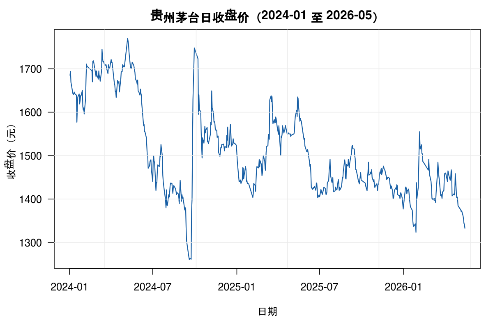
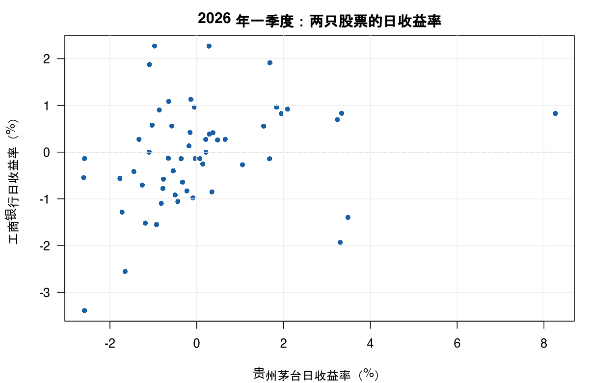
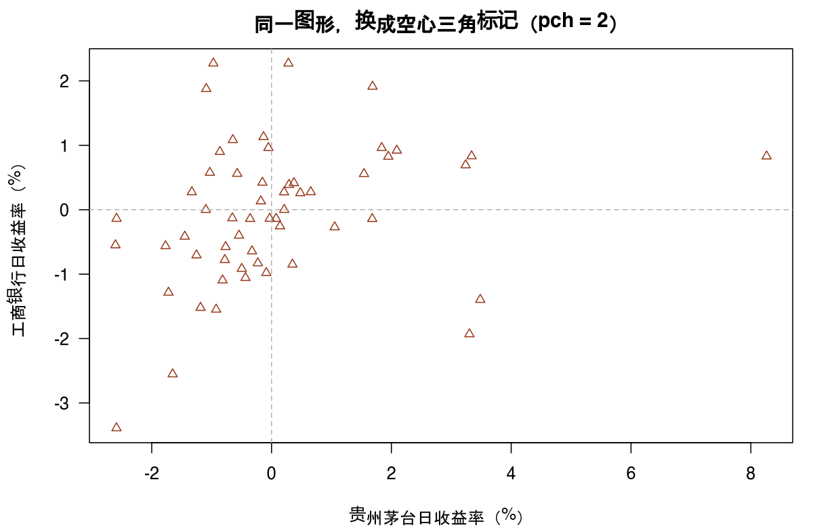
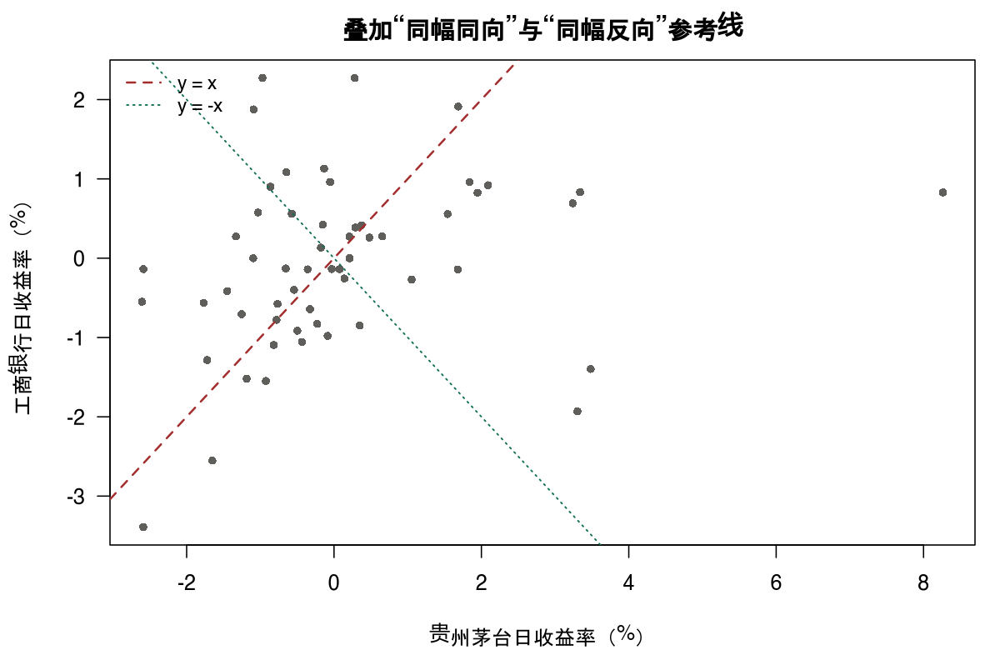

# 1 基础

本章的目的是让你开始使用 R。假定你已经装好 R，并且能载入本书配套的金融数据集。数据来源与构造方法见本章末尾的「数据说明」。

下文描述的是 R 4.6 版。我会尽可能用不依赖操作系统的方式讲解，并假定你具备从菜单里选项目、拖动窗口这类基本操作能力。不过在遇到具体平台的已知问题时，我会特别说明。

## 1.1 第一步

本节介绍 R 的计算环境，并走一遍它最基本的功能。启动 R 很简单，方法取决于你的平台：从系统菜单启动、双击图标，或在命令行输入 `R`。这会打开一个控制台窗口，或者让 R 在当前终端里以交互方式启动。

无论哪种方式，R 都遵循一问一答的模式：你输入一行命令、按回车，程序做点什么，在需要时打印结果，然后等待更多输入。R 准备好接收输入时会打印提示符 `>`。R 也可以当纯文本程序用，也支持批处理模式，但本章假定你坐在图形界面前面。

只要照着书上的样子输入，所有例子都能运行。先把数据集载入当前会话：

```r
source("an-introduction-to-statistics-for-quantitative-investing/data/load_datasets.R")
```

这条命令会把本书用到的全部数据集读进来，之后可以直接按名字使用（`abret`、`px1`、`ashr` 等）。此阶段不必理解它做了什么，第 2 章会讲。

为了先看一眼 R 能做什么，试试：

```r
plot(as.Date(px1$date), px1$close, type = "l")
```

这条命令把贵州茅台 2024 年 1 月至 2026 年 5 月的日收盘价画成一条折线，见图 1.1。



你当然不必在此刻就猜到用这种写法能得到这个结果。选这个例子，是因为它一次展示了用户界面的几个组成部分：一个数据向量、一个函数、若干参数、一个图形设备。

在 Windows 下，此时图形窗口会抢到键盘焦点。点一下控制台，让它继续接受命令。

### 1.1.1 一台过度生长的计算器

R 里最简单的任务，是输入一个算术表达式并拿到结果。比如看某只股票一天的涨跌幅：

```r
(23.45 - 22.80) / 22.80
```

```text
[1] 0.02850877
```

可见 R 知道涨了 2.85%。它也懂其他标准运算。例如计算连续三天、日收益分别为 +1.2%、−0.8%、+0.5% 的累计收益：

```r
(1 + 0.012) * (1 - 0.008) * (1 + 0.005) - 1
```

```text
[1] 0.00892352
```

注意这里不能把三个收益率直接相加，因为复利是相乘关系。这类「看起来该加、实际该乘」的地方，是金融数据里最容易出错的一类，R 只是如实按你写的算式计算。

结果前面的 `[1]` 是 R 打印数字和向量时的标记，表示这一行第一个数的下标。单个数字时它没什么用，但结果是长向量时就有用了。例如取 15 个服从标准正态的随机数：

```r
rnorm(15)
```

```text
 [1] -0.18326112 -0.59753287 -0.67017905  0.16075723  1.28199575
 [6]  0.07976977  0.13683303  0.77155246  0.85986694 -1.01506772
[11] -0.49448567  0.52433026  1.07732656  1.09748097 -1.09318582
```

这里的 `[6]` 表示 0.07976977 是这个向量的第 6 个元素。你自己机器上看到的数字会不同，因为随机数每次不一样（要复现，需先用 `set.seed()` 固定种子，第 3 章再讲）。

### 1.1.2 赋值

即使用计算器，你也会很快需要一个地方存放中间结果，免得反复输入。R 和其他计算机语言一样有符号变量，即用名字代表值。要把 1332.95（茅台 2026 年 5 月 15 日的收盘价）赋给变量 `moutai_close`，输入：

```r
moutai_close <- 1332.95
```

这两个字符 `<-` 应当读作一个符号：一个指向被赋值变量的箭头，称为赋值运算符。R 一般不在意运算符两侧的空格，但要注意：在 `<-` 中间加一个空格，含义就变成「小于」加「负号」；反过来，把一个变量和负数比较时漏掉空格，也会出人意料。

赋值当场没有可见结果，但从这一刻起 `moutai_close` 的值是 1332.95，可以用在后续算式里。

```r
moutai_close
```

```text
[1] 1332.95
```

```r
moutai_close * 100
```

```text
[1] 133295
```

变量名在 R 里可以相当自由地取，由字母、数字和点号组成。限制是不能以数字开头，也不能以「点+数字」开头；以点开头的名字另有特殊含义，应当避免。一个典型的变量名可以是 `ret.2026q1`，表示 2026 年一季度的收益率。名字区分大小写：`RET` 和 `ret` 不是同一个变量。

有些名字系统已经占用了，拿来当变量名会造成混乱。最糟的是单字母名 `c`、`q`、`t`、`C`、`D`、`F`、`I`、`T`，以及 `diff`、`df`、`pt` 等。它们多数是函数，当变量名通常不出问题，但 `F` 和 `T` 是 `FALSE` 和 `TRUE` 的标准缩写，一旦重定义就不再是这个意思了。

### 1.1.3 向量化算术

单个数做不了什么统计，你面对的是整组数据。R 的一个强项是把整个数据向量当作一个对象处理。数据向量就是一串数，可以这样构造：

```r
weight <- c(0.30, 0.25, 0.20, 0.15, 0.10)
weight
```

```text
[1] 0.30 0.25 0.20 0.15 0.10
```

`c(...)` 是构造向量的写法。这五个数是一个假设的五只股票组合的权重，合计为 1。这并不是把数据读进 R 的唯一方法，通常也不是首选方法（读文件见第 2 章），但短向量在很多场合都用得上，`c(...)` 出现得极频繁。

只要长度相同，你就能对向量做普通数字那样的运算。假定对应这五个权重的当日收益是：

```r
ret <- c(0.012, -0.008, 0.005, 0.021, -0.014)
portfolio_ret <- sum(weight * ret)
portfolio_ret
```

```text
[1] 0.00435
```

注意运算是逐元素进行的：第一项是 0.30 × 0.012，依此类推；`sum()` 再把五项加起来。组合当日收益 0.435%，就是权重与收益的内积。这一步是全书后面反复出现的基本动作——组合收益永远是「权重 × 收益」的求和。

事实上，长度不同的向量也能做算术。若把一个长度为 1 的向量（标量）与长度为 5 的向量相加，短的那个会被循环使用：

```r
ret + 0.001
```

```text
[1]  0.013 -0.007  0.006  0.022 -0.013
```

这相当于给每个收益都加上 1 个基点。这种「循环补齐」主要用于长度为 1 的标量，偶尔也用于想构造重复模式的情形。如果长向量不是短向量的整数倍，R 会给出警告。

这些向量化约定让典型统计计算写起来非常短。例如计算茅台日收益的均值与标准差，先算均值 $\bar{x} = \sum x_i / n$：

```r
sum(abret$A)
```

```text
[1] 0.051524
```

```r
sum(abret$A) / length(abret$A)
```

```text
[1] 0.0009200714
```

把均值存进变量，再算标准差 $s = \sqrt{\sum (x_i - \bar{x})^2 / (n-1)}$。我们分步来做，以便看清各组成部分。离差是：

```r
xbar <- sum(abret$A) / length(abret$A)
head(abret$A - xbar)
```

```text
[1]  0.033915  0.000489 -0.004182 -0.008721  0.003883  0.001986
```

注意长度为 1 的 `xbar` 被循环使用，从每个元素里减掉。离差平方是：

```r
head((abret$A - xbar)^2)
```

```text
[1] 1.1502e-03 2.3905e-07 1.7490e-05 7.6057e-05 1.5077e-05 3.9439e-06
```

这条命令和上一条很像，所以方便的做法是调出上一条命令改一改。在多数运行 R 的系统上，按上箭头可以调出上一条命令。

离差平方和同理：

```r
sum((abret$A - xbar)^2)
```

```text
[1] 0.01803825
```

于是标准差为：

```r
sqrt(sum((abret$A - xbar)^2) / (length(abret$A) - 1))
```

```text
[1] 0.01810989
```

当然，R 是统计软件，这些计算已经内置，直接写：

```r
mean(abret$A)
```

```text
[1] 0.0009200714
```

```r
sd(abret$A)
```

```text
[1] 0.01810989
```

结果一样。手算这一遍的意义在于：你应当清楚 `sd()` 的分母是 $n-1$，而不是 $n$。用日频数据时这个差别很小；用只有十几个观测的季度或年度数据时，它就开始有影响了。

### 1.1.4 标准过程

一个稍复杂的例子。日收益的均值不好直接读，行业里习惯年化：A 股每年约 252 个交易日，于是年化收益约为日收益均值乘 252，年化波动率约为日标准差乘 $\sqrt{252}$：

```r
mean(abret$A) * 252
```

```text
[1] 0.231858
```

```r
sd(abret$A) * sqrt(252)
```

```text
[1] 0.2874856
```

贵州茅台在 2026 年一季度的 56 个交易日里，年化收益约 23.2%，年化波动约 28.7%；工商银行（B 列）则是年化 −16.8%、波动 17.4%。看起来茅台明显更好，而且波动还更大——收益高、风险也高，这正是后面组合理论要处理的问题。

真是这样吗？我们想知道这 0.092% 的日均收益是否可以认为显著异于零，假设日收益来自正态分布。为此用 `t.test` 做单样本检验：

```r
t.test(abret$A)
```

```text
	One Sample t-test

data:  abret$A
t = 0.38019, df = 55, p-value = 0.7053
alternative hypothesis: true mean is not equal to 0
95 percent confidence interval:
 -0.003929790  0.005769933
sample estimates:
   mean of x
0.0009200714
```

参数 `mu` 表示理论均值，不写时默认 `mu = 0`，这里正好是「均值是否为零」，所以不必指定。

像这样的检验，输出比前面几个例子长得多。细节在第 5 章解释，这里你只需注意 p 值和置信区间。p 值 0.71 并不小：如果真实均值真的是零，观察到这样一组数据的可能性一点都不低。95% 置信区间从 −0.39% 跨到 +0.58%，把零包在中间，而且相当宽。

这正是金融数据最需要建立的直觉：**一个季度 23% 的年化收益，和 56 个观测的样本量，两者并不构成统计证据**。区间宽度说明我们对真实均值几乎一无所知。同一时期工商银行的检验同样不显著：

```r
t.test(abret$B)
```

```text
	One Sample t-test

data:  abret$B
t = -0.45399, df = 55, p-value = 0.6516
alternative hypothesis: true mean is not equal to 0
95 percent confidence interval:
 -0.003602054  0.002271482
sample estimates:
    mean of x
-0.0006652857
```

两个都不显著，但两只股票的实际表现差了将近 40 个百分点的年化收益。这种「看起来差异很大、统计上说不清」的局面，是本书后半部分（第 9 章功效、第 11 章多元回归）要处理的核心问题。

### 1.1.5 图形

数据展示与分析中最重要的环节之一，是画出合适的图。R——和它之前的 S 一样——有一套构造图形的模型，既能简单地产出标准图形，也能细致地控制图形组件。

若要考察两只股票日收益之间的关系，第一个想法是把一个对另一个作图：

```r
plot(abret$A, abret$B)
```

得到图 1.2。



你常常会想用各种方式修改图形，为此有一大批绘图参数可设。例如用关键字 `pch`（plotting character，绘图符号）把点换成三角形：

```r
plot(abret$A, abret$B, pch = 2)
```

得到图 1.3，点变成空心三角。



散点图在这里想说明的是「同涨同跌」的程度。如果两只股票每天涨跌幅完全一致，点会落在 $y = x$ 这条线上；如果完全反向，落在 $y = -x$ 上。把这两条参考线叠上去：

```r
abline(0, 1, lty = 2)
```

得到图 1.4。点云是一团向右上微倾的云，既不贴 $y=x$，也不贴 $y=-x$，说明两者关联较弱——算出来相关系数 0.27，与图形一致。



`abline()` 会把一条直线加到已有图形上。此处用「截距 + 斜率」的形式指定直线；要加折线则用 `lines(x, y)`。第 6 章会用它在回归线上。

## 1.2 R 语言要点

本节概述 R 语言的基本方面。有些细节只能讲得浅一些。重点放在交互使用中有用的东西，真正的编程只作简短介绍。

### 1.2.1 表达式与对象

R 的基本交互方式是表达式求值：用户输入一个表达式，系统求值并打印结果。有些表达式求值不是为了结果，而是为了副作用，比如画图或写文件。最基本的表达式就是算术：

```r
1 + 1
```

```text
[1] 2
```

```r
log(2)
```

```text
[1] 0.6931472
```

注意 `log` 的默认底数是 $e$；以 10 为底要写 `log10()`。计算连续复利收益时用前者：$r = \ln(P_t / P_{t-1})$。本书所有收益率都用这个定义，所以价格序列取对数差分即可。

表达式求值的结果如果不赋给任何东西，就会被打印然后丢弃。赋值则把结果存进一个对象：

```r
moutai_close <- 1332.95
```

R 里一切皆对象：向量、函数、模型拟合结果、图形都是对象，都可以命名、保存、传递。

### 1.2.2 函数与参数

函数调用的形式是「函数名(参数, 参数, ...)」。例如：

```r
mean(abret$A)
```

```text
[1] 0.0009200714
```

参数可以按位置给，也可以按名字给。按名字给更安全，因为你可以跳过中间那些不用的参数：

```r
mean(c(1, 2, NA, 4))
```

```text
[1] NA
```

```r
mean(c(1, 2, NA, 4), na.rm = TRUE)
```

```text
[1] 2.333333
```

第一行得到 `NA`，因为向量里有缺失值，而 `mean` 默认遇到缺失就返回缺失。这是 R 一个非常重要、也非常容易踩的习惯：**它不会悄悄替你忽略缺失值**。金融数据里停牌、缺报价很常见，看到 `NA` 要先想到这一点。

### 1.2.3 向量

向量是同类型元素的有序集合，用 `c()` 构造。下面放几只股票的收盘价：

```r
prices <- c(1332.95, 7.24, 423.60, 86.87)
prices
```

```text
[1] 1332.95    7.24  423.60   86.87
```

```r
length(prices)
```

```text
[1] 4
```

用方括号取子集：

```r
prices[2]
```

```text
[1] 7.24
```

```r
prices[c(1, 4)]
```

```text
[1] 1332.95   86.87
```

```r
prices[-1]
```

```text
[1]   7.24 423.60  86.87
```

负下标表示「排除」。还可以用逻辑条件筛选，这在后面用得极多：

```r
prices[prices > 100]
```

```text
[1] 1332.95  423.60
```

向量里的元素必须是同一类型。若把数字和字符混在一起，R 会把数字转成字符，这一点要小心：

```r
c(1, "A", 3)
```

```text
[1] "1" "A" "3"
```

### 1.2.4 引号与转义序列

字符常量用单引号或双引号括起来，两者等价：

```r
sector <- c("银行", "白酒", "新能源", "医药")
sector
```

```text
[1] "银行"   "白酒"   "新能源" "医药"
```

字符串拼接用 `paste`，`sep` 参数指定连接符，默认为一个空格：

```r
paste("板块：", sector, sep = "")
```

```text
[1] "板块：银行"   "板块：白酒"   "板块：新能源" "板块：医药"
```

在字符串里要表示引号本身、反斜杠、换行，需用转义序列：`\"`、`\\`、`\n`、`\t`。Windows 路径写成 `"C:\\data\\prices.csv"`，或者干脆用正斜杠 `"C:/data/prices.csv"`——后者在 R 里永远是安全的，推荐这么写。

### 1.2.5 缺失值

金融数据里缺失值极常见：停牌、涨跌停无成交、新上市标的没有历史。R 用 `NA`（Not Available）表示：

```r
x <- c(0.012, NA, -0.008, 0.005)
x
```

```text
[1]  0.012     NA -0.008  0.005
```

```r
is.na(x)
```

```text
[1] FALSE  TRUE FALSE FALSE
```

缺失值会「传染」：

```r
mean(x)
```

```text
[1] NA
```

```r
mean(x, na.rm = TRUE)
```

```text
[1] 0.003
```

```r
sum(x, na.rm = TRUE)
```

```text
[1] 0.009
```

几乎所有统计函数都有 `na.rm` 参数。要特别注意：**忽略缺失值后，分母也变小了**。计算收益率均值时这通常没问题；计算期数、累计收益时就必须显式处理，否则会得到偏高的结果。

`NA` 还分类型：`NA` 是逻辑型缺失，`NA_real_` 是数值型，`NA_character_` 是字符型。一般不必操心，但在 `if` 条件里遇到 `NA` 会报错，因为 `NA` 既不是真也不是假。

### 1.2.6 创建向量的函数

除 `c()` 外，常用的还有几个：

```r
1:6
```

```text
[1] 1 2 3 4 5 6
```

```r
seq(1, 12, by = 3)
```

```text
[1]  1  4  7 10
```

```r
rep(c("A", "B"), each = 3)
```

```text
[1] "A" "A" "A" "B" "B" "B"
```

```r
rep(0.25, 4)
```

```text
[1] 0.25 0.25 0.25 0.25
```

```r
c(rep(0, 2), seq(1, 3))
```

```text
[1] 0 0 1 2 3
```

`rep(0.25, 4)` 这种写法在设定等权组合时很顺手：四只股票各 25%。若持仓只数会变，更稳妥的写法是 `rep(1/n, n)`，其中 `n` 是持仓数。

### 1.2.7 矩阵与数组

矩阵是二维的、元素同类型的对象。下面是一个 2 行 3 列的日收益矩阵，两行代表两个交易日，三列代表三只标的：

```r
m <- matrix(c(0.012, -0.008, 0.005,
              0.021, -0.014, 0.003),
            nrow = 2, byrow = TRUE)
m
```

```text
      [,1]   [,2]  [,3]
[1,] 0.012 -0.008 0.005
[2,] 0.021 -0.014 0.003
```

`byrow = TRUE` 表示按行填充；默认是按列填充，这是初学者最常犯的错之一。

```r
dim(m)
```

```text
[1] 2 3
```

```r
m[2, 3]
```

```text
[1] 0.003
```

```r
m[, 1]
```

```text
[1] 0.012 0.021
```

```r
m[1, ]
```

```text
[1]  0.012 -0.008  0.005
```

按行列汇总：

```r
colSums(m)
```

```text
[1]  0.033 -0.022  0.008
```

```r
rowMeans(m)
```

```text
[1] 0.003000000 0.003333333
```

矩阵乘法用 `%*%`，这正好是组合收益的计算：

```r
w <- c(0.5, 0.3, 0.2)
m %*% w
```

```text
       [,1]
[1,] 0.0046
[2,] 0.0069
```

两个交易日的组合收益分别是 0.46% 和 0.69%。`*` 是逐元素相乘，`%*%` 才是矩阵乘法，两者不能混用——这是 R 里另一处高频错误。

数组是矩阵向更多维的推广，用 `array()` 创建。金融里典型的用法是「标的 × 日期 × 因子」三维数组，但多数场合用长格式数据框更方便，第 10 章会讲。

### 1.2.8 因子

因子用于表示分类变量，比如行业、评级、交易所。它在统计建模里非常关键，因为 R 需要知道某个变量是分类的，才能正确地生成虚拟变量。

```r
sector_f <- factor(c("银行", "白酒", "新能源", "白酒", "银行"))
sector_f
```

```text
[1] 银行   白酒   新能源 白酒   银行
Levels: 新能源 白酒 银行
```

```r
levels(sector_f)
```

```text
[1] "新能源" "白酒"   "银行"
```

```r
table(sector_f)
```

```text
sector_f
新能源   白酒   银行
     1      2      2
```

注意水平（levels）是按拼音顺序排的，不是按出现顺序。这个默认排序会直接影响回归里「基准组」是谁，第 12 章会专门处理。

因子在内部存成整数编码：

```r
as.integer(sector_f)
```

```text
[1] 3 2 1 2 3
```

有序因子用于有内在次序的分类，比如信用评级：

```r
rating <- factor(c("AAA", "AA", "A", "AA", "AAA"),
                 levels = c("A", "AA", "AAA"), ordered = TRUE)
rating
```

```text
[1] AAA AA  A   AA  AAA
Levels: A < AA < AAA
```

```r
min(rating)
```

```text
[1] A
Levels: A < AA < AAA
```

`ordered = TRUE` 让因子记住次序，`min()` 因此能给出「最差评级」。评级这类变量一定要显式声明有序，否则按字母序比较时 `A` 与 `AA` 的先后关系会出错。

数据框里的字符列可以转成因子。`ashr` 的季度列就是这样：

```r
ashr$qtr <- factor(ashr$qtr)
levels(ashr$qtr)
```

```text
 [1] "2024Q1" "2024Q2" "2024Q3" "2024Q4" "2025Q1" "2025Q2" "2025Q3"
 [8] "2025Q4" "2026Q1" "2026Q2"
```

季度标签按字典序排列时恰好也是时间顺序（因为年份在前、四位数字），所以这里不出问题。但如果是 `"Q1"..."Q10"` 这种写法，字典序就会把 Q10 排到 Q2 前面，那类情况必须显式指定 `levels`。

### 1.2.9 列表

列表是可以装不同类型元素的容器。统计模型的结果几乎都是列表。例如把工商银行的日收益对茅台的日收益做线性回归：

```r
fit <- lm(B ~ A, data = abret)
fit
```

```text
Call:
lm(formula = B ~ A, data = abret)

Coefficients:
(Intercept)            A
  -0.0008176     0.1655732
```

斜率 0.166 就是工行相对于茅台的「beta」：茅台涨 1%，工行平均涨 0.17%。截距接近零。

`fit` 是一个列表，里面装了很多东西：

```r
names(fit)
```

```text
 [1] "coefficients"  "residuals"     "effects"       "rank"
 [5] "fitted.values" "assign"        "qr"            "df.residual"
 [9] "xlevels"       "call"          "terms"         "model"
```

可以用 `$` 取出其中任意成分：

```r
fit$coefficients
```

```text
  (Intercept)             A
-0.0008176249  0.1655732296
```

```r
fit$residuals[1:3]
```

```text
           1            2            3
-0.018918119 -0.001976668 -0.005073275
```

残差是实际值减去拟合值，第 6 章会详细用它做诊断。理解「模型结果是个列表」这一点很重要：它意味着你能取出中间量接着算，而不是只能看打印结果。

### 1.2.10 数据框

数据框是本书最常用的数据结构：一张表，每列一个变量、类型可以不同，每行一个观测。`abret` 就是这样一个数据框，56 行 3 列：

```r
head(abret)
```

```text
        date         A         B
1 2026-01-05  0.034835 -0.013968
2 2026-01-06  0.001409 -0.002561
3 2026-01-07 -0.003262 -0.006431
4 2026-01-08 -0.007801 -0.007772
5 2026-01-09  0.004803  0.002597
6 2026-01-12  0.002906  0.003883
```

```r
names(abret)
```

```text
[1] "date" "A"    "B"
```

```r
nrow(abret)
```

```text
[1] 56
```

```r
ncol(abret)
```

```text
[1] 3
```

`str()` 和 `summary()` 是查看数据结构最常用的两个函数：

```r
str(abret)
```

```text
'data.frame':	56 obs. of  3 variables:
 $ date: chr  "2026-01-05" "2026-01-06" "2026-01-07" "2026-01-08" ...
 $ A   : num  0.03483 0.00141 -0.00326 -0.0078 0.0048 ...
 $ B   : num  -0.01397 -0.00256 -0.00643 -0.00777 0.0026 ...
```

```r
summary(abret)
```

```text
        date          A                    B
 Length   :56   Min.   :-0.0260530   Min.   :-0.0339020
 N.unique :56   1st Qu.:-0.0093650   1st Qu.:-0.0072357
 N.blank  : 0   Median :-0.0020340   Median :-0.0013360
 Min.nchar:10   Mean   : 0.0009201   Mean   :-0.0006653
 Max.nchar:10   3rd Qu.: 0.0040005   3rd Qu.: 0.0060532
                Max.   : 0.0826350   Max.   : 0.0227280
```

`str` 告诉你每列是什么类型；`summary` 给出数值列的六数概括，字符列则给出长度与去重信息。这两条命令应当成为你拿到任何新数据后的第一反应。

顺便注意一笔：茅台的最大单日收益 8.26%，是工行最大涨幅 2.27% 的三倍多。单看这一行数字，就能预料到两只股票的波动率会很不一样。

### 1.2.11 索引

数据框取子集用「行, 列」两个下标：

```r
abret$A[1:5]
```

```text
[1]  0.034835  0.001409 -0.003262 -0.007801  0.004803
```

```r
abret[1:3, ]
```

```text
        date         A         B
1 2026-01-05  0.034835 -0.013968
2 2026-01-06  0.001409 -0.002561
3 2026-01-07 -0.003262 -0.006431
```

```r
abret[1:3, "A"]
```

```text
[1]  0.034835  0.001409 -0.003262
```

```r
abret[, c("A", "B")]
```

```text
            A         B
1    0.034835 -0.013968
2    0.001409 -0.002561
...
```

注意一个容易踩的细节：只给一个下标时，`abret[1:3]` 取的是**列**，不是行；而且用单括号取单列会得到数据框，用 `$` 或双括号则得到向量。这个差异在写函数时会导致莫名错误。

### 1.2.12 条件选择

把逻辑向量当下标，就是筛选：

```r
abret$A[abret$A > 0.01]
```

```text
 [1] 0.034835 0.082635 0.018388 0.033029 0.033391 0.019481 0.016806
 [8] 0.015426 0.032392 0.016855 0.010535 0.020907
```

```r
sum(abret$A > 0)
```

```text
[1] 22
```

```r
mean(abret$A > 0)
```

```text
[1] 0.3928571
```

`sum` 对逻辑向量求和，得到「真」的个数——上涨天数 22 天；`mean` 给出比例 39.3%，即上涨概率。这两个写法在统计里极其常用，比 `table()` 简洁。

这个数字值得留意：一个季度里茅台只有 39% 的交易日上涨，年化收益却是 +23%。原因是少数大涨日贡献了几乎全部收益——这是收益率分布尖峰厚尾的直接后果，第 4 章会仔细看。

整个数据框按条件筛选：

```r
abret[abret$A > 0.02, ]
```

```text
         date         A         B
1  2026-01-05  0.034835 -0.013968
19 2026-01-29  0.082635  0.008299
22 2026-02-03  0.033029 -0.019311
23 2026-02-04  0.033391  0.008322
45 2026-03-16  0.032392  0.006921
56 2026-03-31  0.020907  0.009204
```

56 天里有 6 天涨幅超过 2%。

### 1.2.13 数据框索引

多个条件用 `&`（与）、`|`（或）组合。例如找出「A 涨超 1.5% 且 B 也上涨」的日子：

```r
big_up <- abret[abret$A > 0.015 & abret$B > 0, ]
big_up
```

```text
         date         A        B
19 2026-01-29  0.082635 0.008299
21 2026-02-02  0.018388 0.009609
23 2026-02-04  0.033391 0.008322
24 2026-02-05  0.019481 0.008253
44 2026-03-13  0.015426 0.005571
45 2026-03-16  0.032392 0.006921
46 2026-03-17  0.016855 0.019126
56 2026-03-31  0.020907 0.009204
```

```r
nrow(big_up)
```

```text
[1] 8
```

八天里茅台涨超 1.5%，工行全部同步上涨——这比全样本 0.27 的相关系数给人的印象要强。原因是条件筛选挑出的是「大盘大幅上行」的日子，这时个股同涨是常态；而相关性衡量的是**所有日子**的平均联动。样本筛选会放大相关，这一点在做策略回测时务必警惕。

条件里请务必用 `&` 而不是 `&&`。后者只比较第一个元素，用在向量条件上会给出错误结果，而且不报错，属于很难发现的错误。

### 1.2.14 分组数据与数据框

按某个分类变量分组计算，用 `tapply()`：第一个参数是要算的数值向量，第二个是分组变量，第三个是函数。

```r
tapply(ashr$ret, ashr$qtr, mean)
```

```text
     2024Q1      2024Q2      2024Q3      2024Q4      2025Q1      2025Q2
-0.03119400 -0.05901200  0.18122600 -0.03232000  0.01084900  0.00301500
     2025Q3      2025Q4      2026Q1      2026Q2
 0.21263600 -0.01039400 -0.07100200  0.04000000
```

这是 96 只股票各季度的平均收益率。2025Q3 最高（+21.3%），2026Q1 最差（−7.1%），跨度接近 30 个百分点。同一批股票、同样的权重，仅仅因为所处季度不同，收益就能差这么多——这是第 7 章方差分析要检验的对象。

```r
tapply(ashr$ret, ashr$qtr, sd)
```

```text
  2024Q1   2024Q2   2024Q3   2024Q4   2025Q1   2025Q2   2025Q3   2025Q4
0.173203 0.166157 0.173680 0.149110 0.166194 0.099325 0.272663 0.211740
  2026Q1   2026Q2
0.129807 0.167498
```

季度之间的离散程度也差很多：2025Q2 只有 0.099，2025Q3 高达 0.273，差了近三倍。这说明「组间差异」和「组内方差」两个东西都得看，只比较均值会漏掉一半信息。

`aggregate()` 是另一种写法，语法更接近建模公式：

```r
aggregate(ret ~ qtr, data = ashr, FUN = mean)
```

```text
     qtr         ret
1 2024Q1 -0.03119365
2 2024Q2 -0.05901215
3 2024Q3  0.18122566
...
```

结果与 `tapply` 相同，但返回数据框，方便后续再画图或合并。要一次对多个变量分组汇总，`aggregate` 更方便；只是分组算一个数，`tapply` 更直接。

### 1.2.15 隐式循环

对数据框的每一列做同一件事，不必写循环，用 `sapply()`：

```r
sapply(abret[, c("A", "B")], mean)
```

```text
            A             B
 0.0009200714 -0.0006652857
```

```r
sapply(abret[, c("A", "B")], sd)
```

```text
         A          B
0.01810989 0.01096620
```

结果带名字，这比循环加 `c()` 拼接要省事得多。`lapply()` 返回列表而不是向量，适用于结果长度不一致的场合：

```r
lapply(abret[, c("A", "B")], range)
```

```text
$A
[1] -0.026053  0.082635

$B
[1] -0.033902  0.022728
```

「隐式循环」这个说法的意思是：R 在内部替你循环了，你只写对单个元素做的事。用它能显著减少代码量，也更不容易出错。

### 1.2.16 排序

`sort()` 直接返回排好序的向量：

```r
sort(abret$A)[1:5]
```

```text
[1] -0.026053 -0.025889 -0.025872 -0.017692 -0.017209
```

`order()` 返回的是「排序后的下标」，这更有用，因为可以用它给整个数据框重排：

```r
order(abret$A)[1:3]
```

```text
[1] 25 50 20
```

加上负号就是从大到小：

```r
abret[order(-abret$A)[1:5], ]
```

```text
         date         A         B
19 2026-01-29  0.082635  0.008299
1  2026-01-05  0.034835 -0.013968
23 2026-02-04  0.033391  0.008322
22 2026-02-03  0.033029 -0.019311
45 2026-03-16  0.032392  0.006921
```

`sort` 只能排一个向量，`order` 能带着整行一起动，做「涨幅最大的几天」这类查询时必须用后者。

## 1.3 习题

**1.1** 用 `px1` 计算全期累计收益与最大回撤。提示：最大回撤是「历史最高价与当前价之差，占历史最高价的比例」的最大值。

**1.2** 用 `abret` 计算两只股票的相关系数。它和 1.1.5 节图上看到的关系一致吗？

**1.3** 用 `vol3` 找出年化波动率最高的三只股票。

**1.4** 用 `ashr` 计算各季度收益的中位数。与均值相比，中位数反映出什么差异？

**1.5** 用 `excess` 检验茅台的月度超额收益是否显著异于零。结论与 1.1.4 节的日频检验一致吗？

## 数据说明

本书全部数据来自 `xquant-db` 中的真实 A 股行情与财务指标，由复权价推导，**不含模拟数据**。

| 数据集 | 行数 | 内容 | 对应统计场景 |
|---|---|---|---|
| `px1` | 570 | 贵州茅台日收盘价与成交量，2024-01 至 2026-05 | 时间序列、单变量 |
| `abret` | 56 | 茅台与工行 2026Q1 日收益率 | 配对/两样本 |
| `ashr` | 960 | 96 只股票 × 10 个季度的季度收益率 | 单变量分布、分组比较 |
| `indret` | 580 | 20 个行业 ETF × 29 个月 的月度收益 | 多组比较 |
| `pair2` | 58 | 银行 ETF 与半导体 ETF 的月度收益 | 两组比较 |
| `idxret` | 569 | 11 个宽基 ETF 的日收益率 | 宽基面板 |
| `vol3` | 96 | 96 只股票的三种年化波动率估计 | 测量方法比较 |
| `excess` | 116 | 4 只个股相对沪深300ETF 的月度超额收益 | 超额收益 |
| `fin` | 5457 | 全市场 2026Q2 财务指标横截面 | 横截面回归 |

数据快照与构建脚本在 `an-introduction-to-statistics-for-quantitative-investing/data/` 与 `an-introduction-to-statistics-for-quantitative-investing/script/` 下。原始行情抓取截止 2026-05-15，之后不再变动，因此本书所有数值都可复现。

### 三个必须交代的数据处理

**一、复权价。** 收益率一律用复权收盘价（`adjusted`）计算，避免除权除息造成的假跳空。这一点在处理个股时间序列时必须坚持，否则会把分红当成暴跌。

**二、重复与脏值。** 原始个股行情中 4 只股票存在整行完全重复（每个交易日出现两次），已按「日期 + 代码」去重，共删除 2280 行。另有标的出现单日 ±69.7% 的跳变，明显超出 A 股涨跌停限制，属源数据错误，已按单日变动超过 25% 视为脏值剔除。

**三、公司名。** 源数据的 `name` 列存在错标（如 `002415.SZ` 被标为「汉得信息」，实为海康威视）。本书以证券代码为准，名称经价格量级与公开信息双重核验后校正，校正清单见 `an-introduction-to-statistics-for-quantitative-investing/data/csv/_names.csv`。

最后提醒一句：样本期只有 569 个交易日、覆盖 2024 年初至 2026 年中的一段特定行情。本书用它演示统计方法，**不是**在给出任何投资结论。第 9 章会说明，这么短的样本能支持多强的推断。
