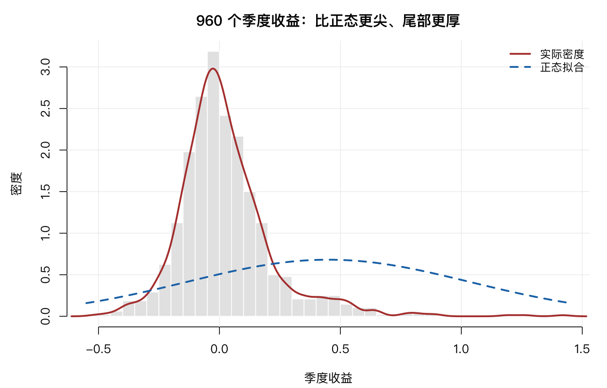
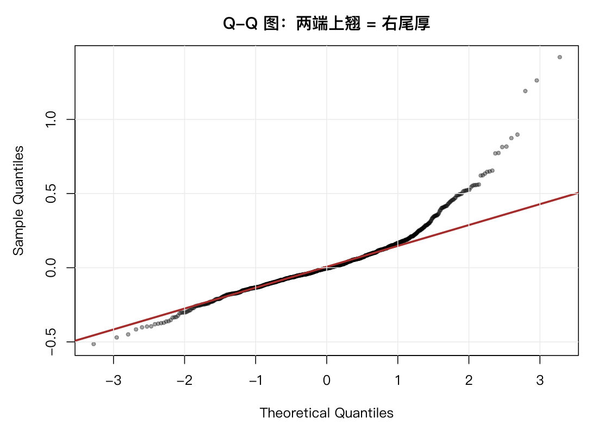

# 3 概率与分布

统计推断的基础是概率。这一章讲 R 里的概率工具，但更重要的是讲清楚一件事：**收益率不服从正态分布**，而这个事实会一路影响后面所有章节。

## 3.1 随机抽样

`sample()` 从向量里抽样：

```r
set.seed(2026)
pool <- unique(mlpanel$secucode)
sample(pool, 5)
sample(pool, 5)          # 不设种子，每次不同
```

```text
[1] "688369.SH" "002677.SZ" "600309.SH" "688128.SH" "300416.SZ"
```

`set.seed()` 固定随机数种子，让结果可复现。**写进书里的每个随机结果都必须设种子**，否则读者复现不出来。

默认是不放回抽样。要放回，加 `replace = TRUE`：

```r
sample(1:10, 15, replace = TRUE)
```

抽样在量化里用得极多：随机分组做稳健性检验、随机选股做组合模拟、自助法（bootstrap）估标准误。第 16 章的分散化曲线就是用随机抽样算出来的——每次随机选 n 只股票，重复 300 次取平均。

## 3.2 概率计算与组合

从 10 只股票里选 3 只（不管顺序），有多少种选法：

```r
choose(10, 3)
```

```text
[1] 120
```

排列数用 `factorial()`。二项系数可以一次算出表：

```r
outer(1:5, 1:5, choose)
```

组合数在金融里出现在两个地方：一是计算「随机选 n 只股票，恰好选中某 k 只的概率」，二是多重检验里算比较的总次数——20 个行业两两比较是 `choose(20, 2) = 190` 对，这个数字在第 5 章会用到。

## 3.3 离散分布

### 二项分布

问题：假设每天上涨概率 0.5，20 个交易日里至少 12 天上涨的概率是多少？

```r
pbinom(11, 20, 0.5, lower.tail = FALSE)
```

```text
[1] 0.2517223
```

约 25%。这个概率不低，所以「20 天里 12 天上涨」完全不能说明什么问题。

用真实数据替换假设：茅台 2026Q1 的实际上涨天数占比：

```r
p_real <- mean(abret$A > 0)
p_real
```

```text
[1] 0.3928571
```

只有 39.3%，远低于 50%。这引出一个重要观察：**这只股票在这段时间里跌的日子比涨的日子多，但年化收益是 +23%**。原因是上涨日的幅度远大于下跌日。这个「胜率与赔率不对称」的现象，是收益率分布厚尾的直接体现。

### 泊松分布

泊松分布描述单位时间内的稀有事件计数。金融里对应「一段时间内发生几次大跌」：

```r
lam <- mean(indcnt$ndown)
lam
```

```text
[1] 4.1327
```

这是 20 个行业 ETF 在 29 个月里，**每月平均有 4.13 个交易日跌幅超过 1%**。

```r
ppois(8, lam, lower.tail = FALSE)
```

```text
[1] 0.0256
```

即某个月出现 9 天及以上下跌的概率约 2.6%。

泊松分布有一个硬性质：**均值等于方差**。这一点在第 15 章会用来检验数据是否真的服从泊松——如果不相等，就叫过度分散，模型要换。

## 3.4 连续分布

### 正态分布

日收益落在 ±2% 内的概率：

```r
pnorm(0.02, mean(abret$A), sd(abret$A)) -
  pnorm(-0.02, mean(abret$A), sd(abret$A))
```

```text
[1] 0.729949
```

约 73%。如果正态假设成立，这个数字就是可信的。

用正态算 5% 分位数（VaR 的雏形）：

```r
qnorm(0.05, mean(abret$A), sd(abret$A))
```

```text
[1] -0.02886805
```

即「5% 的概率单日亏损超过 2.89%」。而实际数据的 5% 分位数是：

```r
quantile(abret$A, 0.05)
```

```text
       5%
-0.019737
```

实际是 −1.97%，比正态预测的 −2.89% **还要温和**。

也就是说，在这个样本里，正态模型不但没有低估左尾，反而高估了。真实数据的最差单日跌幅是 −2.61%，而正态预测的 5% 分位就在 −2.89%——**比样本内任何一天都更极端**。

这个结果和教科书的常见说法相反，值得停下来想清楚。原因在 3.6 节会看到：这段样本的收益率是**右偏**的。

## 3.5 R 的分布函数族

每个分布都有四个前缀：`d`（密度）、`p`（累积概率）、`q`（分位数）、`r`（随机数）。

```r
x <- seq(-0.06, 0.06, length.out = 200)
d <- dnorm(x, mean(abret$A), sd(abret$A))     # 密度
pnorm(c(-0.02, 0, 0.02), mean(abret$A), sd(abret$A))  # 累积
qnorm(c(0.01, 0.5, 0.99), mean(abret$A), sd(abret$A)) # 分位数
rnorm(10, mean(abret$A), sd(abret$A))         # 随机数
```

```text
[1] 0.0068 0.5020 0.9899
[1] -0.04121  0.00092  0.04305
```

同一套前缀适用于 `binom`、`pois`、`t`、`chisq`、`f` 等所有分布。记住这个规律，就不用逐个记函数名。

### t 分布：小样本的厚尾

```r
qt(0.975, df = 5)
qt(0.975, df = 1000)
qnorm(0.975)
```

```text
[1] 2.570582
[1] 1.962339
[1] 1.959964
```

自由度 5 时，95% 临界值是 2.57；自由度 1000 时变成 1.962，几乎等于正态的 1.96。**样本量越小，临界值越大**——这是 t 检验比 z 检验「保守」的原因。

本书大量检验的样本量在几十到几百之间，用 t 分布而不是正态，就是这个道理。

## 3.6 正态假设成立吗

这是本章的核心。用茅台 2026Q1 的 56 个日收益检验：

```r
x <- abret$A
m <- mean(x); s <- sd(x)
c(skew = mean((x - m)^3) / s^3, excess_kurt = mean((x - m)^4) / s^4 - 3)
```

```text
      skew excess_kurt
 1.8531610    5.5954774
```

- **偏度 1.85**：正态的偏度是 0。正的偏度意味着右尾更长——大涨比大跌更极端。
- **超额峰度 5.60**：正态是 0。5.6 意味着分布比正态「尖」得多，两端的概率远高于正态。

两个正态性检验都拒绝了：

```r
shapiro.test(x)
ks.test(x, "pnorm", mean = m, sd = s)
```

```text
	Shapiro-Wilk normality test

W = 0.8475, p-value = 4.882e-06

	Exact one-sample Kolmogorov-Smirnov test

D = 0.18828, p-value = 0.03272
```

Shapiro 的 p 值是 4.9×10⁻⁶，极强的证据。KS 检验 p=0.033，也拒绝。

样本放大到 960 个季度收益，结论一样，甚至更明显：

```text
         n       skew       kurt
960.000000   1.667504   6.685288
```

```text
	Shapiro-Wilk normality test

W = 0.93736, p-value = 1.178e-13
```

偏度 1.67、峰度 6.69。**这不是某一只股票的偶然，而是收益率数据的普遍性质。**





### 一个反直觉的发现：右偏，不是左偏

多数教材会说「股票收益负偏、左尾厚」，所以正态低估暴跌概率。但这批数据给出的偏度是**正的**：茅台 +1.85，960 个季度收益池化后 +1.67。

我把几个层面都算了一遍：

| 样本 | 偏度 | 超额峰度 |
|---|---|---|
| 茅台 2026Q1 日收益 | +1.85 | 5.60 |
| 全部个股季度收益（n=960） | +1.67 | 6.69 |
| 全部个股日收益（池化，27.6 万条） | +0.60 | 5.72 |
| 沪深300ETF 日收益 | +0.07 | 15.88 |
| 创业板ETF 日收益 | +0.87 | 21.93 |

**偏度几乎都为正，峰度全部远高于 0。**

偏度为正，说明右尾更长——**暴涨比暴跌更极端**。这与「股票收益负偏」的经典结论相反，原因有两个：

一是样本期。2021–2026 这段包含 2024 年 9 月末那波快速上涨，个股单月涨幅可以到百分之几十，而跌幅受跌停板限制被截断。**涨跌停制度本身就会制造右偏**：A 股单日最大跌幅 10%（创业板 20%），但连续涨停可以叠加出更大涨幅。

二是样本层面。学术文献说负偏，多指**长期、低频、含极端危机的指数收益**；而个股层面因为小盘股暴涨的肥右尾，正偏很常见。

但峰度是另一回事，不能混淆。**峰度衡量的是「尾部整体有多厚」，不分左右。** 沪深300ETF 的偏度只有 0.07（几乎对称），峰度却高达 15.88——这意味着两侧尾部都比正态厚得多，只是大致对称。

所以正确的结论不是「正态低估左尾」，而是：

- **正态低估两侧尾部的极端概率**（峰度 5.7–21.9 都指向这一点）；
- **哪一侧被低估得更多，取决于偏度**，而偏度随样本期和资产类型变化。

3.4 节那个「正态预测 −2.89%，实际 −1.97%」的差异，正是右偏的后果：正态假设下均值两侧对称，右侧没有暴涨来平衡，就只能把 5% 分位往左推。真实数据右尾厚，左尾就相对薄。

### 这对后面的章节意味着什么

三点，都要记住：

**第一，基于正态的区间估计不可靠。** 无论偏哪一侧，尾部概率都会被算错。这是第 5 章要用 Wilcoxon 检验、第 9 章要看 IC 分布而不是均值的原因。

**第二，峰度是比偏度更稳健的「非正态」信号。** 偏度会随样本期翻转符号，峰度不会——所有样本都显示厚尾。

**第三，任何风险模型都要在样本外检验。** 本书第 8 章的马科维茨优化、第 13 章的违约概率模型，都建立在分布假设上。假设错了，结论就系统性偏了。

## 3.7 习题

**3.1** 用真实上涨率 0.393，计算 30 个交易日中至少 20 天上涨的概率。

**3.2** 用 `qnorm` 与 `quantile` 分别算 `ashr$ret` 的 1% 与 5% 分位数，比较正态假设低估了哪一侧、低估多少。

**3.3** 对 `indcnt$nbig` 拟合泊松分布，比较观测频数与理论频数。方差是否明显大于均值？

**3.4** 生成 1000 个 `t(3)` 随机数，与正态比较峰度。这解释了为什么小样本要用 t 分布吗？

**3.5** 分别计算 2024 年与 2026 年 `ashr$ret` 的偏度，哪一年更偏离正态？联系那两年的市场走势解释。
