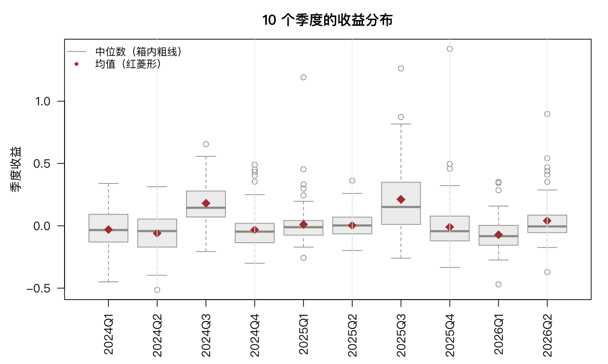

# 4 描述统计

在检验、建模之前，先要把数据看清楚。这一章讲怎么用数字和图描述一组数据，以及怎么按组比较。

## 4.1 单一组别的汇总统计量

用 `ashr` 的 960 个季度收益作为一组数据：

```r
x <- ashr$ret
length(x)
mean(x); median(x)
sd(x); IQR(x); mad(x)
```

```text
[1] 960
[1] 0.02438025
[1] -0.0043215
[1] 0.1983002
[1] 0.189942
[1] 0.1404319
```

**第一个要看的不是均值，而是均值与中位数的差。**

均值 2.44%，中位数 −0.43%，差了 2.87 个百分点。均值是正的、中位数是负的——意思是「**半数以上的季度在亏钱，但平均下来是赚的**」。

这不是矛盾，而是右偏分布的必然结果。少数季度的大涨（最高 +142%）把均值拉了上去，而典型季度（中位数）是亏的。

`sd` 是标准差 19.8%，`IQR` 是四分位距 19.0%，`mad` 是中位数绝对偏差 14.0%。三个都是离散程度，但含义不同：

- `sd` 对离群值敏感（用了平方）；
- `IQR` 只看中间 50%，抗离群；
- `mad` 以中位数为基准，最稳健。

当 `sd` 明显大于 `IQR/1.35` 时，说明尾部有极端值。这里 19.8% 与 19.0%/1.35 = 14.1% 相差明显，提示尾部很厚——与第 3 章的峰度 6.69 一致。

分位数：

```r
quantile(x, c(0, 0.01, 0.25, 0.5, 0.75, 0.99, 1))
```

```text
         0%          1%         25%         50%         75%         99%
-0.51450400 -0.37217219 -0.08877275 -0.00432150  0.10116925  0.65152190
       100%
 1.41962000
```

看两端：最差的季度 −51.5%，最好的 +142.0%。**最大收益是最差亏损的 2.8 倍**，这个不对称正是第 3 章那个正偏度 1.67 的来源。

`summary()` 一次给出六个数：

```text
     Min.   1st Qu.    Median      Mean   3rd Qu.      Max.
-0.51450  -0.08877  -0.00432   0.02438   0.10117   1.41962
```

变异系数 `sd/mean` = 8.13。这个数在金融里很少用，因为收益的均值可能接近零甚至为负，比值会失去意义。**比较离散程度时，直接用标准差比变异系数可靠。**

## 4.2 分布的图形

### 4.2.1 直方图

```r
hist(x, breaks = 60, main = "全部季度收益分布", xlab = "季度收益")
```

`breaks` 控制分箱数。太少看不出形状，太多全是锯齿。经验上取 `sqrt(n)` 到 `2*sqrt(n)` 之间，960 个观测大约 30–60 个箱。

要看形状，把密度曲线和正态曲线叠上去：

```r
hist(x, breaks = 60, probability = TRUE)
lines(density(x), col = "red", lwd = 2)
curve(dnorm(x, mean(x), sd(x)), add = TRUE, col = "blue", lty = 2, lwd = 2)
```

（`probability = TRUE` 让纵轴变成密度，否则直方图与密度曲线的尺度不能对齐。）

两张曲线一对比就能看出：真实分布比正态**更尖、两侧更厚**，中间高出一截，两端拖着长尾。

### 4.2.2 经验累积分布

```r
plot(ecdf(x), xlab = "季度收益", ylab = "F(x)")
abline(h = c(0.05, 0.5, 0.95), col = "grey60", lty = 2)
```

经验分布函数直接给出「小于某个值的比例」。看 50% 那条横线对应的值就是中位数 −0.43%。

### 4.2.3 Q–Q 图

Q–Q 图把「实际分位数」与「正态理论分位数」画在一起。如果数据服从正态，点会落在一条直线上。

```r
qqnorm(x, main = "季度收益的正态 Q-Q 图"); qqline(x, col = "red", lwd = 2)
```

偏离直线的形状告诉你是哪种非正态：

| 形状 | 含义 |
|---|---|
| 两端向上翘 | 右尾厚（大正值比正态多） |
| 两端向下弯 | 左尾厚（大亏损比正态多） |
| 呈 S 形 | 中间太集中、尾部太厚（尖峰） |
| 整体平移 | 均值偏移（用 `qqline` 就能看出） |

这批数据是 S 形加右端上翘，与偏度 1.67、峰度 6.69 完全对应。**Q–Q 图是判断正态性最实用的单张图**，比任何检验都直观。

### 4.2.4 箱线图

```r
boxplot(x, main = "季度收益箱线图", ylab = "季度收益")
```

箱体是 25%–75% 分位，中间粗线是中位数，须线延伸到 1.5 倍 IQR 以内，之外的点标为离群值。

```r
length(boxplot.stats(x)$out)
```

```text
[1] 62
```

960 个观测里 62 个被判为离群（6.5%）。**在正态分布下这个比例应约 0.7%**，实际是它的九倍。这个简单对比就是厚尾的量化证据。

头部离群值是 1.42、1.26、1.19——三个季度翻倍以上。

**注意**：箱线图的「离群值」只是统计标记，不是错误数据。金融里的极端值往往是真实事件（政策转向、行业景气反转），删掉它们会严重低估风险。这一点与实验室数据完全不同。



## 4.3 按组计算汇总

### 按季度

```r
tapply(ashr$ret, ashr$qtr, mean)
```

```text
     2024Q1      2024Q2      2024Q3      2024Q4      2025Q1      2025Q2
-0.03119400 -0.05901200  0.18122600 -0.03232000  0.01084900  0.00301500
     2025Q3      2025Q4      2026Q1      2026Q2
 0.21263600 -0.01039400 -0.07100200  0.04000000
```

10 个季度，均值从 −7.1%（2026Q1）到 +21.3%（2025Q3），跨度 28 个百分点。这个差异是第 7 章方差分析要检验的对象。

### 按行业

```r
g <- tapply(indret$ret, indret$sector, mean)
head(sort(g, decreasing = TRUE), 3)
```

```text
 半导体ETF     电子ETF     有色ETF
  0.0344     0.0308     0.0274
```

```r
head(sort(g), 3)
```

```text
中证消费ETF 中证医药ETF     基建ETF
  -0.0055     -0.0046     -0.0019
```

20 个行业 ETF 的月度平均收益，最高的半导体 3.44%/月，最低的消费 −0.55%/月。这个排序与第 8 章组合优化的结论直接相关——但要注意，**样本内的行业排序不能外推到未来**，第 8、9 章会反复说明这一点。

`aggregate()` 是另一种写法，可以一次算多个统计量：

```r
aggregate(ret ~ qtr, data = ashr,
          FUN = function(z) c(n = length(z), mean = mean(z)))
```

## 4.4 分组图形

### 4.4.1 分组直方图

按季度画三张直方图并排：

```r
par(mfrow = c(1, 3))
for (q in c("2024Q1", "2025Q3", "2026Q1")) {
  hist(ashr$ret[ashr$qtr == q], breaks = 30, main = q, xlab = "季度收益")
}
```

对比这三个季度：2025Q3 整体右移且更分散（均值 +21.3%，标准差 0.273），2026Q1 整体左移（均值 −7.1%）。**均值差异与方差差异同时存在**，这正是第 7 章要处理「方差齐性」的原因。

### 4.4.2 平行箱线图

```r
boxplot(ret ~ qtr, data = ashr, las = 2, ylab = "季度收益", xlab = "")
```

箱线图并排之后，组间差异和组内分散一目了然。`las = 2` 让横轴标签竖排，否则 `2024Q1` 这种标签会重叠。

行业版本：

```r
boxplot(ret ~ sector, data = indret, las = 2, cex.axis = 0.7)
```

20 个标签必须缩小字号（`cex.axis = 0.7`）才放得下。

### 4.4.3 带状图

样本量小时，箱线图会掩盖细节。带状图把每个点画出来，加抖动避免重叠：

```r
stripchart(list(银行 = pair2$bank, 半导体 = pair2$semi),
           method = "jitter", pch = 19, cex = 0.6, vertical = TRUE)
```

从图上能直接数出半导体有几个月涨超 20%，而银行一次都没有。**这是箱线图给不出的信息。**

## 4.5 表格

### 4.5.1 生成表格

```r
tab <- table(mlpanel$industry)
head(sort(tab, decreasing = TRUE), 5)
```

```text
机械设备 医药生物 基础化工     电子 电力设备
   27663    25187    22432    21974    19378
```

31 个行业，股票数从最大 27663 个观测（机械设备）到最小几十个。**行业股票数差异巨大，直接比较绝对数量会误导**，应该看比例。

交叉表（列联表）看两个分类变量的关系：

```r
d <- mlpanel[mlpanel$ym == "2026-06", ]
d$up <- d$ret > 0
head(table(d$industry, d$up), 5)
```

### 4.5.2 边际表与相对频率

```r
m <- table(d$up)
prop.table(m)
```

```text
   FALSE     TRUE
0.759   0.241
```

2026 年 6 月，**只有 24.1% 的股票上涨**，四分之三在跌。这是那个月的市场状态，也解释了为什么单月截面回归的 $R^2$ 会那么低——大部分共同因素是市场层面的，不是个股因子能解释的。

按行业算上涨比例：

```r
ct <- table(d$industry, d$up)
head(round(prop.table(ct, 1) * 100, 1), 5)
```

`prop.table(ct, 1)` 的第二个参数 `1` 表示按行求和为 1，即每个行业内算比例。若传 `2` 则按列。

边际表：

```r
margin.table(ct, 1)[1:5]   # 行合计
margin.table(ct, 2)        # 列合计
```

## 4.6 习题

**4.1** 计算 `drawdown$months` 的均值、中位数、四分位距，判断分布形状是左偏还是右偏。

**4.2** 画 `vol3` 三种波动率估计的平行箱线图，哪种方法的离散程度最小？

**4.3** 用 `table()` 统计各行业的股票数并算占比，找出占比最高的三个行业。

**4.4** 对 `indcnt$ndown` 画直方图并叠加泊松理论频数。观测与理论在哪个区间偏离最大？

**4.5** 计算 `fin$roe` 的偏度与峰度，并与 `ashr$ret` 比较。为什么横截面数据的偏度更大？
