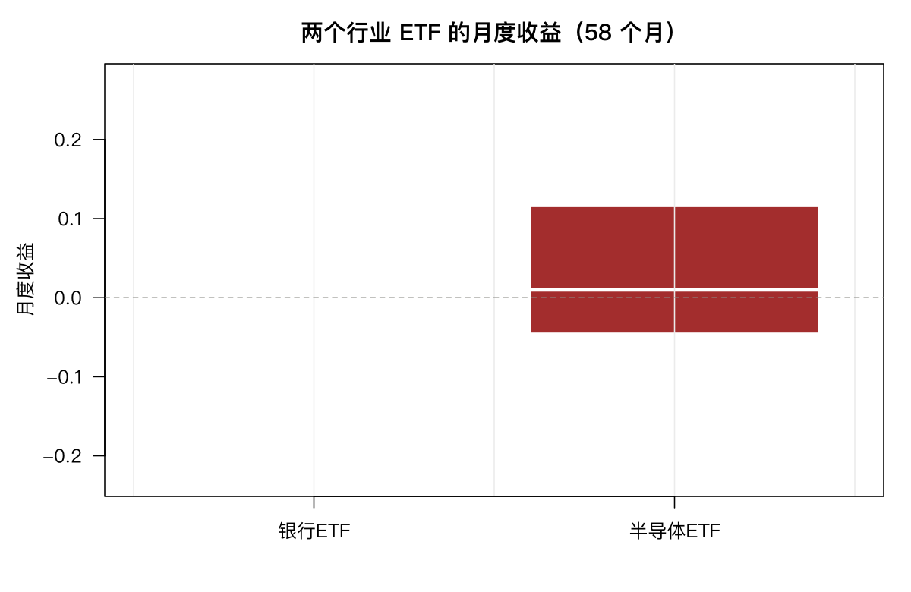

# 5 单样本与双样本检验

这一章讲最基本的统计推断：**一个数估出来，能不能相信它不等于零？两组数据看起来不一样，是不是真有差别？**

金融里几乎每个结论都要过这一关。

## 5.1 单样本 t 检验

问题：茅台 2026Q1 的日均收益，能否认为显著异于零？

```r
x <- abret$A
c(n = length(x), mean = mean(x), sd = sd(x))
t.test(x)
```

```text
        n        mean          sd
56.00000000  0.00092007  0.01810989

	One Sample t-test

data:  x
t = 0.38019, df = 55, p-value = 0.7053
alternative hypothesis: true mean is not equal to 0
95 percent confidence interval:
 -0.003929790  0.005769933
sample estimates:
   mean of x
0.0009200714
```

三个数要连起来看：

- t 统计量 = 均值 / 标准误 = 0.00092 / 0.00242 = 0.38；
- p 值 0.71：如果真实均值为零，观察到这么偏的结果的概率是 71%；
- 95% 置信区间 [−0.39%, +0.58%]，**宽度是点估计的十倍**。

结论：这 56 天的日均收益 0.092%，在统计上完全无法与零区分。

但这只股票这个季度的年化收益是 +23%。**一个看起来很好的收益，配上 56 个观测，什么也证明不了**——这就是本章最需要建立的直觉。

指定理论均值，可以做「是否等于某个值」的检验：

```r
t.test(x, mu = 0.001)
```

单侧检验用 `alternative`：

```r
t.test(x, alternative = "greater")
```

单侧检验的 p 值是双侧的一半（前提是方向对）。**用单侧检验必须有事先的理由**，不能看到数据方向之后再改——那是 p 值操纵。

## 5.2 Wilcoxon 符号秩检验

t 检验假设数据来自正态分布。第 3 章已经证明这个假设不成立（峰度 5.6）。替代方案是秩检验：

```r
wilcox.test(x)
```

Wilcoxon 符号秩检验只看「大于零的个数与秩次之和」，不要求正态。它的零假设是**中位数**为零（不是均值）。

对比两者：

```r
c(t_p = t.test(x)$p.value, wilcox_p = wilcox.test(x)$p.value)
```

```text
      t_p   wilcox_p
0.7052666  0.4169906
```

都远大于 0.05，结论一致。但要注意它们检验的东西不同：t 检验问均值，Wilcoxon 问中位数。这批数据均值正、中位数负（第 4 章算过），所以两者本来就在回答不同的问题。

**当 t 检验与 Wilcoxon 结论不一致时，先别急着选一个，而要想清楚哪个量才是你关心的。** 收益的均值是组合层面的收益，中位数是「典型的一天」，两者都有意义。

## 5.3 双样本 t 检验

比较银行 ETF 与半导体 ETF 的月度收益（58 个月）：

```r
t.test(pair2$bank, pair2$semi)
```

```text
	Welch Two Sample t-test

data:  pair2$bank and pair2$semi
t = -2.1471, df = 59.312, p-value = 0.03588
alternative hypothesis: true difference in means is not equal to 0
95 percent confidence interval:
 -0.066346598 -0.002178947
sample estimates:
   mean of x    mean of y
6.693103e-05 3.436872e-02
```

银行月均 0.0067%，半导体 3.437%，差 3.43 个百分点，p = 0.036，在 0.05 水平上显著。

`df = 59.312` 不是整数——这是 Welch 校正，它不假设两组方差相等。这里方差差异极大（下面会看到），必须用 Welch。

如果强行假设方差相等：

```r
t.test(pair2$bank, pair2$semi, var.equal = TRUE)
```

结果接近，但**前提是错的**。在方差差异悬殊时用 `var.equal = TRUE` 会低估标准误、夸大显著性。R 的默认是 Welch，正是为了避免这个错误。

### 一个重要的对照

同样的数据，用 Wilcoxon：

```r
wilcox.test(pair2$bank, pair2$semi)
```

```text
	Wilcoxon rank sum test

data:  pair2$bank and pair2$semi
W = 1357, p-value = 0.1164
```

**p = 0.116，不显著。**

同一个问题，t 检验说显著（0.036），Wilcoxon 说不显著（0.116）。为什么？

因为 t 检验比较的是**均值**，而 Wilcoxon 比较的是**中位数/秩**。半导体的高收益由少数几个月的大涨贡献（右偏），这些月份在秩检验里只占几个秩次，但在均值里权重很大。

**这个差异本身就是信息**：银行与半导体的差异主要来自「半导体偶尔暴涨」，而不是「半导体大多数月份都更好」。如果你要买的是长期持有的组合，均值差异有意义的；如果你关心的是「哪个月更可能赚钱」，Wilcoxon 的答案更贴切。



## 5.4 方差比较

```r
var.test(pair2$bank, pair2$semi)
```

```text
	F test to compare two variances

data:  pair2$bank and pair2$semi
F = 0.020291, num df = 57, denom df = 57, p-value < 2.2e-16
alternative hypothesis: true ratio of variances is not equal to 1
95 percent confidence interval:
 0.01200990 0.03428139
sample estimates:
ratio of variances
        0.02029079
```

方差比 0.0203，即**银行的方差只有半导体的 1/49**。p 值小到报不出来。

这个结论比均值差异可靠得多——方差的估计比均值稳定，因为方差用了每个观测的二阶信息，而均值只依赖于位置。

第 8 章组合优化正是靠这一点：**协方差矩阵虽然估不准，但比预期收益准得多**。这是为什么最小方差组合通常比最大夏普组合更稳健。

### 三种波动率估计的配对比较

`vol3` 里有 96 只股票的三种年化波动率，同一批股票用三种方法算，是配对数据：

```r
t.test(vol3$close_to_close, vol3$garman_klass, paired = TRUE)
t.test(vol3$close_to_close, vol3$parkinson, paired = TRUE)
```

```text
[1] 7.233915e-13
[1] 2.083779e-15
```

三种方法算出来的波动率有系统差异（收盘价法偏高，因为它只用收盘价，忽略了日内信息）。这是**方法差异**，不是随机波动。

## 5.5 双样本 Wilcoxon

```r
wilcox.test(pair2$bank, pair2$semi, conf.int = TRUE)
```

Wilcoxon 的「置信区间」是**中位数差**的区间，不是均值差。报告时要说明是哪个。

## 5.6 配对 t 检验

配对设计的要点：同一对象测两次，或两个方法测同一批对象。此时要看的是**差值**，不是两组各自的分布。

```r
t.test(vol3$close_to_close, vol3$parkinson, paired = TRUE)
```

配对与不配对的差别可以很大：

```r
t.test(vol3$close_to_close, vol3$parkinson, paired = TRUE)$p.value
t.test(vol3$close_to_close, vol3$parkinson, paired = FALSE)$p.value
```

配对检验的 p 值通常小得多，因为它消掉了「个股之间波动率本来就有大有小」这个噪声。**同一批股票的两种算法必须配对，否则等于把个股差异混进方法差异里。**

手工看差值：

```r
dv <- vol3$close_to_close - vol3$garman_klass
c(mean = mean(dv), sd = sd(dv), n = length(dv))
t.test(dv)
```

`t.test(dv)` 与配对版本完全等价。理解这一点，就理解了配对检验的本质：**它就是对差值做单样本 t 检验。**

## 5.7 配对 Wilcoxon

```r
wilcox.test(vol3$close_to_close, vol3$garman_klass, paired = TRUE)
```

差值不服从正态时用这个。第 3 章已经说明收益率的正态假设不成立，所以秩方法在金融数据里用得很多。

## 5.8 多重检验：两条风险

这是本章最实用的一节。

20 个行业 ETF 两两比较，共 190 对。如果每一对都用 0.05 水平，那么**即使所有行业完全一样**，期望也有 9.5 对会「显著」：

```r
choose(20, 2)
```

```text
[1] 190
```

用真实数据算一遍：

```text
对数: 190  显著(p<.05): 0  比例: 0
Bonferroni 后: 0  BH 后: 0
期望假阳性: 9.5
```

**一对都不显著。**

这个结果比「发现一堆假阳性」更值得琢磨。它说明的不是数据干净，而是**检验功效不足**：29 个月的样本，配上行业间巨大的波动差异，根本不足以分辨 3% 与 5% 的月均收益差。

看具体数字就明白了：第 5.3 节银行与半导体的月均差 3.43 个百分点，p 才 0.036。行业之间的差异大多小于这个，样本又只有 29 个月，检不出来是必然的。

### 两条风险要同时管

多重检验有两个相反方向的错误：

| 风险 | 含义 | 后果 |
|---|---|---|
| **假阳性**（I 类） | 本来没差异，被判为有 | 挑出无效因子，亏钱 |
| **功效不足**（II 类） | 本来有差异，检不出来 | 错过有效因子，也亏钱 |

做 190 次比较时，前者被放大 9.5 倍；但如果样本太短，后者更致命——**你连真有差异的那些也发现不了**。

### 校正方法

Bonferroni 把显著性水平除以比较次数：

```r
p.adjust(pv, method = "bonferroni")
```

$\alpha = 0.05 / 190 = 0.00026$。极其保守，功效进一步下降。

BH（Benjamini–Hochberg）控制的是**错误发现率**（FDR），比 Bonferroni 宽松得多，是因子研究里的标准做法：

```r
p.adjust(pv, method = "BH")
```

| 方法 | 控制对象 | 适用场景 |
|---|---|---|
| 不校正 | 无 | 单一预设假设 |
| Bonferroni | 族错误率（FWER） | 比较次数少、错一个都不行 |
| BH | 错误发现率（FDR） | 大规模筛选（因子挖掘） |

**因子挖掘是典型的 FDR 场景**：你测 100 个因子，允许其中几个是假的，只要大部分真的就行。这时候用 Bonferroni 会筛掉太多有效因子。

## 5.9 习题

**5.1** 检验 `idxret` 中沪深300ETF 的日均收益是否异于零，与茅台的结果比较。

**5.2** 用 `var.test()` 比较银行 ETF 与地产 ETF 的波动率，方差比是多少？

**5.3** 用 `wilcox.test()` 检验 `drawdown$months` 的中位数是否等于 10。

**5.4** 对 5.8 节的 190 个 p 值用 BH 方法校正，显著对数有什么变化？如果换成 Bonferroni 呢？

**5.5** 用 `pair2` 数据做配对 t 检验（把两个 ETF 视为同一个月的配对观测），结果与非配对版本差多少？这样做合理吗？
