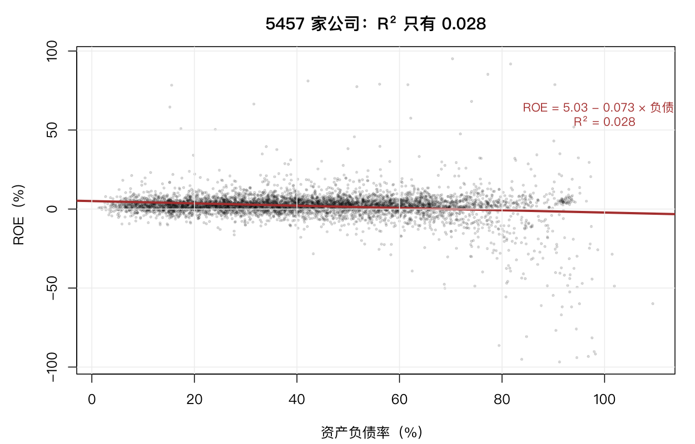

# 6 回归与相关

前面几章都在描述一组数。这一章开始看**两个变量之间的关系**。

在量化里这个问题有很直接的形态：某个财务指标能不能解释收益？两个资产的联动有多强？——前者是回归，后者是相关。

## 6.1 简单线性回归

问题：资产负债率能解释 ROE 吗？

```r
d <- fin[complete.cases(fin[, c("roe", "debt_ratio")]), ]
nrow(d)
m <- lm(roe ~ debt_ratio, data = d)
summary(m)
```

```text
[1] 5457

Coefficients:
            Estimate Std. Error t value Pr(>|t|)
(Intercept)  5.03154    0.27266   18.45   <2e-16 ***
debt_ratio  -0.07252    0.00576  -12.60   <2e-16 ***
---
Multiple R-squared:  0.02827,	Adjusted R-squared:  0.02809
```

三个层次的解读：

**系数**：斜率 −0.0725，意思是「负债率每高 1 个百分点，ROE 平均低 0.0725 个百分点」。截距 5.03 是负债率为 0 时的预期 ROE，实际中不存在这样的公司，它只是直线在纵轴上的截距。

**显著性**：t = −12.6，p < 2e-16。这个关系在统计上极其显著。

**解释力**：$R^2$ = 0.0283。资产负债率只解释了 ROE 变异的 2.8%，剩下 97.2% 由别的东西决定。

**这三件事必须分开看，而且经常被混淆。** 「显著」说的是「这个斜率不太可能是零」，「$R^2$ 小」说的是「这个变量解释不了多少」。5457 个样本让极小的斜率也能显著——这正是第 9 章要讲的：**样本量足够大时，几乎任何关系都显著**。

实践上，一个 $R^2 = 2.8\%$ 的因子在量化里是有用的（第 9 章的因子 IC 也就 0.08），但绝不能靠它单独做决策。



## 6.2 残差与拟合值

模型拟合完，要看它在哪里出错。

```r
fitted(m)[1:5]
resid(m)[1:5]
```

残差 = 实际值 − 拟合值。四个诊断图：

```r
par(mfrow = c(2, 2))
plot(m)
```

| 图 | 看什么 | 出问题时说明 |
|---|---|---|
| Residuals vs Fitted | 残差是否随机散布 | 有曲线 → 关系非线性 |
| Normal Q-Q | 残差是否正态 | 两端偏离 → 厚尾 |
| Scale-Location | 残差绝对值是否随拟合值变化 | 喇叭形 → 异方差 |
| Residuals vs Leverage | 是否有强影响点 | 某些点撬动整条线 |

第一张最要紧。如果残差图呈现明显的弧形，说明真实关系不是直线，应该加二次项（第 12 章）或换模型。

手工画一遍更直观：

```r
plot(fitted(m), resid(m), pch = 19, cex = 0.4, col = rgb(0, 0, 0, 0.3))
abline(h = 0, col = "red", lwd = 2)
```

**残差图里的点应当像一团没有形状的云。** 任何可见的形状都是模型没抓住的东西。

## 6.3 预测带与置信带

`predict()` 可以给两类区间：

```r
newd <- data.frame(debt_ratio = c(20, 40, 60, 80))
predict(m, newd, interval = "confidence")
predict(m, newd, interval = "prediction")
```

两者的区别是关键：

| 区间 | 含义 | 宽度 |
|---|---|---|
| **置信带**（confidence） | 回归**线**在哪 | 窄，样本越大越窄 |
| **预测带**（prediction） | 下一个**观测值**在哪 | 宽，永远有个体误差 |

新手常把置信带当成「预测区间」，结果严重低估不确定性。**只要问的是「新数据会落在哪」，就用 prediction。**

画出来对比：

```r
xs <- seq(min(d$debt_ratio), max(d$debt_ratio), length.out = 100)
ci <- predict(m, data.frame(debt_ratio = xs), interval = "confidence")
pi <- predict(m, data.frame(debt_ratio = xs), interval = "prediction")
```

预测带的宽度基本不随样本量缩小，因为它是「线的不确定性 + 个体的随机性」，后一项去不掉。

## 6.4 相关

### Pearson 相关

```r
cor(d$roe, d$debt_ratio)
cor.test(d$roe, d$debt_ratio)
```

```text
[1] -0.1681344
```

Pearson 相关系数 −0.168，负相关，与回归斜率的符号一致。

相关与回归的关系：

```r
cor(d$roe, d$debt_ratio)^2
summary(m)$r.squared
```

```text
[1] 0.02826918
[1] 0.02827195
```

两者相等（小数点后四位一致）。**一元回归的 $R^2$ 就是相关系数的平方**，这不是巧合，而是同一个几何事实的两种表述。

这个等式说明：相关强，$R^2$ 就高。相关系数 0.168 听着还行，平方之后只剩 0.028。**相关系数给人的印象总是偏乐观**——0.5 的相关只解释 25% 的变异。

### 多组相关

宽基指数之间的相关矩阵：

```r
idx <- idxret[, -1]
C <- cor(idx)
```

指数之间的相关性普遍在 0.7 以上，因为都是同一个市场的切片。这个事实在第 8 章组合优化里是核心约束：**平均相关越高，分散化越无效**。

### Spearman 与 Kendall

```r
cor(d$roe, d$debt_ratio, method = "spearman")
cor(d$roe, d$debt_ratio, method = "kendall")
```

Pearson 用原始值，Spearman 用秩，Kendall 用「一致对/不一致对」的比例。

差别在有离群值时最明显：

```r
x <- c(1:20, 100)
y <- c(1:20, 1)
c(pearson = cor(x, y), spearman = cor(x, y, method = "spearman"),
  kendall = cor(x, y, method = "kendall"))
```

最后一个点把所有线性关系彻底拉平，但秩关系只被打乱一点点。**所以第 9 章的因子评价用 Spearman 而不是 Pearson**——选股只关心排序，且数据里少不了极端值。

| 方法 | 基于 | 抗离群 | 金融用途 |
|---|---|---|---|
| Pearson | 原始值 | 差 | 协方差矩阵、组合风险 |
| Spearman | 秩 | 好 | 因子 IC、单因子有效性 |
| Kendall | 一致对 | 好 | 小样本、有序分类 |

注意一个陷阱：**协方差矩阵必须用 Pearson**，因为组合方差公式 $w^\top\Sigma w$ 依赖线性关系。用 Spearman 算出来的矩阵放进这个公式，结果没有解释。

## 6.5 相关不等于因果

市值与换手率负相关：小市值公司换手率更高。但这不是说「因为市值小所以换手高」，两者可能都由第三个因素驱动。

先看原始尺度：

```r
c1 <- scale[scale$ym == "2026-06", ]
cor(c1$size, c1$turnover)
```

```text
[1] 0.01299596
```

几乎零相关。换成对数尺度，关系才显出来：

```r
c1 <- c1[c1$turnover > 0, ]
cor(log(c1$turnover), c1$size)
```

```text
[1] -0.1036
```

**同一个关系，在原始尺度上是 0.013，在对数尺度上是 −0.104。** 这说明关系是非线性的、且被少数高换手率的极端股干扰。做金融数据探索时，「先看对数」是一个很实用的习惯。

写完：市值解释 1.07% 的（对数）换手率变异。

```r
m1 <- lm(log(turnover) ~ size, data = c1)
summary(m1)$r.squared
coef(m1)[2]
```

```text
[1] 0.01073
      size
-0.06035317
```

加入行业控制：

```r
c1$industry <- factor(c1$industry)
m2 <- lm(log(turnover) ~ size + industry, data = c1)
summary(m2)$r.squared
coef(m2)[2]
```

```text
[1] 0.2635
       size
-0.09367926
```

两个变化都值得注意：

- $R^2$ 从 0.011 跳到 0.264——**行业解释了 26% 的换手率变异**，远大于市值本身；
- 市值系数从 −0.060 变成 −0.094，**绝对值增大了 55%**。

第二条尤其重要。表面上「加了变量之后斜率变大」有点反直觉，但它的含义是：**行业是一个压抑变量（suppressor）**。某些行业既是大市值又高换手（比如大盘科技股），它们的存在削弱了市值与换手率的负关系；把行业固定住，这个负关系才显现出真实强度。

在量化里这叫「因子正交化」或「行业中性化」。第 9 章的多因子模型做截面标准化，就是在做同样的事。不控制行业，你会系统性低估很多因子的真实效力。

**这也解释了为什么单因子回测常常「看起来没用」：不是因子无效，而是被行业结构掩盖了。**

## 6.6 习题

**6.1** 用 `vol3` 的 `parkinson` 对 `close_to_close` 做回归，斜率与 $R^2$ 各是多少？斜率偏离 1 说明什么？

**6.2** 用 `drawdown` 的 `vol_12m` 对 `months` 做回归，解释斜率方向。这个关系是因果吗？

**6.3** 计算 `idxret` 全部宽基指数的相关矩阵，找出相关性最低的一对。它们属于同一类资产吗？

**6.4** 比较 `roe ~ debt_ratio` 的 Pearson 与 Spearman，差异说明分布有什么特征？

**6.5** 把 `fin` 按行业分组，各行业单独做 `roe ~ debt_ratio` 回归，斜率在行业间差多少？
