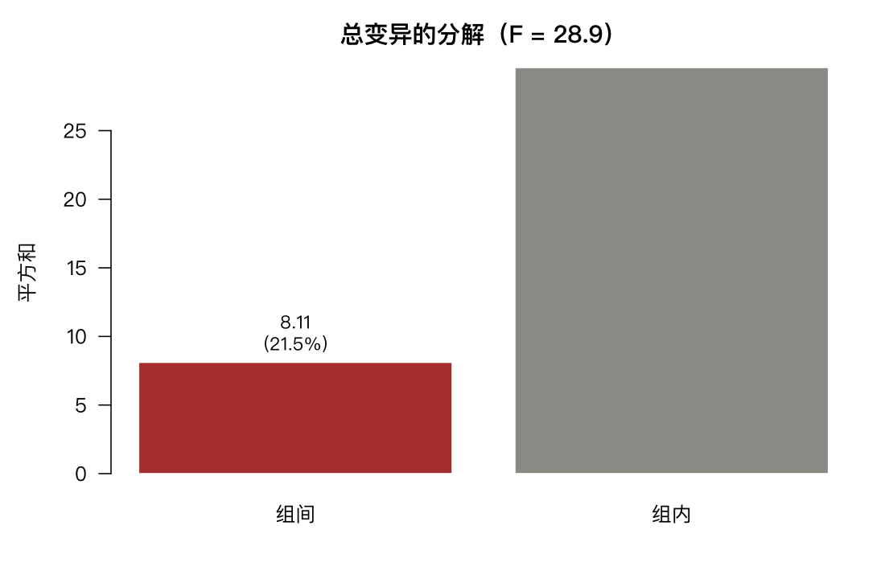

# 7 方差分析与 Kruskal–Wallis

第 5 章比较两组。这一章比较**两组以上**，而且用的工具是方差——听起来奇怪：比均值为什么要用方差？

答案在 7.1 节的分解式里。这是全章的核心。

## 7.1 单因素方差分析

问题：10 个季度的收益均值有差异吗？

```r
m <- aov(ret ~ qtr, data = ashr)
summary(m)
```

```text
             Df Sum Sq Mean Sq F value Pr(>F)
qtr           9  8.111  0.9012   28.92 <2e-16 ***
Residuals   950 29.600  0.0312
```

F = 28.92，p < 2e-16。极度显著。

### 方差的分解

方差分析的名字来自这个恒等式：

$$\underbrace{\sum_i (x_i - \bar{x})^2}_{\text{总变异}} = \underbrace{\sum_g n_g (\bar{x}_g - \bar{x})^2}_{\text{组间}} + \underbrace{\sum_i (x_i - \bar{x}_{g(i)})^2}_{\text{组内}}$$

```r
tapply(ashr$ret, ashr$qtr, mean)
table(ashr$qtr)
```

```text
     2024Q1      2024Q2      2024Q3      2024Q4      2025Q1      2025Q2
-0.03119400 -0.05901200  0.18122600 -0.03232000  0.01084900  0.00301500
     2025Q3      2025Q4      2026Q1      2026Q2
 0.21263600 -0.01039400 -0.07100200  0.04000000

2024Q1 2024Q2 2024Q3 2024Q4 2025Q1 2025Q2 2025Q3 2025Q4 2026Q1 2026Q2
    96     96     96     96     96     96     96     96     96     96
```

每组正好 96 只股票，设计平衡。手工算分解：

```r
ss_between <- sum(table(ashr$qtr) * (tapply(ashr$ret, ashr$qtr, mean) -
                 mean(ashr$ret))^2)
ss_within <- sum(resid(m)^2)
c(between = ss_between, within = ss_within,
  ratio = ss_between / (ss_between + ss_within))
```

```text
   between     within      ratio
 8.1109456 29.5997654  0.2150833
```

组间平方和 8.11，组内 29.60。**组间占总变异的 21.5%**——这就是 $\eta^2$（eta squared），效应量。

F 统计量就是这两个的比值，再按自由度调整：

$$F = \frac{SS_{\text{between}}/(k-1)}{SS_{\text{within}}/(N-k)} = \frac{0.9012}{0.0312} = 28.92$$

### 为什么用方差比

直觉是这样的：如果各季度均值真的相同，那么「组间差异」应当只是抽样噪声，大小与「组内差异」相当，F 就接近 1。F 远大于 1，说明组间差异超出了噪声水平。

**所以方差分析不是在比均值，而是在比「组间的差异」与「组内的噪声」谁更大。**

这就是为什么 F 检验对组内方差很敏感：组内方差大（数据本身乱），即使组间均值差很多也检不出来。第 5 章的功效问题在这里以另一种形式重现。



## 7.1.1 成对比较与多重检验

ANOVA 显著只说明「至少有一组不同」，没说哪些组不同。要逐对比较：

```r
pairwise.t.test(ashr$ret, ashr$qtr, p.adjust.method = "none")$p.value[1:3, 1:3]
```

```text
             2024Q1       2024Q2       2024Q3
2024Q2 2.751659e-01           NA           NA
2024Q3 2.644227e-16 3.061078e-20           NA
2024Q4 9.647339e-01 2.950677e-01 1.864921e-16
```

45 对比较。不校正时会有不少「显著」——

```r
pairwise.t.test(ashr$ret, ashr$qtr, p.adjust.method = "bonferroni")$p.value[1:5, 1:5]
```

Bonferroni 校正后 p 值乘以 45，显著的对比大幅减少。

Tukey HSD 是更标准的做法，它用学生化极差分布，比 Bonferroni 略宽松：

```r
tk <- TukeyHSD(m)
head(tk$qtr[order(tk$qtr[, "p adj"]), ], 5)
```

第 5 章的 190 对比较讲过多重检验的两条风险。45 对的问题一样：不校正会挑出假阳性，过度校正会漏掉真差异。**实践建议：先看 ANOVA 的整体 p 值，显著再做逐对比较，并明确报告用了哪种校正。**

## 7.1.2 放宽方差假设

ANOVA 假设各组方差相等。这个假设经常不成立——第 4 章已经看到 2025Q3 的标准差 0.273，2025Q2 只有 0.099，差了近三倍。

```r
oneway.test(ret ~ qtr, data = ashr)
oneway.test(ret ~ qtr, data = ashr, var.equal = TRUE)
```

`oneway.test` 默认是 Welch 版本，不要求方差齐性，类似第 5 章的 Welch t 检验。两者结果如果差别大，说明方差假设确实有问题。

## 7.1.3 图形展示

```r
boxplot(ret ~ qtr, data = ashr, las = 2, ylab = "季度收益", xlab = "")
means <- tapply(ashr$ret, ashr$qtr, mean)
points(1:length(means), means, pch = 18, cex = 1.6, col = "red")
```

箱线图加红色菱形标出组均值。**均值与中位数偏离越远，说明该组越偏斜**，此时 ANOVA 的结论要谨慎。

## 7.1.4 Bartlett 检验

```r
bartlett.test(ret ~ qtr, data = ashr)
```

Bartlett 检验方差是否齐性。它对非正态极其敏感，容易误报。Levene 检验用中位数，更稳健：

```r
library(car)
leveneTest(ret ~ factor(qtr), data = ashr)
```

## 7.2 Kruskal–Wallis 检验

方差分析的秩版本，比较各组的中位数：

```r
kruskal.test(ret ~ qtr, data = ashr)
```

```text
	Kruskal-Wallis rank sum test

data:  ret by qtr
Kruskal-Wallis chi-squared = 211.87, df = 9, p-value < 2.2e-16
```

与 ANOVA 结论一致。

行业层面：

```r
m2 <- aov(ret ~ sector, data = indret)
summary(m2)
kruskal.test(ret ~ sector, data = indret)
bartlett.test(ret ~ sector, data = indret)
```

```text
ANOVA F p: 0.926   KW p: 0.943
Bartlett p: 6.88e-27
```

**两个检验都说均值没有差异**（0.926 与 0.943），结论一致；**但 Bartlett 说方差差异极大**（p = 6.9×10⁻²⁷）。

这个组合本身就是本章最有价值的发现：

- 行业之间的**收益**差异，在 29 个月的样本里检不出来；
- 行业之间的**波动**差异，大到不可能由随机产生。

换句话说，**行业配置的价值不在「哪个行业收益更高」，而在「哪个行业波动更大、彼此怎么联动」**。这与第 5 章 190 对比较全都不显著的结果完全一致——行业收益的差异被巨大的噪声淹没，而风险特征的差异清晰可辨。

第 8 章的组合优化就建立在这一点上：既然预期收益估不准，就转向用协方差矩阵做文章。

**什么时候用哪个？**

| 情形 | 用 |
|---|---|
| 各组近似正态、方差相近 | ANOVA |
| 明显偏斜或有极端值 | Kruskal–Wallis |
| 只关心排序/中位数 | Kruskal–Wallis |
| 关心均值（如组合收益） | ANOVA，或 Welch 版 |
| 样本量各组都很大 | 两者接近（中心极限定理） |

## 7.3 双因素方差分析

两个分类变量同时影响因变量。

```r
d <- indret
d$year <- substr(d$month, 1, 4)
m3 <- aov(ret ~ sector + year, data = d)
summary(m3)
```

这检验的是「控制年份之后，行业还有差异吗」以及「控制行业之后，年份有差异吗」。

加交互项：

```r
m4 <- aov(ret ~ sector * year, data = d)
summary(m4)
```

交互项显著意味着「某些行业在特定年份表现特别不同」——这在金融里就是「行业轮动」。第 9 章的因子研究里，交互项是捕捉「因子在特定环境下才有效」的工具。

### 7.3.1 重复测量的图形

```r
interaction.plot(d$year, d$sector, d$ret, legend = FALSE, las = 1)
```

交互图看线条是否平行。平行 = 无交互（各行业随年份同步变化），交叉或不平行 = 有交互。

## 7.4 Friedman 检验

对同一批对象在多个条件下排序。这里有天然的应用：每个月给 20 个行业排名，看行业的相对强弱是否稳定。

```r
w <- reshape(indret[, c("month", "sector", "ret")], idvar = "month",
             timevar = "sector", direction = "wide")
w <- w[complete.cases(w), ]
M <- as.matrix(w[, -1])
friedman.test(M)
```

Friedman 检验的零假设是「各行业的排名随机」。拒绝它意味着存在稳定的行业优劣——这正是行业轮动策略的前提。

## 7.5 回归中的方差分析表

同一个 ANOVA 表也可以从回归得到：

```r
m5 <- lm(ret ~ qtr, data = ashr)
anova(m5)
```

结果与 `aov()` 完全一致。**`aov()` 本质上就是 `lm()` 的包装**，只是输出格式更适合展示方差分解。

理解这一点很有用：方差分析不是独立的统计方法，它是线性模型的一个特例。第 11、12 章的多元回归、协方差分析，都是在同一个框架下。

## 7.6 效应量

p 值告诉你「有没有差异」，效应量告诉你「差异有多大」。样本量大时，微小的差异也会显著，所以效应量必须报告。

```r
ss <- summary(m)[[1]][["Sum Sq"]]
eta2 <- ss[1] / sum(ss)
c(eta_squared = eta2, sqrt_eta2 = sqrt(eta2))
```

```text
eta_squared  sqrt_eta2
 0.2150833   0.4637759
```

$\eta^2 = 0.215$，即**季度因素解释了 21.5% 的收益变异**。

参照标准（Cohen）：0.01 小、0.06 中、0.14 大。0.215 属于很大的效应。

这个数字的含义值得琢磨：季度这个「因素」本身没有因果作用，它只是时间的代理——21.5% 的变异来自「所有股票在同一个季度同涨同跌」，也就是**系统性风险**。

这正是第 8 章组合优化的出发点：如果能把这 21.5% 的共同波动分散掉，剩下的 78.5% 才是可以靠选股获取的。

## 7.7 习题

**7.1** 用 `mlevent` 的 `win` 按行业分组做 ANOVA，哪些行业显著不同？注意 `win` 是 0/1 变量，用方差分析合适吗？

**7.2** 对 `drawdown$months` 按行业做 Kruskal–Wallis 检验，与 ANOVA 的 p 值比较。

**7.3** 比较 2024 与 2025 两年的季度收益，做双因素分析，年份效应显著吗？

**7.4** 计算 7.2 节 Kruskal–Wallis 的效应量（用 $\epsilon^2 = \chi^2/(n-1)$）。

**7.5** 把 `indret` 的月份按季度聚合，做「行业 × 季度」双因素分析，交互项是否显著？
