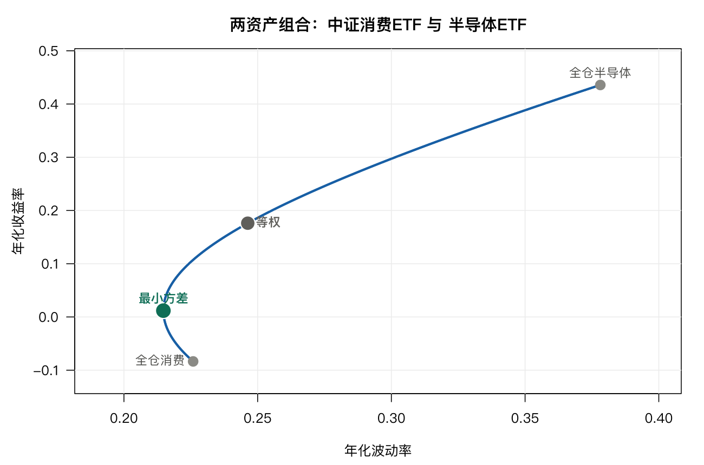
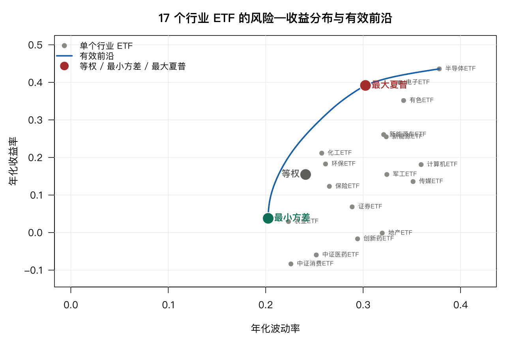
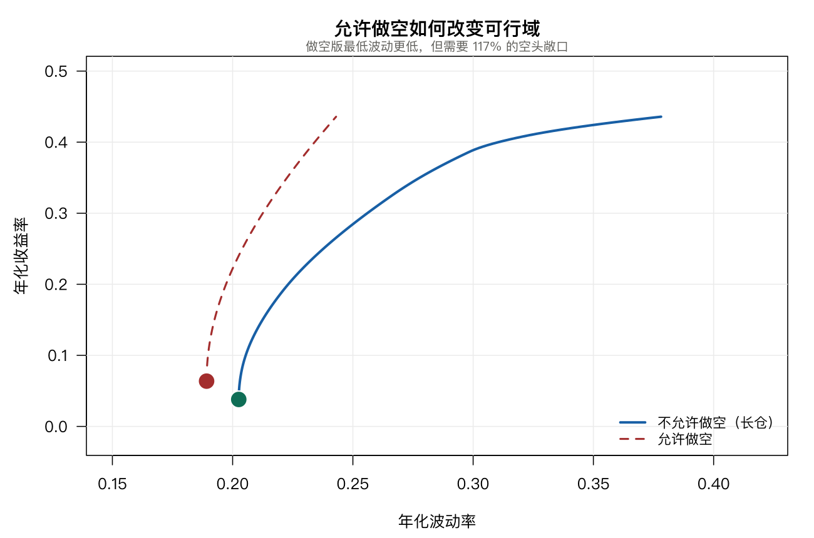
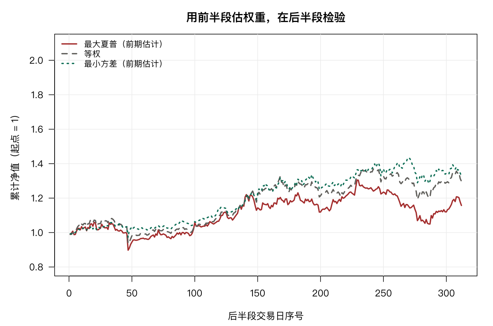
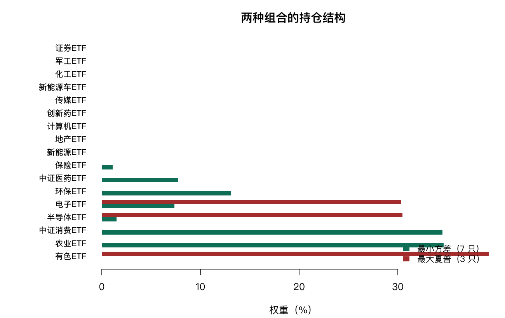

# 8 均值—方差组合优化

上一章用方差衡量「组与组之间的差异有多大」。这一章换一个用法：把方差当作**风险**，让它在资产之间分配。

这个转换看起来只是换个名字，但它带来一个全新的问题。第 7 章里，方差是描述性的东西，算出来多大就是多大。而一旦方差代表「你不想要的那部分」，问题就从「它有多大」变成「怎么让它最小」——于是变成一个优化问题，而优化的答案对输入极其敏感。这一章会看到，均值—方差框架本身很漂亮，真正难的是估计。

## 8.1 为什么单看每只资产的方差不够

先把最核心的那一步讲清楚。两个资产，权重 $w$ 和 $1-w$，组合方差是

$$\sigma_p^2 = w^2\sigma_1^2 + (1-w)^2\sigma_2^2 + 2w(1-w)\sigma_{12}$$

前两项是「各自的风险按权重的平方加权」，第三项是协方差。注意它与前两项形式完全不同：权重是一次方，而且带正负号。

如果 $\sigma_{12} = 0$，两项风险简单相抵；如果 $\sigma_{12} < 0$，第三项变成负数，组合方差可以小于任何一个组成资产。这就是分散化的全部数学内容——**风险不是加起来的，因为资产之间不完全同向**。

用相关系数写法更直观。设 $\rho = \sigma_{12}/(\sigma_1\sigma_2)$，则

$$\sigma_p^2 = w^2\sigma_1^2 + (1-w)^2\sigma_2^2 + 2w(1-w)\rho\sigma_1\sigma_2$$

$\rho = 1$ 时右边是完全平方，$\sigma_p = w\sigma_1 + (1-w)\sigma_2$，组合波动就是加权平均，分散化毫无作用。$\rho$ 越小，能削掉的方差越多。

第 7 章会看到：同一批股票在不同季度的收益率差别很大，那是**时间维度**的差异。这里的关键在**横截面**——同一时点上，不同资产动得多一致。这两件事必须分开看，否则很容易把「这只股票自己波动大」和「这只股票拖累组合」混为一谈。

## 8.2 数据与参数估计

用 20 个行业 ETF 的日收益率。先做一步必要的清洗：

```r
R <- as.matrix(indday[, -1])
dim(R)
```

```text
[1] 569  20
```

```r
keep <- colSums(is.na(R)) < 0.05 * nrow(R)
colnames(R)[!keep]
```

```text
[1] "银行ETF" "光伏ETF" "基建ETF"
```

这三只 ETF 到 2025 年 10 月才有数据（569 个交易日里缺了 425 天），不能用于全样本。剔掉它们，再删掉剩余零星缺失的行：

```r
R <- R[, keep]
R <- R[complete.cases(R), ]
dim(R)
```

```text
[1] 562  17
```

17 个行业 ETF、562 个交易日，2024-01 至 2026-05。**这一步不能省**：如果直接拿 20 列去算协方差，缺失值会让矩阵失去正定性，后面的优化会直接报错——这不是理论问题，我第一次跑就撞上了。

参数按年化处理，日收益乘以 252：

```r
n  <- ncol(R)
mu <- colMeans(R) * 252
S  <- cov(R) * 252
```

单资产的风险—收益画像：

| 行业 | 年化收益 | 年化波动 | 夏普 |
|---|---|---|---|
| 半导体 | 43.6% | 37.8% | 1.11 |
| 电子 | 40.0% | 33.8% | 1.14 |
| 有色 | 35.2% | 34.2% | 0.99 |
| 化工 | 21.1% | 25.8% | 0.76 |
| 保险 | 12.3% | 26.5% | 0.41 |
| 地产 | −0.1% | 32.0% | −0.05 |
| 中证医药 | −6.0% | 25.2% | −0.30 |
| 中证消费 | −8.3% | 22.6% | −0.44 |

（夏普按无风险利率 1.5% 计算。这个利率是**参数假设**，不是数据——实际应用应取对应期限的国债收益率。）

收益跨度将近 52 个百分点，波动从 22% 到 38%。行业之间的平均相关系数是 0.615：

```r
CC <- cor(R)
mean(CC[upper.tri(CC)])
```

```text
[1] 0.6148059
```

平均 0.615 意味着行业 ETF 之间**大部分风险是同源的**——它们是同一个股票市场的不同切片。这决定了分散化的空间有限，先记住这个数，后面看前沿的弯度会用到。

## 8.3 两资产：先看解析解

取一只负收益、低波动的资产（中证消费）和一只高收益、高波动的资产（半导体）：

```r
m2
```

```text
中证消费ETF   半导体ETF
 -0.08349137   0.43579409
```

```r
sqrt(diag(S2))
```

```text
中证消费ETF   半导体ETF
  0.2258770   0.3781377
```

```r
S2[1, 2] / sqrt(S2[1, 1] * S2[2, 2])
```

```text
[1] 0.2847521
```

相关系数 0.285，属于这批资产里最低的一档（因为它们分处消费与科技两端）。最小方差的权重有闭式解：

$$w^* = \frac{\sigma_2^2 - \sigma_{12}}{\sigma_1^2 + \sigma_2^2 - 2\sigma_{12}}$$

```r
w_min <- (S2[2, 2] - S2[1, 2]) / (S2[1, 1] + S2[2, 2] - 2 * S2[1, 2])
w_min
```

```text
[1] 0.8163322
```

也就是 81.6% 放消费、18.4% 放半导体。四个方案的波动对比：

```r
c(pure1 = sqrt(S2[1, 1]), pure2 = sqrt(S2[2, 2]),
  equal = sqrt(0.25 * S2[1, 1] + 0.25 * S2[2, 2] + 0.5 * S2[1, 2]),
  minvar = min(sd_p))
```

```text
    pure1     pure2     equal    minvar
0.2258770 0.3781377 0.2462983 0.2147525

```



这里是本章第一个反直觉的地方。**中证消费在这段样本里年化收益是 −8.3%，是全样本最差的资产之一。但把它加进来，组合波动从纯半导体的 37.8% 降到 21.5%——比纯消费的 22.6% 还低。**

也就是说，一个「亏钱」的资产可以改善组合。原因不是它收益高，而是它和半导体不同步：半导体跌的时候，消费不一定要跌。组合关心的是资产之间怎么一起动，而不是单独看谁涨得好。

这也解释了为什么「只买过去涨得最好的」在理论上就不成立——那个策略只用到了 $\mu$，完全丢掉了 $\Sigma$。

顺带注意：等权（50/50）的波动是 24.6%，高于最小方差的 21.5%。等权不是最稳的，它只是一个不需要估计的基准。

## 8.4 多资产：有效前沿

资产多于两个时，闭式解不存在，要解一个二次规划。给定目标收益率 $\mu_p$，求权重使方差最小：

$$\min_w \; w^\top \Sigma w \quad \text{s.t.} \quad \mathbf{1}^\top w = 1,\; \mu^\top w = \mu_p,\; w \ge 0$$

用 `quadprog` 求解。先封装一个函数，`short = FALSE` 时加长仓约束（$w \ge 0$）：

```r
qp <- function(mu, S, short = FALSE, target = NULL) {
  n <- ncol(S)
  A <- matrix(rep(1, n), 1, n); b <- 1; meq <- 1
  if (!short) { A <- rbind(A, diag(n)); b <- c(b, rep(0, n)) }
  if (!is.null(target)) { A <- rbind(A, mu); b <- c(b, target); meq <- 2 }
  tryCatch(solve.QP(2 * S, rep(0, n), t(A), b, meq = meq)$solution,
           error = function(e) NULL)
}
```

把目标收益率从「最小方差组合的收益」扫到「最高收益资产的收益」，每个点解一次，就得到有效前沿。

```r
w_eq <- rep(1 / n, n); names(w_eq) <- colnames(R)
w_mv <- qp(mu, S);     names(w_mv) <- colnames(R)
```

三种组合的结果：

```r
rbind(port(w_eq, "等权"), port(w_mv, "最小方差"), port(w_ms, "最大夏普"))
```

```text
      name      ret        sd    sharpe npos
1     等权 0.15463262 0.2409570 0.5794918   17
2 最小方差 0.03794984 0.2025453 0.1133072    7
3 最大夏普 0.39233212 0.3028382 1.2459858    3
```

持仓结构：

```r
sort(w_mv[w_mv > 1e-6], decreasing = TRUE)
```

```text
    农业ETF 中证消费ETF     环保ETF 中证医药ETF     电子ETF   半导体ETF     保险ETF
 0.34652452  0.34523935  0.13122374  0.07754566  0.07367830  0.01487467  0.01091375
```

```r
sort(w_ms[w_ms > 1e-6], decreasing = TRUE)
```

```text
  有色ETF 半导体ETF   电子ETF
0.3897497 0.3159080 0.2943423
```



前沿的弯度说明了分散化的实际价值：从等权出发，波动可以从 24.1% 压到 20.3%，代价是收益从 15.5% 掉到 3.8%。这一段是「用收益换风险」，划不划算取决于你的偏好，数学不替你决定。

第二个反直觉的地方在这里：**最小方差组合的夏普只有 0.113，比等权的 0.579 差得多。**

最小化方差并不等于最大化风险调整收益。前者只看 $\Sigma$、完全不管 $\mu$，于是它把仓位堆在农业和消费这类低波动资产上——而这两个行业在这段样本里几乎不赚钱。想要夏普好看，必须在 $\mu$ 上也做正确的判断。

第三个观察：最大夏普只持有 3 只资产，有色、半导体、电子，合计 100%。这看起来很「果断」，其实是 8.6 节要讲的麻烦。

## 8.5 约束：做空与杠杆

上面的 $w \ge 0$ 是人为加的。如果放开会怎样？

```r
w_short <- qp(mu, S, short = TRUE); names(w_short) <- colnames(R)
c(sd_long = vsd(w_mv, S), sd_short = vsd(w_short, S))
```

```text
  sd_long  sd_short
0.2025453 0.1891675
```

波动从 20.25% 降到 18.92%，看起来只改善了一点。但代价藏在权重里：

```r
min(w_short)
```

```text
[1] -0.5964555
```

```r
sum(w_short[w_short < 0])
```

```text
[1] -1.171015
```

为了让波动再降 1.3 个百分点，模型给出的方案是：**做空新能源 ETF 59.6%，做空创新药 22.7%，做空证券 20.4%，空头合计 117%。**



这就是均值—方差优化最常见的一种病：**它对冲风险的方式是加大杠杆，而不是真正分散。** 数学上没问题——空头头寸确实能抵消多头敞口。但现实中融券有成本、有券源限制，而且 117% 的空头敞口意味着任何一次逼空都会造成远超预期的损失。

所以业界几乎不会用无约束的解。常见做法是加约束：个股权重上下限、行业暴露上限、换手率上限、总杠杆上限。约束一加，前沿会向内移——这是必须接受的成本，换来的是可执行性。

## 8.6 估计误差：这套方法最脆弱的地方

现在做一件很朴素的事：只用前半段 250 天估计参数，看结论稳不稳。

```r
h1 <- 1:250
R1 <- R[h1, ]; mu1 <- colMeans(R1) * 252; S1 <- cov(R1) * 252
w_mv1 <- qp(mu1, S1); names(w_mv1) <- colnames(R)
sum(abs(w_mv1 - w_mv))
```

```text
[1] 0.7618523
```

两段样本给出的最小方差组合，权重差异（L1 距离）是 0.76。由于权重合计为 1，L1 最大可能值是 2，0.76 意味着**超过三分之一的仓位换掉了**。同一个市场、同一套方法，只是换了时间窗口。

持仓对比：

```text
前半段： 农业 50.5%  环保 17.6%  有色 8.3%  电子 5.9%  消费 5.7%
全样本： 农业 34.7%  消费 34.5%  环保 13.1%  医药 7.8%  电子 7.4%
```

更严重的是最大夏普组合。用前半段估计，它给出：

```r
sort(w_ms1[w_ms1 > 1e-6], decreasing = TRUE)
```

```text
     保险ETF    半导体ETF      电子ETF      有色ETF
0.7180919603 0.1783041274 0.1031734590 0.0004304532
```

**71.8% 押在保险 ETF 一只上。** 前半段的样本内表现是年化 28.6%、夏普 0.909，看起来不错。但这是它自己挑出来的最优组合，在估计它的那批数据上当然好看。

真正的问题是样本外。用这套权重去跑后半段 312 天：

```text
样本外 最大夏普 年化  14.49%  波动  22.61%  夏普 0.574
样本外 等权   年化  23.10%  波动  20.23%  夏普 1.068
样本外 最小方差 年化  24.51%  波动  17.85%  夏普 1.289
```



**精心优化的组合，样本外输给了最简单的等权，也输给了几乎不看收益的最小方差。**

这不是运气差。这是均值—方差优化被反复验证过的性质。原因不复杂：$\mu$ 是用样本均值估的，而收益的均值极难估准。第 1 章已经算过一次——用 56 个观测、23% 的年化收益，单样本 $t$ 检验的 p 值是 0.71，置信区间宽到几乎覆盖整个实数轴。$\mu$ 的估计误差远大于 $\mu$ 本身的差异。

优化器做的事情，恰恰是**把这些误差当成真实信号去最大化**。哪只资产的历史收益恰好估高了，它就把仓位压上去；误差最大的资产获得最大权重。71.8% 的保险 ETF 就是这么来的。

$\Sigma$ 的情况好一些但也不理想。562 个观测估计 17×17 的协方差矩阵，有 153 个独立参数，样本量只有参数量的 3.7 倍。相关系数 0.995 的两只 ETF（新能源与新能源车）几乎无法区分，优化器会在它们之间给出极端的、随机的分配。

## 8.7 一个补救：收缩

既然 $\Sigma$ 估不准，一个自然的想法是把它往一个结构化的目标拉。最简单的是向对角矩阵收缩：

$$\hat\Sigma_\delta = (1-\delta)\hat\Sigma + \delta \,\mathrm{diag}(\hat\Sigma)$$

$\delta = 0$ 是原始样本协方差，$\delta = 1$ 是「认为资产之间完全不相关」。收缩会压低协方差，等于假设分散化比样本显示的更有效。为了可比，三个方案都在**原始** $\Sigma$ 下评估：

```r
shrink <- function(S, delta) (1 - delta) * S + delta * diag(diag(S))
```

```text
收缩   0%: 波动  20.25%  收益   3.79%  持仓  7  最大权重 0.347
收缩  20%: 波动  20.34%  收益   4.89%  持仓  9  最大权重 0.295
收缩  50%: 波动  20.80%  收益   6.66%  持仓 14  最大权重 0.220
```

收缩 50% 的代价是波动高了 0.55 个百分点，换来的是：持仓从 7 只增到 14 只，最大单只权重从 34.7% 降到 22.0%，而收益反而从 3.79% 升到 6.66%。

这是典型的「用一点点理论最优性，换很多稳健性」。真实组合管理中这笔交易通常划算——因为理论最优性建立在参数准确这个前提上，而这个前提并不成立。



## 8.8 小结：框架与答案的区别

马科维茨的贡献是把「怎么配仓位」变成一个可以求解的问题：

- 用 $\mu$ 描述想要的，用 $\Sigma$ 描述不想要的；
- 组合的风险不是加权平均，协方差决定了分散化的上限；
- 给定偏好，最优组合落在有效前沿上。

这套框架至今仍是资产配置的通用语言。但要分清**框架**和**答案**：框架是对的，$\mu$ 与 $\Sigma$ 已知时前沿也是对的；现实里参数是估出来的，而估出来的参数会把误差直接放大成仓位。

所以实践中的均值—方差，重点几乎全在参数这一侧：更长的样本、收缩估计、贝叶斯先验、因子模型降维、稳健优化、加上现实约束。数学本身反倒是最简单的一步。

最后把边界说清楚：本章的样本期只有 562 个交易日，覆盖 2024 年初至 2026 年中一段特定行情。文中所有收益、波动、夏普都是这段样本的**样本内统计量**，不是对未来任何时期的预测，也不构成投资建议。

## 8.9 习题

**8.1** 把无风险利率从 1.5% 改为 3%，重算最大夏普组合。持仓应该怎么变？为什么？

**8.2** 用 `idxret` 里的宽基 ETF（沪深300、中证500、创业板等）重做 8.4 节。宽基之间的平均相关系数是多少？前沿的弯度比行业 ETF 大还是小？

**8.3** 给权重加下限 5%（不允许小于 5% 的仓位），重解最小方差组合。波动上升多少？持仓数变成几个？

**8.4** 用 2024 年的数据估计参数、2025 年做样本外检验，重跑 8.6 节。最大夏普组合还输给等权吗？

**8.5** 把 8.6 节的 L1 差异算成「换手率」的口径（单边换手 = L1/2）。如果每次调仓都要付这个换手率对应的交易成本，样本外的排序会变吗？
