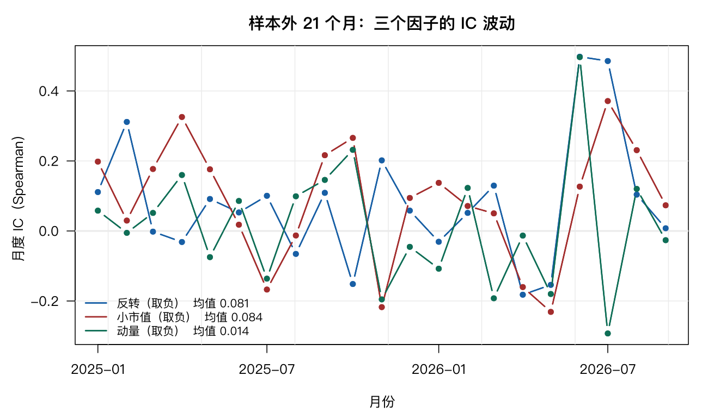
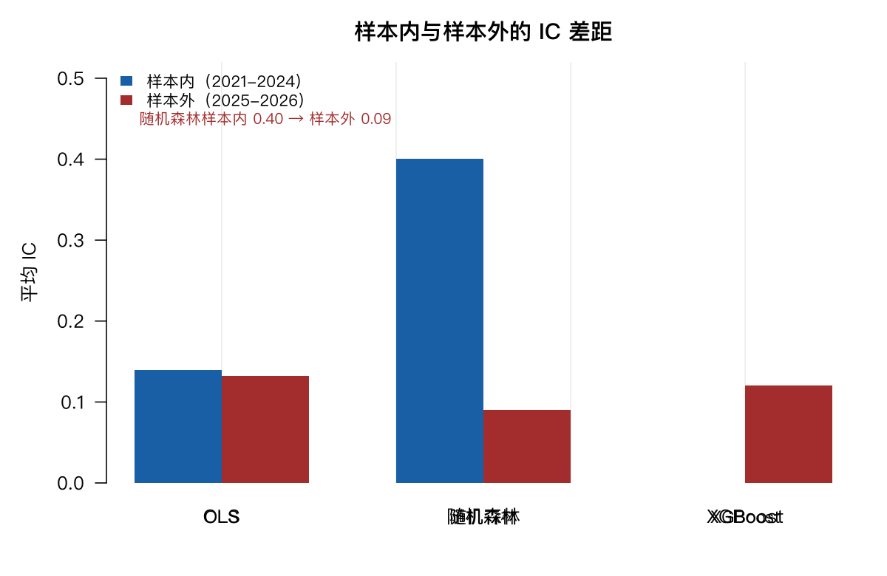
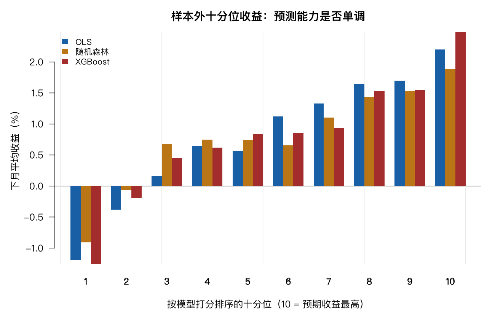
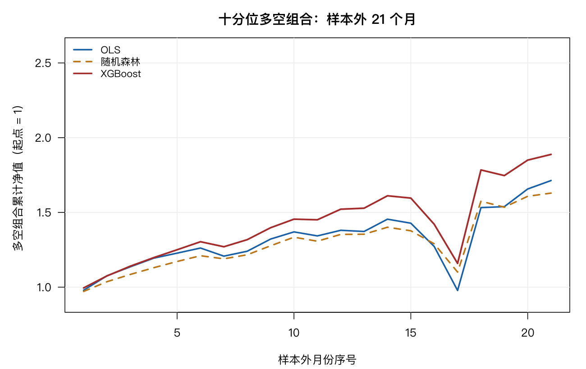
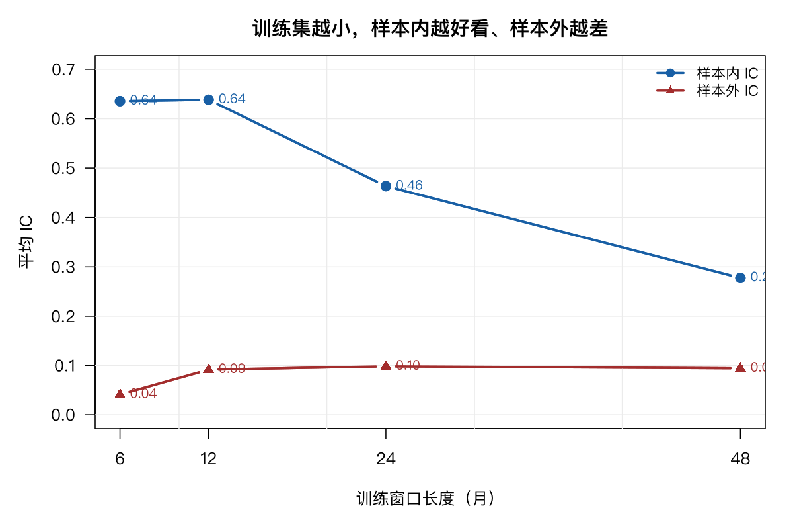

# 9 机器学习与多因子模型

上一章处理的是**时间序列**：给定几个资产，怎么分配权重。这一章换个方向，处理**横截面**：同一时点上，几千只股票，买哪些。

这个方向变了，问题的数学结构也就变了。第 8 章的输入是 $T \times N$ 的收益矩阵，输出是 $N$ 个权重；这一章的输入是「股票 × 特征」的二维表，输出是每只股票的一个分数。前者叫组合优化，后者叫选股，也叫多因子模型。

机器学习恰好在后一种问题上用得多。这一章会讲清它是怎么用的，然后给出一个可能让人意外的结果：**在这批因子上，机器学习没能跑赢最普通的线性回归。**

## 9.1 多因子模型到底是什么

一句话：**用若干个可观测的特征，给每只股票算一个预期收益的分数。**

写成式子，最朴素的线性形式是

$$E[r_i] = \alpha + \beta_1 f_{i1} + \beta_2 f_{i2} + \cdots + \beta_K f_{iK}$$

$f_{ik}$ 是第 $i$ 只股票在第 $k$ 个因子上的取值，$\beta_k$ 是因子收益，$r_i$ 是下期收益。这在形式上就是一次回归——只不过因变量是「未来」的收益，自变量是「现在」能观测到的特征。

所以「多因子模型」和「线性回归」在数学上是同一件事。业界说的「打分」，就是 $\sum \beta_k f_{ik}$ 这一项；说的「因子暴露」，就是 $f_{ik}$；说的「因子有效性」，就是 $\beta_k$ 是否显著不为零。

这个认识很重要，因为它把机器学习的位置摆正了：机器学习不是另一种模型，它只是**换一种方式去估计 $\sum \beta_k f_{ik}$**——允许非线性、允许交互项、允许 $\beta$ 随特征取值变化。

## 9.2 数据：面板的三个维度

这一章的数据是 `mlpanel`，从 `xquant-db` 的 MySQL 库中拉取全市场行情与财务指标后构建：

```r
FEATS <- c("mom_12_1", "mom_6_1", "rev_1m", "vol_12m", "turnover", "size")

d <- mlpanel[, c("secucode", "ym", "fwd_ret", FEATS)]
d <- d[complete.cases(d), ]
cat("样本:", nrow(d), "行 |", length(unique(d$secucode)), "只 |",
    length(unique(d$ym)), "个月\n")
```

```text
样本: 276813 行 | 4145 只 | 69 个月
```

四个维度必须分清：

| 维度 | 取值 | 含义 |
|---|---|---|
| 股票 | 4145 只 | 横截面，同一时点可比 |
| 月份 | 69 个（2021-01 至 2026-09） | 时间序列，反映状态变化 |
| 因子 | 6 个 | 特征，用于打分 |
| 标签 | `fwd_ret` | 下月收益，只用于训练和评估 |

六个因子的定义都从价格与股本推导：

| 因子 | 定义 | 金融含义 |
|---|---|---|
| `mom_12_1` | 过去 12 个月收益，跳过最近 1 个月 | 中期动量 |
| `mom_6_1` | 过去 6 个月收益，跳过最近 1 个月 | 短中期动量 |
| `rev_1m` | 最近 1 个月收益 | 短期反转 |
| `vol_12m` | 过去 12 个月月度收益的标准差 | 低波动异象 |
| `turnover` | 月成交量 / 流通股本，取对数 | 流动性、关注度 |
| `size` | 流通市值，取对数 | 规模效应 |

**跳过最近一个月**这个细节不是随意定的。经典动量因子都这么做，原因是最新一个月的收益以反转为主（与 `rev_1m` 方向相反），混进去会互相抵消。因子构造本身就是一门学问，这里只取最标准的做法。

## 9.3 三件必须做对的事

在跑任何模型之前，有三步不能省。它们比选什么模型重要得多。

### 一、截面标准化

不同月份的因子绝对水平不可比。2024 年的波动率普遍 30%，2025 年可能 20%，直接混在一起建模，模型学到的是「年份」而不是「波动率」。

正确做法是在**每个月内部**做标准化：

```r
for (f in FEATS) {
  d[[f]] <- ave(d[[f]], d$ym, FUN = function(x) {
    q <- quantile(x, c(0.01, 0.99), na.rm = TRUE)
    as.numeric(scale(pmin(pmax(x, q[1]), q[2])))
  })
}
```

`ave(..., d$ym, ...)` 的意思是「按月分组，组内各做一次」。`scale()` 做 $z$ 标准化，`quantile` + `pmin/pmax` 先把 1% 与 99% 分位之外的值压回边界（winsorize），避免极值主导。

### 二、标签也要去极值

`fwd_ret` 的原始分布长这样：

```text
   Min. 1st Qu.  Median    Mean 3rd Qu.    Max.
-108.89   -6.75   -0.05    0.28    6.57  247.10
```

最低 −108.9%（退市或重组），最高 +247.1%。平方损失函数对极端值极其敏感，一个 +247% 的样本能把整条回归线拉偏。同样按月 winsorize。

### 三、按时间切分，绝不能随机切分

这是这一章最重要的一条。

```r
TR <- d$ym <= "2024-12"
TE <- d$ym >= "2025-01"
```

```text
train_rows train_months    test_rows  test_months
    189768           48        87045           21
```

如果用 `sample()` 随机抽 70% 做训练，同一只股票的第 30 个月可能在训练集、第 31 个月在测试集。相邻月份的收益高度相关，模型等于偷看了答案，样本外指标会好得完全不真实。

时间序列预测里这叫**数据泄漏**（lookahead bias），是回测里最常见也最致命的错误。它的可怕之处在于不会报错，只会静静给你一个漂亮的结果。

用财务数据时这个问题更隐蔽。财报有报告期和公告日两个日期，2025 年年报的报告期是 2025-12-31，但要到 2026 年 4 月才公告。若按报告期对齐，模型在 2026 年 1 月就用上了 4 月才公开的数据。本书的 `mlfin` 数据集保留了 `notice_date`，就是为了按公告日对齐。

## 9.4 IC：因子研究的通用货币

评价一个因子（或一个模型）好不好，业界不用 $R^2$，用 **IC**（Information Coefficient，信息系数）。

IC 的定义很朴素：**同一时点上，预测值与实际收益的秩相关系数**。

```r
ic_by_month <- function(dat, pred) {
  v <- sapply(split(dat, dat$ym), function(x) {
    if (nrow(x) < 50) return(NA_real_)
    cor(x[[pred]], x$fwd_ret, method = "spearman")
  })
  v[!is.na(v)]
}
```

每月算一个，得到一串 21 个月的 IC。然后看两个数：

- **平均 IC**：方向对不对、强度够不够。经验上 0.03 以上可用，0.05 以上算好。
- **ICIR** = 平均 IC / IC 标准差：稳定性。相当于 IC 的夏普比率。

用秩相关（Spearman）而不是皮尔逊，原因有二：一是不关心数值大小，只关心排序——选股只需要排序正确；二是抗极值。

## 9.5 单因子：先把基准立住

六个因子各自单独使用，样本外 21 个月的结果（因子已取负号，使「IC 为正」表示该方向有效）：

| 因子 | 平均 IC | IC 标准差 | ICIR | 正 IC 月份占比 |
|---|---|---|---|---|
| `rev_1m`（反转） | +0.0807 | 0.1802 | 0.45 | 67% |
| `size`（小市值） | +0.0845 | 0.1702 | 0.50 | 76% |
| `turnover`（低换手） | +0.0684 | 0.2221 | 0.31 | 62% |
| `vol_12m`（低波动） | +0.0518 | 0.2147 | 0.24 | 57% |
| `mom_12_1`（动量） | +0.0144 | 0.1772 | 0.08 | 48% |
| `mom_6_1`（动量） | +0.0117 | 0.1474 | 0.08 | 52% |



两个观察。

**一是反转和小市值最强。** `rev_1m` 与 `size` 的 IC 都在 0.08 左右，ICIR 0.45-0.50。这与 A 股的既有研究一致：A 股散户占比高，短期反转和规模效应比动量更明显。

**二是动量几乎无效，甚至反了。** 两个动量因子的 IC 只有 0.012-0.014，正 IC 月份占比只有 48%-52%，等于抛硬币。这与美股形成鲜明对比——动量在美股是最稳健的因子之一。同一个因子在不同市场失效，是因子研究里必须接受的事实。

注意 IC 的波动有多大：最好用的 `size`，IC 标准差也有 0.17，是平均值的两倍。看图 9.1 会看到单月 IC 从 −0.4 到 +0.4 来回摆。**单个因子在单月几乎没有预测力，只有长期平均才有意义。**

## 9.6 线性多因子：把六个因子加起来

单个因子 IC 0.08，六个加起来会是多少？先跑最朴素的回归：

```r
fml <- as.formula(paste("fwd_ret ~", paste(FEATS, collapse = " + ")))
m_ols <- lm(fml, data = d[TR, ])
```

系数：

```text
(Intercept)    mom_12_1     mom_6_1      rev_1m     vol_12m    turnover
    0.00009     0.00225    -0.00499    -0.00510    -0.00266    -0.00655
       size
   -0.00738
```

除了 `mom_12_1` 是轻微正号，其余全部为负——负号的含义分别是：短期涨多的接下来跌（反转）、高波动的接下来跌（低波动）、高换手的接下来跌、大市值的接下来跌（小市值）。与单因子检验方向一致。

效果：

| 模型 | 样本内 IC | 样本外 IC | 样本外 ICIR |
|---|---|---|---|
| OLS | 0.1393 | **0.1322** | 0.70 |

**六个弱因子组合起来，样本外 IC 从单个的 0.08 提到 0.132，ICIR 从 0.45 提到 0.70。**

这个提升来自「正交化」：六个因子的信息有重叠但不等价，线性组合相当于给每个因子按边际贡献分配权重，把重叠部分压掉、把互补部分放大。这正是多因子模型存在的理由——不是哪个因子更好，而是它们的误差不完全同向。

值得注意的是样本内（0.1393）与样本外（0.1322）几乎一样。只有 6 个参数、19 万行数据，没有过拟合的空间。顺手跑一下岭回归也是同样结论：

```text
lambda = 562.34
Ridge 样本内      meanIC=+0.1393  sd=0.1502  ICIR=+0.93
Ridge 样本外      meanIC=+0.1322  sd=0.1893  ICIR=+0.70
```

正则化强度调到 562，结果与 OLS 小数点后四位一致。**正则化是用来对付过拟合的，而这里根本没有过拟合，所以它无事可做。**

## 9.7 机器学习：换成非线性会更好吗

现在上机器学习。逻辑很简单：如果因子与收益的关系不是线性的，树模型能捕捉到；如果因子之间有交互，树模型也能自动发现。

先看随机森林：

```r
rf <- randomForest(x = as.matrix(d[sub, FEATS]), y = d$fwd_ret[sub],
                   ntree = 120, mtry = 3, nodesize = 100, importance = TRUE)
```

```text
RF 样本内       meanIC=+0.4005  sd=0.0775  ICIR=+5.17  正IC月占比=100%
RF 样本外       meanIC=+0.0901  sd=0.1342  ICIR=+0.67  正IC月占比=76%
```

再看 XGBoost：

```text
XGB 样本外      meanIC=+0.1198  sd=0.1718  ICIR=+0.70  正IC月占比=76%
```



结果很干脆：

| 模型 | 样本内 IC | 样本外 IC | 样本外 ICIR |
|---|---|---|---|
| OLS | 0.1393 | **0.1322** | **0.70** |
| 随机森林 | 0.4005 | 0.0901 | 0.67 |
| XGBoost | — | 0.1198 | 0.70 |

**三个结论：**

**一、随机森林的样本内表现是假的。** 样本内 IC 0.4005、ICIR 5.17、100% 的月份为正——如果这是真的，意味着每月都能完美排序。而样本外掉到 0.0901，比最好的单因子（0.0845）好不了多少。

**二、XGBoost 表现正常，但没赢过 OLS。** 0.1198 对 0.1322，低了约 9%。它的 ICIR（0.70）与 OLS 相同，说明稳定性相当。

**三、最复杂的模型没有带来最好的结果。** 这是这一章最需要记住的一点。

## 9.8 为什么机器学习没赢

原因不复杂，但值得说清。

**信噪比太低。** 上面这个 OLS 的样本内 $R^2$ 只有 0.0109，样本外 $R^2$ 只有 0.0045。也就是说，**模型只解释了不到 1% 的收益变动，99% 以上是它解释不了的**。在这样的数据里，「模式」和「噪声」的界限极其模糊，而树模型的拟合能力正好用来记住噪声。

**OLS 已经抓住了主要关系。** 六个因子与未来收益的关系本身就是近似线性、近似单调的。树模型要先用很多次切分去逼近一条直线，这个过程里多出来的自由度全用来拟合噪声了。

**样本量看着大，其实不然。** 19 万行听起来很多，但 4145 只股票 × 48 个月，真正独立的「事件」只有 48 个（每个月是一个截面）。同一月份内几千只股票的收益共享同一批宏观冲击，有效样本量远小于行数。这一点在时间序列里常被忽略。

**树模型不适合外推。** 随机森林的预测值永远落在训练集标签的范围内，遇到因子取值超出历史区间的月份，它给不出合理答案。而因子分布经常漂移。

顺带看特征重要性：

```text
mom_12_1  mom_6_1     size  vol_12m   rev_1m turnover
   43.91    40.76    38.47    37.73    33.91    33.10
```

```text
    Feature      Gain
1:   rev_1m 0.2418579
2:     size 0.1880493
3: turnover 0.1656567
```

两个模型给出的排序不完全一致，但都把 `rev_1m` 和 `size` 排在前面——与单因子 IC 的结论一致。这个一致性是交叉验证：三种方法都指向同样的因子，说明结论可信。

**那机器学习在多因子里到底有什么用？**

它有用，但用在别处。真正的优势场景是：

- **因子维度很高**（几十上百个），线性模型难以分配权重；
- **关系确实非线性的场景**，比如订单流、文本情绪、图结构；
- **样本量远大于参数**，比如高频数据（每天几百万条）；
- **需要处理缺失值和异构数据**，树模型在这方面比回归宽容得多。

在这些条件不满足时，机器学习带来的提升往往被过拟合抵消。这一章的实验就是这种情况。

## 9.9 组合层面：十分位检验

IC 是统计指标，最终要落到能交易的组合。标准做法是**十分位分组**：每月按模型打分排序，分十组，等权买入最高分组、卖空最低分组。

```text
.ols       月均 +3.39%  年化 +40.7%  胜率 67%
.ridge     月均 +3.40%  年化 +40.8%  胜率 67%
.rf        月均 +2.79%  年化 +33.5%  胜率 67%
.xgb       月均 +3.61%  年化 +43.3%  胜率 67%
```

XGBoost 在组合层面反超了：年化 43.3% 对 OLS 的 40.7%。原因是组合只取两端（最好和最差各 10%），而 IC 衡量的是全体排序。**模型在极端分组的排序能力强，在中间段弱，这在 IC 上看不出来。**



单调性检验（XGBoost 打分，各十分位的下月平均收益，%）：

```text
    1     2     3     4     5     6     7     8     9    10
-1.15 -0.19  0.30  0.56  0.98  0.78  0.98  1.39  1.68  2.46
```

从第 1 组 −1.15% 到第 10 组 +2.46%，除了第 5、6 组有个小回落，整体单调。这个单调性是因子有效的直接证据——如果只是随机噪声，十个组应该高低交错。



## 9.10 这些数字为什么不能当真

上面那个 +40% 的年化，需要立刻打三个折扣。

**一、没扣成本。** 每月全换仓，单边换手接近 100%。A 股双边成本（佣金 + 印花税 + 冲击成本）保守算千分之三，一年十二次调仓就是 3.6 个百分点的拖累。这还只是显性成本。

**二、成分股不可交易。** 这批样本包含全部 4145 只股票，其中有大量微盘股、ST 股（已剔除名称含 ST 者，但仍有风险股）。这些股票日均成交额可能只有几百万元，构建几十只股票的组合时，买入行为本身就会把价格推上去，实际成交价远差于回测价。

**三、涨停买不进、跌停卖不出。** 反转因子的收益很大一部分来自「超跌反弹」，而这些股票在买入时点往往正处于跌停或接近跌停，实际上无法建仓。这是 A 股量化回测里最经典的虚高来源。

业界处理这些问题的标准做法是：限定股票池（如剔除市值后 30%、剔除近 20 日日均成交额低于某阈值）、用 VWAP 或次日均价成交、显式扣除成本、加入涨跌停过滤。做完这四件事，年化通常会掉一半以上。

**本章的价值不在于那个 40%，而在于「OLS 与 XGBoost 的差距只有 2.6 个百分点」这个事实。** 它说明在这个信噪比水平上，模型选择远不如数据质量和成本控制重要。

## 9.11 过拟合的量化：训练集越小越危险

最后做一个实验：用不同长度的训练窗口训练同一个随机森林，比较样本内与样本外的差距。

```text
训练  6 个月: 样本内 IC=+0.636  样本外 IC=+0.041  差距=0.595
训练 12 个月: 样本内 IC=+0.639  样本外 IC=+0.092  差距=0.547
训练 24 个月: 样本内 IC=+0.463  样本外 IC=+0.098  差距=0.365
训练 48 个月: 样本内 IC=+0.277  样本外 IC=+0.094  差距=0.183
```



规律很清楚：**训练窗口越短，样本内 IC 越高（0.636 对 0.277，涨了 2.3 倍），样本外反而更低（0.041 对 0.094）。**

只用 6 个月数据训练时，模型对这 6 个月的噪声记得极牢，样本内 IC 高达 0.636——看起来很完美。但样本外只剩 0.041，低于最好单因子的水平。

这张图是整章的收束：**样本内指标衡量的是模型记住了多少，样本外指标衡量的是模型学到了多少。两者的差距就是过拟合的度量。**

判断一个量化模型的真实水平，只看一件事：样本外、扣成本、可交易。三者缺一，结论都不算数。

## 9.12 小结

- **多因子模型 = 横截面回归**。因子暴露是自变量，因子收益是系数，「打分」就是预测值。
- **三件事必须先做对**：截面标准化、标签去极值、按时间切分。第三条错了，后面全错。
- **IC 是通用语言**，ICIR 衡量稳定性。单因子 IC 0.03 可用、0.05 良好；单月 IC 毫无意义，只有长期平均才有。
- **线性组合的价值来自正交化**：六个弱因子合成后，样本外 IC 从 0.08 提到 0.132。
- **机器学习在这批因子上没有优势**：随机森林严重过拟合（样本内 0.40、样本外 0.09），XGBoost 略逊于 OLS。
- **原因在信噪比**：99% 的收益变动与因子无关，模型容量越大，记住的噪声越多。
- **十分位检验比 IC 更贴近交易**：XGBoost 在极端分组反超，年化 43.3% 对 40.7%，但两者都远低于计入成本后的真实水平。
- **判断模型只看样本外、扣成本、可交易**。缺一不可。

数据边界仍需说明：样本期为 2021-01 至 2026-09 共 69 个月，测试期仅 21 个月。21 个月的 IC 均值有相当的随机性，不足以判断哪个模型长期更优。本章的结论只在这段样本、这批因子、这个股票池内成立，不构成对任何策略未来表现的判断。

## 9.13 习题

**9.1** 把 `fwd_ret` 换成一个更稳健的标签：先按月做截面排名，再转成均匀分布的分位数。重跑 OLS，IC 有变化吗？为什么？

**9.2** 把 `mlfin` 中的 `roe`、`debt_ratio`、`gross_margin` 按 `notice_date` 对齐到月份，加入模型。IC 是否提升？注意只能用公告日早于当月月底的报告。

**9.3** 把训练期改为 2021-2023、测试期改为 2024-2026，重跑随机森林与 XGBoost。随机森林的样本外 IC 是否稳定？这个结果说明了什么？

**9.4** 给十分位多空组合加上单边万分之五的交易成本（假设每月全换仓）。年化收益还剩多少？如果改为每季度调仓一次呢？

**9.5** 用 `mlpanel` 里的 `industry` 字段做行业中性化（每个行业内单独做截面标准化），再看 ICIR。行业中性化让 IC 上升还是下降？为什么？

**9.6** 用 `size` 因子把股票分成大、中、小三组，各组内分别跑 OLS。哪个子样本的 IC 最高？这说明因子在什么范围内更有效？
