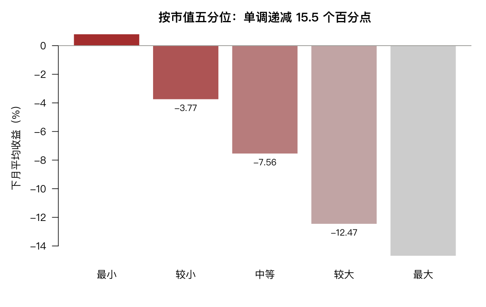

# 10 高级数据处理

统计方法本身不难，难的是把原始数据整理成能建模的形状。这一章讲的全是「脏活」，但它们决定了后面所有分析的可靠性。

## 10.1 变量重编码

### 10.1.1 cut：把连续变量分箱

分箱是量化里最常见的变换——因子研究几乎都要先分组。

```r
d <- mlpanel[mlpanel$ym == "2026-06", ]
d$size_g <- cut(d$size, 5)
table(d$size_g)
```

```text
(20.3,21.9] (21.9,23.5] (23.5,25.1] (25.1,26.7] (26.7,28.3]
        957        2165         811         188          24
```

注意各组人数极不均衡：中间一组 2165 只，最大一组只有 24 只。原因是对数市值本来就右偏，按等宽分箱必然一头挤一头空。

**用等频分箱（按分位数切）更合理**：

```r
d$size_g2 <- cut(d$size, breaks = quantile(d$size, 0:5/5),
                 labels = c("最小", "较小", "中等", "较大", "最大"),
                 include.lowest = TRUE)
table(d$size_g2)
```

```text
最小 较小 中等 较大 最大
 829  829  829  829  829
```

五组各 829 只。然后看各组的平均下月收益：

```r
tapply(d$fwd_ret, d$size_g2, mean)
```

```text
        最小         较小         中等         较大         最大
 0.008187932 -0.037664810 -0.075614587 -0.124746701 -0.147096151
```

**从 +0.82% 单调降到 −14.71%**，跨度 15.5 个百分点。这是市值因子在这一个月的横截面表现，也是第 9 章 `size` 因子 IC 为正（取负号后）的来源。



`include.lowest = TRUE` 别忘：否则最小值会被判为 `NA`，因为默认区间是左开右闭。

参数 `labels` 可以给自定义标签，`ordered_result = TRUE` 让结果成为有序因子，便于排序和作图。

### 10.1.2 因子水平的操作

```r
f <- factor(c("银行", "医药", "银行", "计算机"))
levels(f)
droplevels(f)
factor(f, levels = c("计算机", "银行", "医药"))
relevel(factor(c("银行", "医药", "计算机")), ref = "计算机")
```

四个函数各有用处：

| 函数 | 作用 | 什么时候用 |
|---|---|---|
| `levels()` | 查看或重命名水平 | 检查排序 |
| `droplevels()` | 删掉没出现的水平 | 子集之后（否则回归会出行全是 0 的虚拟变量） |
| `factor(levels=)` | 重排水平顺序 | 指定作图/表格的顺序 |
| `relevel(ref=)` | 指定基准组 | 回归里想让某个行业做基准 |

**`droplevels` 是子集操作后必须做的一步。** 从 31 个行业里筛出 3 个，因子的 `levels` 属性仍然记着 31 个，回归会生成 30 个虚拟变量，其中 27 个全是零——直接报错。

### 10.1.3 处理日期

```r
x <- as.Date("2026-06-30")
format(x, "%Y年%m月")
as.numeric(x - as.Date("2026-01-01"))
seq(as.Date("2026-01-01"), by = "month", length.out = 4)
weekdays(x)
```

```text
[1] "2026年06月"
[1] 180
[1] "2026-01-01" "2026-02-01" "2026-03-01" "2026-04-01"
[1] "Tuesday"
```

日期在 R 内部是「自 1970-01-01 起的天数」，所以相减直接得天数的差。

从字符串解析要指定格式：

```r
as.Date("2026/06/30", format = "%Y/%m/%d")
```

不指定格式时 R 只认 `YYYY-MM-DD` 和 `YYYY/MM/DD`。遇到 `30/06/2026` 这种必须先声明，否则会得到 `NA` 或错误日期。

月度数据常用「月首日」代表整月：

```r
ym <- "2026-06"
as.Date(paste0(ym, "-01"))
```

本书的 `mlpanel` 就是用 `YYYY-MM` 字符串做时间索引的，比存成 `Date` 更省空间，也便于分组。

### 10.1.4 多个变量的重编码

```r
d2 <- mlpanel[1:3, c("secucode", "size", "turnover", "vol_12m")]
d2[, c("size", "turnover")] <- lapply(d2[, c("size", "turnover")],
                                      function(z) round(z, 2))
```

`lapply` 对多列同时施加同一函数，比一列一列写省事。要施加不同函数，用 `Map` 或逐个赋值。

## 10.2 条件计算

```r
x <- c(-0.05, -0.01, 0, 0.02, 0.08)
ifelse(x > 0, "涨", "跌")
ifelse(x > 0.03, "大涨", ifelse(x < -0.03, "大跌", "平常"))
```

```text
[1] "跌" "跌" "跌" "涨" "涨"
[1] "平常" "平常" "平常" "平常" "大涨"
```

`ifelse` 是**向量化**的——它对整个向量逐元素判断，返回等长向量。这与 `if...else`（只判断一个条件、走一个分支）完全不同。

```r
# 错误用法：if 只取第一个元素，还会有警告
if (x > 0) "涨" else "跌"

# 正确
ifelse(x > 0, "涨", "跌")
```

**在 R 里见到「条件长度大于 1」的警告，几乎总是把 `if` 写成了 `ifelse` 的地方。**

按条件截断（winsorize 的核心操作）：

```r
y <- x
y[x > 0.03] <- 0.03
y[x < -0.03] <- -0.03
y
```

```text
[1] -0.03 -0.01  0.00  0.02  0.03
```

这个「逻辑下标 + 赋值」的模式比 `ifelse` 更高效，因为它不做完整复制。第 9 章的 winsorize 就是这么写的。

## 10.3 数据框的合并与重构

### 10.3.1 追加（行堆叠）

```r
a <- data.frame(code = c("A", "B"), ret = c(0.01, -0.02))
b <- data.frame(code = c("C", "D"), ret = c(0.03, 0.00))
rbind(a, b)
```

`rbind` 要求列名完全一致。列顺序不同会被拒绝（`dplyr::bind_rows` 会按名字对齐，更宽容）。

### 10.3.2 合并（列连接）

```r
meta <- data.frame(code = c("A", "B", "E"), name = c("甲", "乙", "戊"))
merge(a, meta, by = "code")                    # 内连接：只留两边都有的
merge(a, meta, by = "code", all.x = TRUE)      # 左连接：保留 a 全部
merge(a, meta, by = "code", all = TRUE)        # 全连接
```

三种连接的差别在缺失处理上：

| 连接 | 结果 |
|---|---|
| 内连接 | A、B（E 被丢，C/D 不在 meta 里也被丢） |
| 左连接 | A、B（C/D 保留，name 为 NA） |
| 全连接 | A、B、C、D、E |

**做面板数据时，左连接最常用**：以主表（股票池）为准，把辅助信息接上去，缺的就是缺，不要悄悄丢样本。

### 10.3.3 重构（长宽转换）

长表便于存储与分组，宽表便于做矩阵运算。`reshape` 两个方向都支持：

```r
long <- indret[1:12, c("sector", "month", "ret")]
wide <- reshape(long, idvar = "month", timevar = "sector", direction = "wide")
```

```r
reshape(wide, direction = "long", varying = 2:ncol(wide),
        v.names = "ret", timevar = "sector", times = names(wide)[-1],
        idvar = "month")
```

宽转长时 `varying` 指定要堆叠的列，`v.names` 是堆叠后的值列名，`timevar` 是新分类列名。

**第 8 章的协方差矩阵必须用宽表**（行 = 时间，列 = 资产），第 4 章的分组箱线图必须用长表（一行一个观测）。同一份数据，两种形状，按用途切换。

## 10.4 分组与分个案处理

### 按月算截面排名

```r
d3 <- mlpanel[mlpanel$ym %in% c("2026-05", "2026-06"), ]
d3$rk <- ave(d3$fwd_ret, d3$ym, FUN = function(z) rank(z) / length(z))
```

`ave()` 的三段式：**对谁操作、按什么分组、做什么**。它返回与原数据等长的向量，可以原地加列——这是它比 `tapply` 好用的地方。

`rank(z)/length(z)` 把排名归一化到 (0, 1]，这就是截面百分位。

### 组内去均值（行业中性化）

```r
d3$ret_dm <- d3$fwd_ret - ave(d3$fwd_ret, d3$ym, FUN = mean, na.rm = TRUE)
```

减去当月市场平均，得到超额收益。这是最简单的市场中性化。

换成按行业分组，就是行业中性化：

```r
d3$ret_ind <- d3$fwd_ret - ave(d3$fwd_ret, d3$industry, FUN = mean, na.rm = TRUE)
```

**注意 `na.rm = TRUE` 不能漏**——否则组内有一个 NA，整组均值就是 NA。

## 10.5 时间拆分

```r
d4 <- data.frame(date = px1$date[1:3])
d4$year <- as.integer(substr(d4$date, 1, 4))
d4$month <- as.integer(substr(d4$date, 6, 7))
```

按时间窗口切片：

```r
p1 <- px1[px1$date >= "2025-01-01" & px1$date <= "2025-03-31", ]
nrow(p1)
```

滚动窗口用 `filter`：

```r
r <- mlpanel$ret[mlpanel$secucode == mlpanel$secucode[1]]
r <- r[!is.na(r)]
ma <- stats::filter(r, rep(1/6, 6), sides = 1)
```

`sides = 1` 表示只用过去的数据（右侧单边），这是时间序列的正确做法。`sides = 2`（默认）会用未来数据，在回测里造成未来函数。

**这个参数是回测里最容易埋雷的地方之一。**

## 10.6 缺失值处理

```r
x <- c(0.01, NA, -0.02, NA, 0.03)
is.na(x); sum(is.na(x)); mean(is.na(x))
x[!is.na(x)]
na.omit(x)
```

金融时间的缺失有两种，处理方式完全不同：

| 类型 | 例子 | 处理 |
|---|---|---|
| 停牌 | 该日无交易 | 前值填充（`na.locf`）或剔除 |
| 未上市 | 该股票当时还不存在 | 不能填充，必须剔除该时段 |

```r
library(zoo)
na.locf(c(1, NA, NA, 4, NA))
```

```text
[1] 1 1 1 4 4
```

`na.locf`（last observation carried forward）用前一个值填充。它适合停牌——价格没变，就是没有成交。但**绝不能用于未上市期**，那等于凭空造出不存在的历史。

判断标准：**这个缺失是「有值但没观测到」，还是「本来就没有值」？** 前者可填，后者必须删。

## 10.7 习题

**10.1** 把 `mlpanel` 的 `size` 按行业分组，各行业内做五分位。各组的平均下月收益是否仍单调？

**10.2** 将 `indret` 从长表转成「月 × 行业」的宽表，算相关矩阵。相关性最低的一对行业是什么？

**10.3** 给 `mlpanel` 增加 `year` 列，按 year 分组算平均收益。哪一年最好？

**10.4** 用 `cut()` 把 `vol_12m` 分成低/中/高三组，比较各组的下月收益。

**10.5** 用 `ave()` 计算每只股票在其行业内的 `size` 排名百分位，与原始 `size` 一起对 `fwd_ret` 做回归，R² 变化多少？
