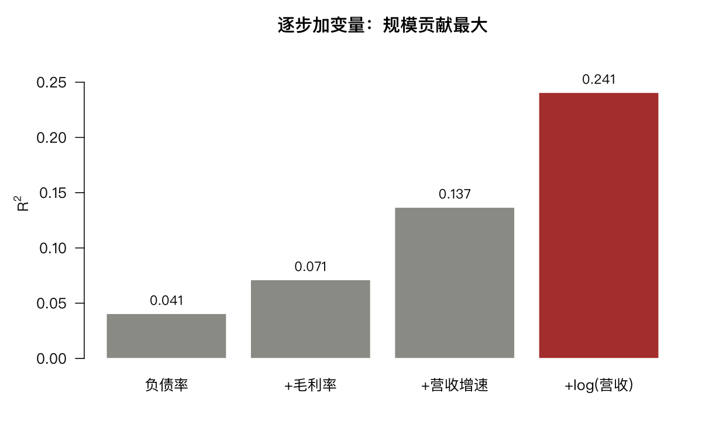

# 11 多元回归

第 6 章是一个自变量。实际研究里几乎总有多个，而且它们之间相关——这就带来简单回归没有的问题。

## 11.1 绘制多元数据

多元数据没法直接画在一张散点图上。`pairs()` 画两两散点矩阵：

```r
d <- fin[complete.cases(fin[, c("roe", "debt_ratio", "gross_margin",
                                "rev_growth", "revenue")]), ]
d <- d[d$rev_growth > -100 & d$rev_growth < 300, ]
nrow(d)

pairs(d[, c("roe", "debt_ratio", "gross_margin", "rev_growth")],
      pch = 19, cex = 0.3, col = rgb(0, 0, 0, 0.2))
```

四张散点图两两对照，能快速看出哪些变量相关、哪些有明显的非线性。

相关矩阵更紧凑：

```r
round(cor(d[, c("roe", "debt_ratio", "gross_margin", "rev_growth")]), 3)
```

**先看这张表再建模。** 如果两个自变量相关性超过 0.8，放进同一个模型就危险了——这就是共线性，11.6 节会量化。

## 11.2 模型设定与输出

逐步加变量，看每一步的贡献：

```r
m1 <- lm(roe ~ debt_ratio, data = d)
m2 <- lm(roe ~ debt_ratio + gross_margin, data = d)
m3 <- lm(roe ~ debt_ratio + gross_margin + rev_growth, data = d)
m4 <- lm(roe ~ debt_ratio + gross_margin + rev_growth + log(revenue), data = d)
```

```text
[1] 0.04043842
[1] 0.07085101
[1] 0.13626921
[1] 0.24011770
```

| 模型 | 变量数 | $R^2$ |
|---|---|---|
| m1 | 1 | 0.0406 |
| m2 | 2 | 0.0712 |
| m3 | 3 | 0.1368 |
| m4 | 4 | 0.2407 |

**注意 m1 的 $R^2$ 是 0.0406，而第 6 章算的是 0.0283。** 差别来自样本：这里剔除了 `rev_growth` 异常的公司，样本变了。这提醒一件事：**报告 $R^2$ 时必须说明样本**，不同样本的 $R^2$ 不能直接比较。



从 m3 到 m4 加的是 `log(revenue)`，$R^2$ 从 0.1368 跳到 0.2407——**规模这个变量贡献了 10 个百分点，比前三个加起来还多。**

为什么取对数？营收跨越几个数量级（从几千万到几千亿），取对数后接近对称，线性关系更合理。**这是金融数据建模的常规操作**，市值、成交量、营收几乎都要取对数。

看完整输出：

```r
summary(m3)
```

### 系数怎么读

多元回归的系数是**偏效应**：控制其他变量后，该变量变化一单位对因变量的影响。

```r
coef(m3)["debt_ratio"]
coef(m1)["debt_ratio"]
```

对比这两个数很有意义。如果它们差别大，说明 `debt_ratio` 的效应里混进了 `gross_margin` 与 `rev_growth` 的影响。

```r
round(cor(d$debt_ratio, d$gross_margin), 3)
```

相关系数决定了这两个系数差多少。**相关越强，单变量系数与多变量系数差得越远**——因为单变量回归把另一个变量的效应也算在了它头上（遗漏变量偏误）。

## 11.3 模型搜索

变量多了，怎么选？`step()` 按 AIC 逐步增删：

```r
m_full <- lm(roe ~ debt_ratio + gross_margin + rev_growth + log(revenue), data = d)
step(m_full, direction = "both", trace = 0)
```

`direction = "both"` 是双向（可增可删），`"backward"` 只删，`"forward"` 只增。

比较 AIC：

```r
AIC(m1, m2, m3, m4)
```

AIC 越小越好，它在拟合优度与参数个数之间权衡：$\text{AIC} = -2\log L + 2k$。加变量总能提高似然，所以惩罚项 $2k$ 是必要的。

调整 $R^2$ 是另一种准则：

```r
sapply(list(m1, m2, m3, m4), function(m) summary(m)$adj.r.squared)
```

$$\bar{R}^2 = 1 - \frac{(1-R^2)(n-1)}{n-k-1}$$

它也对参数个数罚分，但罚得比 AIC 轻。

**三条警告：**

1. 逐步回归在统计上是有争议的——它做的是「在同一批数据上反复挑选」，最终的 p 值和置信区间都偏乐观（选择性推断问题）。
2. 它给你的是「这批数据上的最优」，不是「真实模型」。
3. 变量之间高度相关时，`step` 的选择对初始模型极其敏感，可能给出完全不同的结果。

实践上更可靠的做法是：**先想清楚业务逻辑应该有哪些变量，再看数据说话**，而不是让算法替你挑。

## 11.4 分类变量进回归

行业是分类变量，进回归会自动转成虚拟变量：

```r
ind_map <- unique(mlpanel[, c("secucode", "industry")])
d$ind <- factor(ind_map$industry[match(d$code, ind_map$secucode)])
d <- d[!is.na(d$ind), ]

m5 <- lm(roe ~ debt_ratio + gross_margin + rev_growth + ind, data = d)
length(coef(m5))
```

31 个行业生成 30 个虚拟变量（第一个是基准组）。系数个数从 4 涨到 34。

**每个虚拟变量的系数含义**：该行业相对基准行业的 ROE 差异，控制其他变量后。

对比：

```r
m3b <- lm(roe ~ debt_ratio + gross_margin + rev_growth, data = d)
c(no_ind = summary(m3b)$r.squared, with_ind = summary(m5)$r.squared)
anova(m3b, m5)
```

```text
   no_ind  with_ind
0.1442052 0.1848598
```

$R^2$ 从 0.144 升到 0.185，行业解释了额外 4 个百分点。

F 检验（`anova`）检验「所有行业虚拟变量是否联合为零」。显著说明行业整体有解释力。

**但注意**：31 个行业、30 个参数，只换来 4 个百分点的 $R^2$。这是明显的过拟合风险——用 30 个自由度换 0.04 的解释力，在样本外未必站得住。

## 11.5 交互作用

交互项检验「一个变量的效应是否依赖于另一个变量」：

```r
m6 <- lm(roe ~ debt_ratio * ind, data = d)
anova(m5, m6)
```

`debt_ratio * ind` 展开为 `debt_ratio + ind + debt_ratio:ind`，即每个行业有自己的负债率斜率。

如果交互项显著，说明**负债率对 ROE 的影响因行业而异**——这在金融上有明确含义：银行的高杠杆是正常的（负债就是它的业务），制造业的高杠杆是风险信号。把两者混在一起回归，斜率是两者的加权平均，没有意义。

**这正是行业中性化的必要性所在。**

## 11.6 诊断

### 四个诊断图

```r
par(mfrow = c(2, 2))
plot(m3)
```

第 6 章讲过怎么看，多元回归下要特别关注第四张（Residuals vs Leverage）——变量多了，强影响点更容易出现。

### Cook 距离

```r
cooks <- cooks.distance(m3)
sum(cooks > 4 / nrow(d))
head(sort(cooks, decreasing = TRUE), 5)
```

Cook 距离衡量「删掉这个点，整条回归线会移动多少」。经验阈值是 $4/n$。

**发现强影响点不要直接删。** 先看它是不是数据错误；如果是真实观测（比如某公司当年巨亏），删掉它就等于把最有信息的样本扔了。正确做法是报告「含/不含该点」两个结果。

### 共线性：VIF

方差膨胀因子：

$$VIF_j = \frac{1}{1 - R_j^2}$$

其中 $R_j^2$ 是把第 $j$ 个自变量对其他自变量回归得到的 $R^2$。

```r
vif_manual <- sapply(c("debt_ratio", "gross_margin", "rev_growth"), function(v) {
  f <- as.formula(paste(v, "~", paste(setdiff(c("debt_ratio", "gross_margin", "rev_growth"), v), collapse = "+")))
  1 / (1 - summary(lm(f, data = d))$r.squared)
})
round(vif_manual, 3)
```

```text
 debt_ratio gross_margin   rev_growth
      1.199        1.201        1.007
```

三个 VIF 都在 1.2 附近，几乎无共线性（`debt_ratio` 与 `gross_margin` 之间略有相关，VIF 从 1 涨到 1.2）。参照标准：VIF > 5 要警惕，> 10 不能接受。

**共线性的后果不是系数有偏，而是系数估不准**——标准误膨胀，p 值变大，符号甚至可能翻转。这是为什么「两个高度相关的因子同时放进模型，结果不可解释」。

## 11.7 从统计显著到经济显著

这一章反复出现一个落差：$R^2$ 只有 0.24，但每个系数都极显著。

原因在第 6 章说过——样本 5000 多，标准误小，微小的系数也能显著。

**判断一个变量值不值得放进模型，看两件事：**

1. 系数的经济含义有多大（一单位变化带来多少变化）；
2. 加入它之后 $R^2$ 或样本外表现提升多少。

只看 p 值会误导。金融里绝大多数因子都「显著」，真正稀缺的是**稳定且可交易的显著**。

## 11.8 习题

**11.1** 把 `eps` 加入模型，$R^2$ 提升多少？它与 `roe` 的相关性有多高（是否存在共线）？

**11.2** 用 BIC 代替 AIC 做模型选择，选出的模型一致吗？BIC 的惩罚更重体现在哪里？

**11.3** 对 `mlpanel` 的 2026-06 截面，用 `size` 与 `turnover` 解释 `fwd_ret`，$R^2$ 是多少？与第 9 章的 IC 对照。

**11.4** 计算 11.6 中 Cook 距离最大的那一行的各项取值，判断是否该剔除。

**11.5** 把 `industry` 换成 `relevel` 指定的基准行业，截距如何变化？其他行业的系数变了吗？
