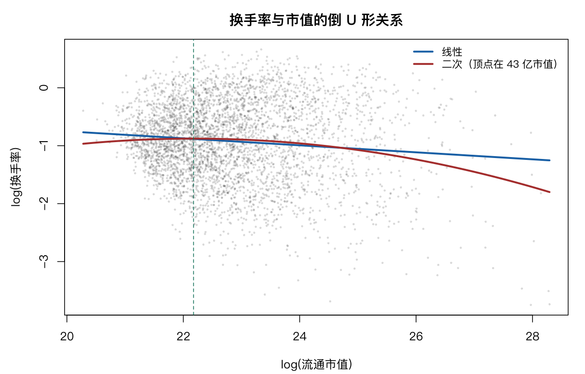

# 12 线性模型

第 11 章讲多元回归。这一章讲它的变形：非线性关系、分类与连续混合、交互作用、协方差分析。

它们看起来是不同方法，其实都是同一个线性模型——只是设计矩阵不同。理解这一点，这一章就变成一道题。

## 12.1 多项式回归

换手率与市值的关系不是直线。先看对数尺度：

```r
d <- scale[scale$ym == "2026-06", ]
d <- d[!is.na(d$turnover) & !is.na(d$size), ]
d$lsize <- d$size
d$lturn <- log(d$turnover)

m1 <- lm(lturn ~ lsize, data = d)
m2 <- lm(lturn ~ lsize + I(lsize^2), data = d)
m3 <- lm(lturn ~ lsize + I(lsize^2) + I(lsize^3), data = d)
```

```text
[1] 0.01073333
[1] 0.01603854
[1] 0.02377546
```

| 模型 | $R^2$ |
|---|---|
| 线性 | 0.0107 |
| 加二次项 | 0.0160 |
| 加三次项 | 0.0238 |

逐项检验：

```r
anova(m1, m2, m3)
```

```text
  Res.Df    RSS Df Sum of Sq      F    Pr(>F)
1   4142 1924.5
2   4141 1914.2  1    10.321 22.498 2.174e-06 ***
3   4140 1899.2  1    15.052 32.811 1.088e-08 ***
```

二次项和三次项都极显著。**但 $R^2$ 只从 0.011 涨到 0.024**——统计显著不等于解释力强。

系数：

```text
 (Intercept)        lsize   I(lsize^2)
-13.00000955   1.09327825  -0.02465024
```

二次项为负，说明是倒 U 形（开口向下）。顶点位置：

```r
cf <- coef(m2)
- cf["lsize"] / (2 * cf["I(lsize^2)"])
```

```text
   lsize
22.17582
```

对数市值 22.18，换算成市值约 $e^{22.18} \approx 4.3 \times 10^9$，即 43 亿元。**换手率在这个规模附近达到最高，再大的公司换手率反而下降。**

这个形状有明确的经济解释：太小的公司没人关注，流动性差；中等规模的公司既受散户追捧又有足够流动性；超大盘股以机构持有为主，换手天然低。



**`I()` 是必须的。** 直接写 `lsize^2` 在公式里会被解释成「lsize 与其自身的交互」，结果不对。`I()` 告诉 R「先算这个表达式，再当变量用」。

### 多项式阶数的选择

阶数越高越容易过拟合。经验上：

- 二次项能画出「一个弯」，适合单调但非线性的关系；
- 三次项能画出「两个弯」，很少有必要；
- 四次以上几乎总是过拟合，除非有明确理论依据。

**判断标准不是 p 值，而是看拟合曲线在数据稀疏区是否失控。** 多项式在边缘处会剧烈摆动，这是它最大的问题。第 16 章的非线性模型在这一点上更可靠。

## 12.2 过原点的回归

```r
m0 <- lm(lturn ~ 0 + lsize, data = d)
m0
summary(m0)$r.squared
```

`0 +` 或 `- 1` 去掉截距。什么时候该去掉？

**只有当理论上 $x = 0$ 时 $y$ 必然为 0 才可以。** 例如「投入 0 成本，收益必然为 0」。

金融数据里这种情况很少。更常见的误用是「截距不显著所以删掉」——这是错的。截距不显著只说明它与 0 无法区分，不代表它该被去掉；去掉截距会强制回归线过原点，把所有残差往一个方向推。

而且过原点模型的 $R^2$ 定义不同（分母不减均值），与含截距模型不可直接比较：

```r
summary(m1)$r.squared
summary(m0)$r.squared
```

**看到「过原点 $R^2$ 更高」的结论要警惕**，那通常是定义差异造成的假象。

## 12.3 设计矩阵与虚拟变量

线性模型的一切都可以归结为 $y = X\beta + \varepsilon$。`X` 就是设计矩阵。

```r
d2 <- indret[indret$month %in% c("2026-05", "2026-06"), ]
d2$sector <- factor(d2$sector)
m4 <- lm(ret ~ sector, data = d2)
length(coef(m4))
```

```r
X <- model.matrix(~ sector, data = d2)
dim(X)
X[1:3, 1:4]
```

设计矩阵的形状是「观测数 × 参数数」。第一列全是 1（截距），后面每列对应一个行业虚拟变量。

**关键细节：基准组不生成虚拟变量。** 31 个行业只有 30 个虚拟变量，被省略的那个就是基准组——它的效应被吸收进截距。

```r
levels(d2$sector)[1]
```

所以截距的含义是「基准组的均值」，其他系数是「相对基准组的差」。改基准组用 `relevel()`，截距会变，但组间差异不变。

**这就是「虚拟变量陷阱」**：如果给所有水平都生成虚拟变量，加上截距列会造成完全共线（所有虚拟变量之和恒为 1），矩阵不可逆。R 自动处理了这件事，但手工构建设计矩阵时容易踩。

## 12.4 分组内的线性关系

同一个关系在不同组里是否相同？两种建模方式：

```r
m5 <- lm(lturn ~ lsize + ind, data = d)      # 各组截距不同，斜率相同
m6 <- lm(lturn ~ lsize * ind, data = d)      # 各组截距和斜率都不同
summary(m5)$r.squared
summary(m6)$r.squared
anova(m5, m6)
```

`+ ind` 允许各组有不同的截距（平行线），`* ind` 允许斜率也不同（自由斜率）。

分层算斜率更直观：

```r
slopes <- tapply(seq_len(nrow(d)), d$ind, function(i) {
  if (length(i) < 30) return(NA_real_)
  coef(lm(lturn ~ lsize, data = d[i, ]))["lsize"]
})
head(sort(slopes, decreasing = TRUE), 5)
head(sort(slopes), 5)
```

**斜率的行业差异本身就是一个发现**：某些行业里市值与换手率关系强，某些几乎无关。这说明「市值因子」不是普遍有效的，而是集中在特定行业。

这也解释了一个实务现象：**同一个因子在不同行业的 IC 差别很大，全样本平均会把行业差异抹平。**

## 12.5 交互作用

```r
sub <- d[d$ind %in% c("银行", "电子"), ]
sub$ind <- droplevels(sub$ind)
m7 <- lm(lturn ~ lsize * ind, data = sub)
summary(m7)$coefficients
```

两个行业、四个参数：截距、`lsize` 斜率、行业虚拟变量、交互项。

交互项系数的含义：**电子行业相对银行的斜率差**。如果显著，说明两个行业的市值效应强度不同。

银行与电子是很好的对照：一个是高杠杆、机构主导、换手极低；一个是成长型、散户参与多、换手高。它们的流动性与规模关系理应不同。

`droplevels` 在这里不能省——`sub` 是从 31 个行业的 `d` 里筛出来的，因子的 `levels` 还记着 31 个。

## 12.6 有重复的双因素方差分析

```r
dd <- indret
dd$year <- substr(dd$month, 1, 4)
m8 <- aov(ret ~ sector * year, data = dd)
summary(m8)
```

这是第 7 章内容的扩展：两个因素加交互项。「有重复」指的是每个「行业 × 年份」组合有多个观测（这里是多个月），这样才能估计交互项——如果每个格子只有一个观测，交互项与残差无法分离。

分成主效应模型：

```r
m9 <- aov(ret ~ sector + year, data = dd)
summary(m9)
```

对比 m8 与 m9，能看出交互项贡献了多少。

## 12.7 协方差分析

协方差分析（ANCOVA）= 方差分析 + 连续协变量。

问题：控制波动率之后，行业间收益还有差异吗？

```r
dm <- mlevent[mlevent$ym == "2026-06", ]
dm <- dm[complete.cases(dm[, c("fwd_ret", "vol_12m", "industry")]), ]
dm$ind <- factor(dm$industry)
dm <- dm[dm$ind %in% names(which(table(dm$ind) > 30)), ]
dm$ind <- droplevels(dm$ind)

m10 <- lm(fwd_ret ~ ind, data = dm)
m11 <- lm(fwd_ret ~ ind + vol_12m, data = dm)
```

```r
c(no_cov = summary(m10)$r.squared, with_cov = summary(m11)$r.squared)
anova(m10, m11)
```

协变量的作用是**吸收噪声**。如果 `vol_12m` 与 `fwd_ret` 有关，把它放进模型能减少残差方差，从而提高检验行业效应的功效。

**这在观察性数据里极其重要**：不同行业的收益差异，可能只是因为它们处于不同的波动区间，而不是行业本身有优劣。控制波动率之后剩下的差异，才是「行业效应」。

### 12.7.1 图形描述

```r
boxplot(fwd_ret ~ ind, data = dm, las = 2, cex.axis = 0.7)
```

分组箱线图看原始差异。但要注意：如果各组的 `vol_12m` 分布不同，这张图里的差异是混杂的。

### 12.7.2 回归线的比较

```r
m12 <- lm(fwd_ret ~ ind * vol_12m, data = dm)
anova(m11, m12)
```

如果交互项显著，说明**各行业的「波动—收益」关系斜率不同**，此时用单一斜率（m11）不合适。

这是协方差分析的关键诊断：**先检验斜率是否齐性，再决定用什么模型。** 斜率不齐时，「控制波动率后的行业效应」这个概念本身就不成立——因为控制多少取决于你在哪个波动水平上比较。

## 12.8 诊断

```r
par(mfrow = c(2, 2))
plot(m11)
```

多元与混合模型的诊断与简单回归一样，但有两个额外关注点：

**异方差**：不同行业的残差方差可能差异很大（第 7 章已经看到 Bartlett p = 6.9×10⁻²⁷）。这会低估标准误。

```r
r2 <- lm(abs(resid(m11)) ~ fitted(m11))
summary(r2)$r.squared
```

残差绝对值对拟合值回归，$R^2$ 显著说明有异方差。处理办法：用稳健标准误（`sandwich` 包），或对因变量做变换。

**残差正态性**：大样本下不太重要（中心极限定理），但极端偏离会影响小样本推断。

```r
shapiro.test(sample(resid(m11), 500))
```

## 12.9 小结：一个框架，多种变形

这一章的所有方法都是 $y = X\beta + \varepsilon$：

| 方法 | $X$ 的构造 |
|---|---|
| 多项式回归 | 加入 $x^2, x^3$ 列 |
| 过原点回归 | 去掉全 1 列 |
| 虚拟变量 | 分类变量展开为 0/1 列 |
| 交互作用 | 两个变量的乘积列 |
| 双因素 ANOVA | 两个分类变量各自展开 |
| 协方差分析 | 虚拟变量 + 连续变量 |

**理解了设计矩阵，就不必分别记这些方法的名字。** 看到一个新模型，问一句「它的 $X$ 长什么样」，问题就清楚了。

## 12.10 习题

**12.1** 用三次多项式拟合 `divcurve` 的分散化曲线，与第 16 章的 nls 比较拟合优度与参数含义。

**12.2** 在 12.7 的模型中加入 `size` 作为第二个协变量，行业的效应是否改变？

**12.3** 检验 `dm` 中各行业的残差方差是否齐性（Bartlett 或 Levene）。

**12.4** 用 `relevel()` 改变基准行业，解释截距的变化，其他系数变了吗？

**12.5** 对 `scale` 数据，用 `lsize` 的四次多项式拟合 `lturn`，画出拟合曲线。在数据稀疏的两端，曲线是否出现不合理摆动？
