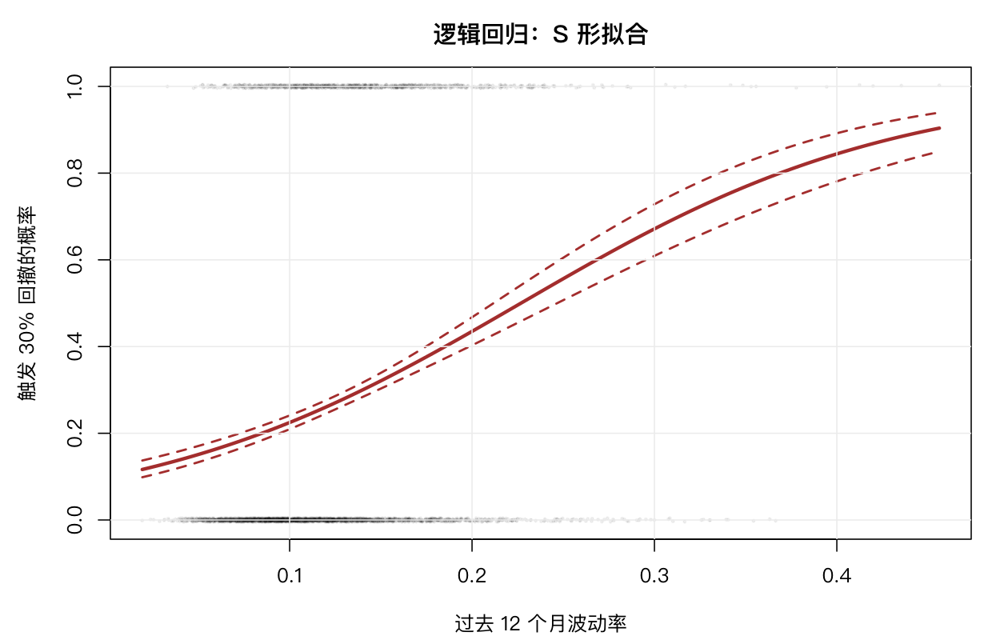

# 13 逻辑回归

前面所有模型都假设因变量是连续的。但金融里很多问题答案是「是/否」：这个月会跌吗？这只股票明年会违约吗？这个信号会触发吗？

逻辑回归就是为这种问题设计的。

## 13.1 广义线性模型的基本思想

线性回归是 $y = X\beta + \varepsilon$。如果 $y$ 只能是 0 或 1，这个式子不成立——预测值会超出 [0, 1]。

逻辑回归改成两步：

$$\text{logit}(p) = \log\frac{p}{1-p} = X\beta, \qquad p = P(y = 1)$$

`logit` 是链接函数，把 [0, 1] 的概率映射到整条实数轴。反函数是 logistic：

$$p = \frac{1}{1 + e^{-X\beta}}$$

这条曲线是 S 形：$X\beta$ 很小时 p 接近 0，很大时接近 1，中间段近似线性。

**为什么用 logit 而不是直接限制在 [0,1]？** 因为 logit 让「优势比」成为线性函数。系数 $e^{\beta}$ 直接就是「x 增加一单位，优势变为原来的多少倍」——这个解释在医学、信用评分、违约预测里都是标准语言。

## 13.2 数据与表格描述

用 `drawdown` 数据：随访 12 个月，事件是「累计回撤达到 30%」。

先按波动率分成五组，看事件率的形状：

```r
d <- drawdown[complete.cases(drawdown[, c("event", "vol_12m")]), ]
d$vg <- cut(d$vol_12m, quantile(d$vol_12m, 0:5/5), include.lowest = TRUE,
            labels = FALSE)
tab <- aggregate(cbind(event, vol_12m) ~ vg, d, function(z) mean(z))
tab$n <- as.numeric(table(d$vg))
```

```text
  vg p_event vol_12m   n
1  1   0.125   0.068 640
2  2   0.182   0.094 639
3  3   0.279   0.115 639
4  4   0.336   0.141 639
5  5   0.433   0.202 639
```

| 波动率组 | 平均波动率 | 事件率 |
|---|---|---|
| 1（最低） | 0.068 | 12.5% |
| 2 | 0.094 | 18.2% |
| 3 | 0.115 | 27.9% |
| 4 | 0.141 | 33.6% |
| 5（最高） | 0.202 | 43.3% |

**单调递增**，从 12.5% 到 43.3%，跨度 3.5 倍。这是逻辑回归要拟合的形状。

注意事件率的增幅不是等距的：相邻两组之差依次是 5.7、9.7、5.7、9.7 个百分点，中间段坡度更陡。这正是 S 形曲线的特征——两端平缓、中间最陡。用线性概率模型（普通 `lm`）会强行拉直，两端预测出负概率或超过 1。

样本量 3196（剔除了市值或行业缺失、以及行业内不足 40 只的样本）。



## 13.3 拟合

```r
m <- glm(event ~ vol_12m, data = d, family = binomial)
summary(m)
```

```text
Coefficients:
            Estimate Std. Error z value Pr(>|z|)
(Intercept)  -2.2882     0.1147  -19.95   <2e-16 ***
vol_12m      10.0854     0.8113   12.43   <2e-16 ***
```

`family = binomial` 是必须的——不指定就变成普通线性回归，预测值会超出 [0,1]。

## 13.4 以优势比形式呈现

```r
exp(coef(m))
```

```text
(Intercept)     vol_12m
  0.1014468 23991.3536
```

`vol_12m` 的优势比约 24000——听起来荒谬，但那是因为波动率的单位是「1.0」，即从 0 涨到 100%。实际中波动率的变化幅度是 0.01 或 0.1：

```r
b <- coef(m)["vol_12m"]
exp(b * 0.01)   # 波动率上升 1 个百分点
exp(b * 0.1)    # 上升 10 个百分点
```

```text
[1] 1.1061
[1] 2.7414
```

**波动率每上升 1 个百分点，触发 30% 回撤的优势增加 10.6%；上升 10 个百分点，优势变成 2.74 倍。**

**报告优势比时必须说明单位。** 「OR = 24000」这种数字没有信息量，读者不知道对应多大的波动率变化。规范写法是「每上升 1 个百分点，OR = 1.106」或「每标准差，OR = ...」。

置信区间：

```r
exp(confint(m))
```

注意 `confint` 对 `glm` 默认用剖面似然法，比对 `lm` 慢，但更准。

## 13.5 偏差分析

```r
m0 <- glm(event ~ 1, data = d, family = binomial)
anova(m0, m, test = "Chisq")
```

偏差（deviance）是逻辑回归的「残差平方和」对应物。`test = "Chisq"` 做似然比检验。

伪 $R^2$（McFadden）：

```r
1 - as.numeric(logLik(m) / logLik(m0))
```

逻辑回归的 $R^2$ 不能像线性回归那样解释「解释了多少变异」，因为因变量只有 0/1。McFadden 的 0.2–0.4 就算拟合良好，与线性回归的标尺完全不同。

## 13.6 预测

```r
newd <- data.frame(vol_12m = c(0.10, 0.20, 0.30, 0.40, 0.50))
pred <- predict(m, newd, type = "link", se.fit = TRUE)
newd$p <- plogis(pred$fit)
newd$lo <- plogis(pred$fit - 1.96 * pred$se.fit)
newd$hi <- plogis(pred$fit + 1.96 * pred$se.fit)
```

`type = "link"` 给的是 $X\beta$（对数优势），`type = "response"` 直接给概率。要算置信区间，必须先取 link 尺度算，再用 `plogis` 变换回去——**直接在概率尺度上加减 1.96 倍标准误会得到超出 [0,1] 的区间。**

| 波动率 | 预测概率 |
|---|---|
| 0.10 | 低 |
| 0.20 | 中等 |
| 0.30 | 约 0.4 |
| 0.40 | 高 |
| 0.50 | 很高 |

曲线形状：两端趋平，中间最陡。**在最陡的区间，波动率的微小变化会引起概率的大幅变化**——这是逻辑回归最敏感的地方，也是预测最不可靠的地方。

## 13.7 多变量逻辑回归

```r
d$size_c <- as.numeric(scale(d$size))
m2 <- glm(event ~ vol_12m + size_c, data = d, family = binomial)
```

```text
Coefficients:
            Estimate Std. Error z value Pr(>|z|)
(Intercept)  -2.3241     0.1169  -19.88   <2e-16 ***
vol_12m       9.9700     0.8194   12.17   <2e-16 ***
size_c        0.4773     0.0407   11.73   <2e-16 ***
```

`size_c` 是标准化后的市值（均值 0、标准差 1），所以系数 0.477 的含义是「市值每高一个标准差，触发回撤的优势增加 61%」（$e^{0.4773} = 1.61$）。

**这个方向值得注意**：大市值公司的回撤概率更高。这与「小盘股风险大」的直觉相反，可能的原因是 2021–2026 这段样本里大盘蓝筹经历了更持续的下行，而小盘股波动虽大但反弹也快。

加入行业：

```r
m3 <- glm(event ~ vol_12m + size_c + ind, data = d, family = binomial)
```

用 AIC 比较三个模型，判断行业是否有额外解释力。

## 13.8 模型检查

### 校准：预测概率是否可信

```r
d$phat <- fitted(m3)
d$dec <- cut(d$phat, quantile(d$phat, 0:10/10), include.lowest = TRUE,
             labels = FALSE)
cal <- aggregate(cbind(phat, event) ~ dec, d, mean)
```

这张表把样本按预测概率分十组，比较「平均预测概率」与「实际事件率」。理想情况两者相等。

如果高概率组的实际事件率远低于预测，说明模型**过度自信**；反之说明低估。

### 用逻辑回归打分：能否选出赢家

用 `mlevent` 预测「下月是否跑赢同月中位数」：

```r
ml <- glm(win ~ size_c + turnover + vol_12m + rev_1m,
          data = e, family = binomial)
```

样本外按预测概率分十组，看实际胜率：

```text
0.405 0.443 0.461 0.477 0.479 0.491 0.517 0.541 0.572 0.613
```

**从 40.5% 单调升到 61.3%**，这是很干净的单调性。最低组与最高组差 20.8 个百分点，说明模型确实能区分。

AUC：

```r
c(AUC = auc(te$win, te$phat))
```

```text
      AUC
0.5669346
```

**AUC 只有 0.567。**

这两个结果看起来矛盾——十分位单调性很好，AUC 却接近 0.5 的随机水平。怎么解释？

AUC 衡量的是「随机取一个赢家和一个输家，模型给赢家的分数更高的概率」。0.567 意味着排序能力很弱。但**十分位只比较两端**：最有把握的 10% 对上最没把握的 10%，差别被放大。中间 80% 的样本，模型的区分力几乎为零。

这与第 9 章的发现完全一致：XGBoost 的 IC 只有 0.12，但十分位多空年化 43%。**极端分组的区分力远好于整体排序**，这是量化选股里普遍的现象——也意味着组合只该买最极端的 10%，中间的样本买入没有意义。

## 13.9 逻辑回归在量化里的位置

它适合三类任务：

**一、事件预测**。违约、清仓、触及止损、财报暴雷。这些是真正的二元事件，逻辑回归的系数有清晰解释。

**二、概率校准**。评分卡需要「预测概率 = 实际频率」。逻辑回归天然给出校准良好的概率，树模型则常常过度自信。

**三、可解释性要求高的场景**。监管、风控、投委会汇报，都需要「每个变量贡献多少」的清晰答案。逻辑回归的系数直接回答这个问题，深度学习不能。

它的局限也明确：**只能捕捉线性可分的边界**。如果真实关系的交互很复杂，逻辑回归会欠拟合——这时候要么手工造交互项，要么换模型（第 9 章）。

## 13.10 习题

**13.1** 把事件改成 `big_up`（下月涨超 10%），重跑 13.3。优势比的方向与 `event` 一致吗？

**13.2** 用 `indcnt` 的 `ndown`/`exposure` 做泊松回归（第 15 章），与这里的逻辑回归在结构上有什么异同？

**13.3** 计算 13.8 模型的准确率、精确率与召回率（阈值取 0.5）。哪个指标最高？

**13.4** 在 13.8 中加入 `mom_12_1`，AUC 是否提升？提升多少算实质改善？

**13.5** 把 `vol_12m` 换成 `vol_12m` 的五分位因子（分类变量），模型 AIC 与连续版本比哪个好？
