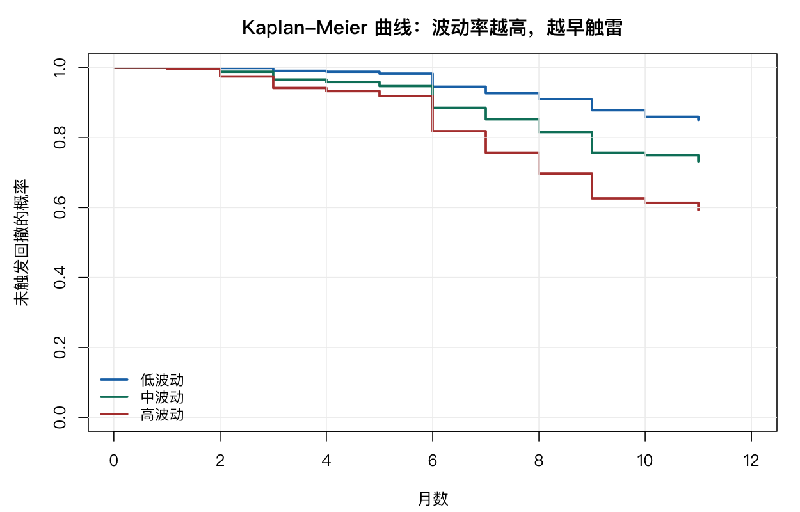

# 14 生存分析

有些问题的因变量是「**多久之后发生**」：多久违约、多久清盘、多久触发止损。这类数据有个麻烦——**研究结束时，有些个体还没发生事件**。

这部分信息不能丢，也不能当成「永不发生」。生存分析就是为处理这种**删失**（censoring）而生的。

## 14.1 基本概念

本书构造了一个真实可算的生存问题：**个股从 2021 年初起随访 12 个月，累计回撤是否达到 30%。**

- **事件**（event = 1）：随访期内某月触发 30% 回撤；
- **删失**（event = 0）：随访满 12 个月仍未触发。

```r
d <- drawdown
table(d$event)
```

```text
   0    1
2670 1475
```

事件 1475 例，删失 2670 例，**事件率 35.6%**。

```r
round(mean(d$event), 3)
summary(d$months)
```

```text
[1] 0.356
   Min. 1st Qu.  Median    Mean 3rd Qu.    Max.
  1.000   8.000  11.000   9.441  11.000  11.000

```

事件与删失的月数分布不同：

```r
tapply(d$months, d$event, summary)
```

删失组集中在 11（随访满期），事件组分散在各月。这符合直觉——没触发的都是「撑到最后」，触发的早晚不一。

**为什么设 12 个月的上限？** 因为不设上限时，A 股几乎每只股票在 69 个月里都会经历一次 30% 回撤（事件率 99.7%），几乎没有删失，生存分析就退化成「算平均时间」。有限随访才产生删失，才需要用生存方法。

## 14.2 生存对象

```r
S <- Surv(d$months, d$event)
head(S, 10)
```

`Surv(时间, 事件)` 把两列合成一个生存对象。事件用 1/0 或 `TRUE`/`FALSE` 表示，1 是「发生」。

**注意一个常见的错误**：如果数据里 1 表示删失、0 表示事件（有些数据库这么存），要写成 `Surv(time, 1 - event)`。符号搞反，整个分析全错。

## 14.3 Kaplan–Meier 估计

KM 估计的是**生存函数** $S(t) = P(\text{时间} > t)$，即「到第 t 个月还没触发回撤的概率」。

```r
km <- survfit(S ~ 1, data = d)
km
```

```text
        n events median 0.95LCL 0.95UCL
[1,] 4145   1475     NA      NA      NA
```

`median = NA`——中位生存时间估不出来。

这不是程序出错，而是数据本身的性质：事件率只有 35.6%，超过一半的样本在 12 个月内没触发事件，生存曲线没降到 0.5 以下。**中位数只在曲线穿过 0.5 时才存在。**

这一点很重要：**中位生存时间「不存在」本身就是一个结论**——说明多数股票在一年内扛住了 30% 回撤。

逐月看：

```r
summary(km)
```

```text
 time n.risk n.event survival std.err lower 95% CI upper 95% CI
    1   4145      39    0.991 0.00150        0.988        0.994
    2   4106      84    0.970 0.00264        0.965        0.976
    3   4022     117    0.942 0.00363        0.935        0.949
    4   3905      57    0.928 0.00401        0.921        0.936
```

第 1 个月存活 99.1%，第 3 个月 94.2%，第 4 个月 92.8%。前 3 个月掉得最快（累计 5.8%），之后放缓。

作图：

```r
plot(km, xlab = "月数", ylab = "未触发回撤的概率", conf.int = TRUE,
     xlim = c(0, 12), mark.time = TRUE)
```

`mark.time = TRUE` 在删失点画竖线，能看出删失集中在末尾。

## 14.4 对数秩检验

比较两组的生存曲线。

按行业：

```r
km2 <- survfit(Surv(months, event) ~ ind, data = d2)
survdiff(Surv(months, event) ~ ind, data = d2)
```

```text
 Chisq= 130  on 20 degrees of freedom, p= <2e-16
```

行业间差异极显著（χ²=130）。

两个行业单独比（银行 vs 电子）：

```r
survdiff(Surv(months, event) ~ ind, data = sub)
```

```text
 Chisq= 12.5  on 1 degrees of freedom, p= 4e-04
```

按波动率分组更有说服力：

```r
survdiff(Surv(months, event) ~ vq, data = d)
```

```text
 Chisq= 196  on 2 degrees of freedom, p= <2e-16
```

**波动率三组的差异（χ²=196）比 20 个行业的差异（χ²=130）还大。** 这说明决定回撤风险的主要因素是波动率，行业只是它的代理。

对数秩检验比较的是**整条曲线**，不是某个时点。它的零假设是「两组在各时点的风险比恒为 1」。



## 14.5 Cox 比例风险模型

单变量：

```r
m1 <- coxph(Surv(months, event) ~ vol_12m, data = d)
summary(m1)
```

```text
             coef exp(coef)  se(coef)     z Pr(>|z|)
vol_12m    7.1384 1259.4002    0.5078 14.06   <2e-16 ***

        exp(coef) exp(-coef) lower .95 upper .95
vol_12m      1259   0.000794     465.5      3407

Concordance= 0.643  (se = 0.009 )
```

`exp(coef)` 是**风险比**（hazard ratio）：波动率每上升 1.0（即 100 个百分点），触发回撤的瞬时风险变成 1259 倍。

同样，这个数字要换算成可读的单位：

$e^{7.1384 \times 0.01} = 1.074$——**波动率每上升 1 个百分点，风险增加 7.4%**。

`Concordance = 0.643` 是 C 指数，含义类似 AUC：随机取两个个体，模型正确判断谁先发生事件的概率。0.643 属于中等偏弱的区分力，与第 13 章逻辑回归的 AUC 0.567 相比略好——因为 Cox 模型利用了「时间顺序」这个额外信息。

多变量：

```r
m2 <- coxph(Surv(months, event) ~ vol_12m + size_c, data = d)
m3 <- coxph(Surv(months, event) ~ vol_12m + size_c + turnover_c, data = d)
```

```text
             coef exp(coef)  se(coef)      z Pr(>|z|)
vol_12m      6.56589 710.44186   0.57857 11.348  < 2e-16 ***
size_c       0.38647   1.47178   0.02877 13.434  < 2e-16 ***
turnover_c   0.11711   1.12424   0.03396  3.448 0.000564 ***
```

三个变量都显著：

- 波动率：每 1 个百分点，风险 ×1.068；
- 市值（每 1 个标准差）：风险 ×1.472；
- 换手率（每 1 个标准差）：风险 ×1.124。

**市值越高、换手越高，越容易触及 30% 回撤**——与第 13 章逻辑回归的结论一致，两个模型互相印证。

模型比较：

```r
anova(m1, m2, m3)
```

```text
   loglik   Chisq Df Pr(>|Chi|)
1 -7300.6
2 -7222.2 156.802  1  < 2.2e-16 ***
3 -7216.6  11.344  1  0.0007569 ***
```

### 比例风险假设

Cox 模型的核心假设是「两组的风险比不随时间变化」。这个假设要检验：

```r
cox.zph(m3)
```

如果某个变量的 p 值显著，说明它的效应随时间变化，Cox 模型不合适——此时应考虑时变系数模型，或分段 Cox。

**这一步经常被跳过，但它决定了整个模型是否成立。**

## 14.6 风险分层

用 Cox 的线性预测子把样本分三组：

```r
d$risk <- predict(m3, newdata = d, type = "lp")
d$rg <- cut(d$risk, quantile(d$risk, 0:3/3, na.rm = TRUE), include.lowest = TRUE,
            labels = c("低风险", "中风险", "高风险"))
km4 <- survfit(Surv(months, event) ~ rg, data = d)
```

三条 KM 曲线分离得越开，模型区分力越强。这是生存模型最直观的评估方式。

## 14.7 参数化生存模型

Cox 模型不指定基线风险的形状（半参数）。如果愿意假设，可以用参数模型，效率更高。

指数模型假设风险恒定：

```r
me <- survreg(Surv(months, event) ~ vol_12m, data = d, dist = "exponential")
```

Weibull 允许风险随时间单调变化：

```r
mw <- survreg(Surv(months, event) ~ vol_12m, data = d, dist = "weibull")
c(AIC_exp = AIC(me), AIC_weib = AIC(mw))
```

Weibull 的形状参数决定风险是递增还是递减。金融里的回撤风险通常是**递减**的——刚买入时最危险，撑过一段时间后，「已经跌了很多」反而降低了继续跌的概率（均值回归）。这与 A 股的短期反转效应一致。

## 14.8 生存分析在量化里能做什么

三个直接应用：

**一、持有期决策**。「买入后多久需要止损」这类问题，本质是生存分析。KM 曲线能告诉你不同持有期的事件概率，直接指导止损线的设置。

**二、因子有效期的估计**。一个因子从被发现到失效能持续多久？把「因子 IC 连续 3 个月转负」定义为事件，就能估计因子的半衰期。

**三、客户/产品的生命周期**。基金清盘、客户流失、产品下线，都是标准的生存数据。

它的价值在于**正确处理删失**。如果简单地算「已发生事件的平均时间」，会系统性低估真实时间——因为那些还没发生的（可能时间更长）被丢掉了。

## 14.9 习题

**14.1** 把事件阈值改为 20% 与 40%，观察事件率与生存曲线的变化。阈值如何影响中位时间是否存在？

**14.2** 用 `turnover` 单独建模，风险比是多少？与 `vol_12m` 相比哪个更强？

**14.3** 对 14.5 的 `m3` 做 `cox.zph` 检验，比例风险假设成立吗？

**14.4** 用 `lognormal` 分布重拟合 14.7，与 Weibull 比较 AIC。

**14.5** 把随访期改为 24 个月，重新构造生存数据。事件率变成多少？这对结论有什么影响？
