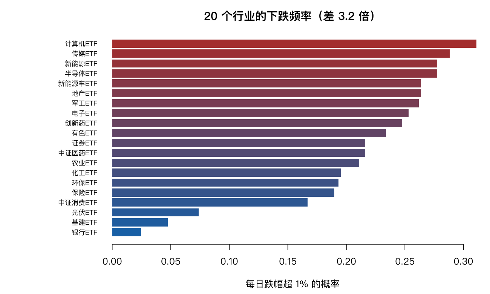

# 15 率与泊松回归

前两章的因变量是「是否发生」和「多久发生」。这一章处理**计数**：某段时间内发生了几次。

计数数据有个特点：它天然与「暴露时间」绑定。一个月有 21 个交易日、另一个月有 18 个，下跌天数当然不同——比较绝对数量毫无意义，要比的是**率**。

## 15.1 泊松分布

泊松分布描述单位时间内的稀有事件计数，只有一个参数 $\lambda$（事件率）。

先看数据：`indcnt` 记录 20 个行业 ETF 每个月「跌幅超过 1% 的交易日数」。

```r
x <- indcnt$ndown
mean(x); var(x)
c(mean = mean(x), var = var(x), ratio = var(x) / mean(x))
```

```text
[1] 4.132759
   mean      var    ratio
4.132759 4.949308 1.197525
```

**泊松分布的关键性质是均值等于方差。** 这里方差 4.95 略大于均值 4.13，比值 1.20，属于轻微过度分散。

比值接近 1 说明泊松假设基本可用；如果比值远大于 1（比如 3 或 5），就该换负二项回归。

```r
hist(x, breaks = 0:16, probability = TRUE)
lines(0:15, dpois(0:15, mean(x)), col = "red", lwd = 2, type = "h")
```

观测频数与泊松理论频数大致贴合，但右端（7 天以上）实际比理论多一些——这就是那点过度分散。

计算概率：

```r
ppois(3, mean(x))
```

约 40% 的月份只有 0–3 天下跌超 1%。

## 15.2 拟合泊松模型

因为不同月份的交易日数不同，必须用 `offset` 处理暴露量：

```r
m <- glm(ndown ~ 1, data = indcnt, family = poisson, offset = log(exposure))
summary(m)
exp(coef(m))
```

```text
Coefficients:
            Estimate Std. Error z value Pr(>|z|)
(Intercept) -1.43911    0.02043  -70.46   <2e-16 ***
```

```text
[1] 0.237
```

截距 −1.439，取指数得 0.237——这是**日率**：平均每个交易日有 23.7% 的概率出现跌幅超 1% 的情况。

校验：

```r
mean(indcnt$ndown) / mean(indcnt$exposure)
exp(coef(m)) * mean(indcnt$exposure)
```

```text
[1] 0.2373
[1] 4.64
```

`offset = log(exposure)` 的作用是：模型拟合的是 $\log(\text{率})$ 而不是 $\log(\text{计数})$。

$$\log E[\text{ndown}] = \beta_0 + \log(\text{exposure})$$

移项得 $\log(E[\text{ndown}]/\text{exposure}) = \beta_0$。**没有 offset 就直接建模计数，交易日多的月份会被误判为「风险高」。**

## 15.3 计算率

```r
agg <- aggregate(cbind(ndown, exposure) ~ sector, indcnt, sum)
agg$rate <- agg$ndown / agg$exposure
agg <- agg[order(-agg$rate), ]
```

| 行业 | 下跌日数 | 暴露 | 率 |
|---|---|---|---|
| 计算机ETF | 177 | 569 | 0.3111 |
| 光伏ETF | 42 | 145 | 0.2897 |
| 传媒ETF | 164 | 569 | 0.2882 |
| … | | | |
| 基建ETF | 27 | 145 | 0.1862 |
| 中证消费ETF | 95 | 569 | 0.1670 |
| 银行ETF | 14 | 145 | 0.0966 |

```r
c(max_rate = max(agg$rate), min_rate = min(agg$rate), ratio = max(agg$rate) / min(agg$rate))
```

```text
  max_rate   min_rate      ratio
0.31107206 0.09655172 3.22181773
```

**计算机行业的下跌日频率是银行的 3.22 倍。**



注意光伏、基建、银行三个 ETF 的暴露只有 145 个交易日（2025-10 才上市），而其它是 569。**这正是必须用 offset 的原因**——如果直接比 `ndown` 的绝对值，银行只有 14 天，会被误认为最安全，其实它只是数据少。

## 15.4 行业之间的差异

```r
m_ind <- glm(ndown ~ sector, data = indcnt, family = poisson, offset = log(exposure))
summary(m_ind)
anova(m_ind, test = "Chisq")
```

```text
Coefficients:
                    Estimate Std. Error z value Pr(>|z|)
(Intercept)       -1.532e+00  9.017e-02 -16.987  < 2e-16 ***
sector中证消费ETF -2.583e-01  1.366e-01  -1.891  0.05860 .
sector传媒ETF      2.877e-01  1.193e-01   2.412  0.01587 *
```

系数是对数率比。传媒的 0.288 意味着它的率是基准行业的 $e^{0.288} = 1.33$ 倍。

### 过度分散检验

```r
disp <- sum(residuals(m_ind, type = "pearson")^2) / df.residual(m_ind)
c(dispersion = disp)
```

```text
dispersion
 0.8992129
```

0.899，略小于 1，**轻微欠分散**——比过度分散好处理。泊松假设成立。

如果这个数明显大于 1（比如 2.5），说明数据比泊松更「扎堆」，要用拟泊松或负二项：

```r
m_quasi <- glm(ndown ~ sector, data = indcnt, family = quasipoisson, offset = log(exposure))
library(MASS)
m_nb <- glm.nb(ndown ~ sector + offset(log(exposure)), data = indcnt)
c(AIC_pois = AIC(m_ind), AIC_nb = AIC(m_nb))
```

拟泊松不改变系数，只把标准误乘以 $\sqrt{\text{dispersion}}$——这是最简单的补救。负二项则是一个完整的新模型，用 $\theta$ 参数刻画额外的方差。

## 15.5 分段常数强度模型

把时间分段，假设每段内风险恒定：

```r
d$period <- cut(as.numeric(substr(d$ym, 1, 4)),
                breaks = c(2023, 2024, 2025, 2027),
                labels = c("2024", "2025", "2026"), include.lowest = TRUE)
m_yr <- glm(ndown ~ period, data = d, family = poisson, offset = log(exposure))
```

```text
            Estimate Std. Error z value Pr(>|z|)
(Intercept) -1.26529    0.02941 -43.020   <2e-16 ***
period2025  -0.41279    0.04590  -8.992   <2e-16 ***
period2026  -0.09545    0.05620  -1.698   0.0894 .
```

各年的率：

```text
  period ndown exposure      rate
1   2024  1156     4097 0.2821577
2   2025   805     4311 0.1867316
3   2026   436     1700 0.2564706
```

**2024 年 28.2%，2025 年 18.7%，2026 年 25.6%。**

2025 年显著低于 2024 年（系数 −0.413，即率降低 34%）。这与市场实况吻合——2025 年 A 股整体波动小于 2024 年。

「分段常数强度」这个名字听起来专业，其实就是**把时间切成几段，每段单独估一个率**。它在生存分析里也常用：当比例风险假设不成立时，用分段 Cox 代替。

## 15.6 用连续协变量

波动率越高的月份，下跌天数越多？

```r
m_sd <- glm(ndown ~ sd_m, data = indcnt, family = poisson, offset = log(exposure))
summary(m_sd)
```

```text
Coefficients:
            Estimate Std. Error z value Pr(>|z|)
(Intercept) -1.82242    0.05156 -35.348   <2e-16 ***
sd_m        21.19335    2.52535   8.392   <2e-16 ***
```

系数 21.19 是在对数率尺度上。换算成「波动率每上升 1 个百分点」：

```r
exp(coef(m_sd)["sd_m"] * 0.01)
```

```text
[1] 1.236
```

**月波动率每上升 1 个百分点，下跌日数增加 23.6%。**

这个弹性是相当大的。它解释了为什么第 8 章的组合优化要把波动率作为核心输入——波动不只是「幅度」，它还直接决定了「频率」。

### 泊松回归 vs 逻辑回归

第 13 章的逻辑回归预测「是否触发回撤」，这一章预测「触发几天」。两者的结构对比：

| | 逻辑回归 | 泊松回归 |
|---|---|---|
| 因变量 | 0/1 | 非负整数 |
| 链接函数 | logit | log |
| 方差 | $p(1-p)$ | $\mu$ |
| 系数解释 | 对数优势比 | 对数率比 |
| 暴露量 | 不需要 | 必须用 offset |

**共同点是都用对数链接**——这保证了预测值落在合理范围内（概率 0–1，计数 ≥ 0）。

## 15.7 另一个计数变量

`nbig`：单日涨跌超过 2% 的天数。它的率应该更高——阈值更宽。

```r
m2 <- glm(nbig ~ sector, data = indcnt, family = poisson, offset = log(exposure))
c(AIC_down = AIC(m_ind), AIC_big = AIC(m2))
```

对比两个模型的 AIC 能看出哪个事件更「可预测」。AIC 越小，说明模型相对更好——但注意两者的因变量不同，AIC 的绝对值不可直接比，只能各自与自己的零模型比。

**跨因变量比较 AIC 是无效的**，这是常见误用。要比就用同一个因变量、不同自变量。

## 15.8 习题

**15.1** 不用 offset、改用 `rate = ndown/exposure` 做加权回归，结果与 15.2 一致吗？权重怎么取？

**15.2** 检验 `ndown` 是否符合泊松分布：计算方差均值比，并做卡方拟合优度检验。

**15.3** 把 `period` 换成按季度划分，看是否有季节性。

**15.4** 用负二项模型重新估计行业效应，系数与泊松的差多少？$\theta$ 的估计值说明什么？

**15.5** 用 `nbig` 作为因变量重跑 15.6，波动率的系数比 `ndown` 版本大还是小？为什么？
