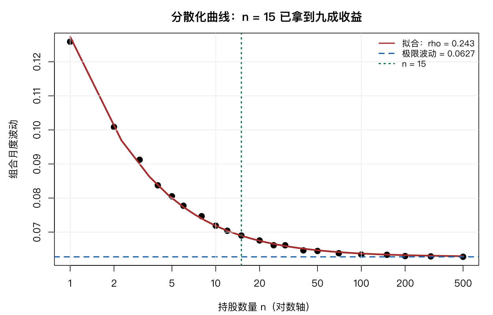

# 16 非线性曲线拟合

前几章的模型都能写成 $y = X\beta$。这一章处理**参数以非线性方式进入**的模型——式子长这样：

$$y = f(x; \theta) + \varepsilon$$

$\theta$ 可以是曲线里的任何参数（渐近值、速率、半饱和点）。R 用 `nls()`（nonlinear least squares）求解。

## 16.1 基本用法

本章的核心例子是**分散化曲线**。

先看数据是怎么来的：随机选 $n$ 只股票等权持有，算组合的月度波动，重复 300 次取平均。

| $n$ | 组合波动 |
|---|---|
| 1 | 0.1259 |
| 2 | 0.1009 |
| 5 | 0.0805 |
| 10 | 0.0719 |
| 20 | 0.0676 |
| 50 | 0.0645 |
| 500 | 0.0628 |

波动随持股数下降，但**下降速度越来越慢**——这是典型的饱和曲线。

### 理论模型

如果所有股票两两相关系数都是 $\rho$，个股波动都是 $\sigma_1$，那么等权组合的波动有精确解：

$$\sigma(n) = \sigma_1\sqrt{\rho + \frac{1-\rho}{n}}$$

这个式子不是拟合出来的，是从组合方差公式推出来的（第 8 章）：

$$\sigma_p^2 = \frac{1}{n}\sigma_1^2 + \frac{n-1}{n}\rho\sigma_1^2 = \sigma_1^2\left(\rho + \frac{1-\rho}{n}\right)$$

用 `nls` 拟合：

```r
m <- nls(sd ~ s1 * sqrt(rho + (1 - rho) / n), data = d,
         start = list(s1 = 0.126, rho = 0.25))
summary(m)
```

```text
Parameters:
     Estimate Std. Error t value Pr(>|t|)
s1  0.1273523  0.0004413  288.59   <2e-16 ***
rho 0.2427016  0.0024755   98.04   <2e-16 ***

Residual standard error: 0.0005963 on 19 degrees of freedom
```

拟合优度：

```r
pred <- fitted(m)
c(R2 = 1 - sum((d$sd - pred)^2) / sum((d$sd - mean(d$sd))^2))
```

```text
        R2
0.9986384
```

$R^2 = 0.9986$。**几乎完美。**

### 参数的含义

这才是非线性回归最有价值的地方——参数本身有金融含义。

```r
s1 <- coef(m)["s1"]; rho <- coef(m)["rho"]
c(single_stock_vol = s1, avg_correlation = rho, limit_vol = s1 * sqrt(rho))
```

```text
single_stock_vol  avg_correlation       limit_vol
       0.1273523        0.2427016        0.0627543
```

- $\sigma_1 = 12.74\%$：单只股票的月度波动；
- $\rho = 0.243$：**股票间的平均相关系数**；
- 极限波动 $= \sigma_1\sqrt{\rho} = 6.28\%$：即使持有全部 500 只，波动也降不到 6.28% 以下。

对比观测的极限值（n=500 时 0.0628），拟合值 0.06275 几乎分毫不差。



**这个 $\rho = 0.243$ 是整章最有用的数字。** 它是分散化的天花板：无论怎么分散，剩下的波动都是 $\sigma_1\sqrt{\rho}$，这部分是系统性风险，去不掉。

## 16.2 寻找起始值

`nls` 与 `lm` 最大的区别：**必须给初值，而且初值不好会失败。**

```r
bad <- try(nls(sd ~ s1 * sqrt(rho + (1 - rho) / n), data = d,
               start = list(s1 = 1, rho = 10)), silent = TRUE)
class(bad)
```

给一个荒谬的初值，算法直接报错或不收敛。

### 从图形读初值

这是最实用的方法：

```r
c(s1_guess = d$sd[d$n == 1], limit_guess = tail(d$sd, 1))
c(rho_guess = (tail(d$sd, 1) / d$sd[d$n == 1])^2)
```

三个数一次读出来：

- $n = 1$ 处的值就是 $\sigma_1$ 的初值（0.126）；
- $n \to \infty$ 处的值就是 $\sigma_1\sqrt{\rho}$ 的初值（0.0628）；
- 两者相除再平方，就是 $\rho$ 的初值。

**这个「从图上读参数」的技巧适用于任何饱和型曲线**，比盲目试数字快得多。

### 网格搜索

初值不确定时，可以用网格搜索：

```r
grid <- expand.grid(s1 = seq(0.10, 0.15, 0.005), rho = seq(0.15, 0.40, 0.01))
grid$sse <- apply(grid, 1, function(g) {
  fit <- try(nls(sd ~ s1 * sqrt(rho + (1 - rho) / n), data = d,
                 start = list(s1 = g[1], rho = g[2])), silent = TRUE)
  if (inherits(fit, "try-error")) return(Inf)
  sum(resid(fit)^2)
})
best <- grid[which.min(grid$sse), ]
```

517 个组合各拟合一次，取残差平方和最小的作初值。这个方法慢但可靠，参数量少时完全可行。

**注意 `silent = TRUE` 与 `inherits(..., "try-error")` 的配合**——网格里必然有一些初值不收敛，不能让它们中断整个搜索。

## 16.3 自启动模型

R 内置了一批「自启动」模型，会自己算初值。渐近回归：

```r
m3 <- nls(sd ~ SSasymp(n, Asym, r0, lrc), data = d)
summary(m3)
```

```text
Parameters:
       Estimate Std. Error t value Pr(>|t|)
Asym  0.0654617  0.0007901   82.85  < 2e-16 ***
r0    0.1446736  0.0052234   27.70 3.28e-16 ***
lrc  -1.0748500  0.0891396  -12.06 4.67e-10 ***
```

`Asym` 是渐近值 0.0655，与理论模型的 0.0628 接近但不完全相同——因为 `SSasymp` 的形式是 $y = \text{Asym} + (r_0 - \text{Asym})e^{-e^{lrc}x}$，与理论公式不同。

用 AIC 比较：

```r
c(AIC_asymp = AIC(m3), AIC_theory = AIC(m))
```

理论模型的 AIC 更低，说明带金融含义的公式比通用渐近模型拟合得更好。这不奇怪——它是从组合方差公式严格推导出来的，不是凑出来的形状。

### 自启动模型不是万能的

试另一个自启动模型：

```r
bad <- try(nls(sd ~ SSasympOrig(n, Asym, lrc), data = d), silent = TRUE)
cat("SSasympOrig 是否可用:", !inherits(bad, "try-error"), "\n")
```

```text
SSasympOrig 是否可用: FALSE
```

`SSasympOrig` 的形式是强制过原点的渐近曲线，它的自启动初值依赖 $\log(1 - y/\text{Asym})$。本数据的 $y$ 处处接近 Asym，这个对数会算出 NaN 或负值，初值估计直接失败。

**自启动模型只在曲线形状匹配时才可用。** 拿到一个新数据集，先画图判断形状，再选自启动函数，比盲试效率高。

## 16.4 剖面分析

剖面（profile）分析固定一个参数，看另一个参数的最优值如何随之变化：

```r
rhos <- seq(0.15, 0.40, 0.02)
prof <- t(sapply(rhos, function(r) {
  fit <- try(nls(sd ~ s1 * sqrt(r + (1 - r) / n), data = d,
                 start = list(s1 = 0.13)), silent = TRUE)
  if (inherits(fit, "try-error")) return(c(s1 = NA, sse = NA))
  c(s1 = coef(fit)["s1"], sse = sum(resid(fit)^2))
}))
```

画出 `sse ~ rho` 的曲线，最低点就是 $\rho$ 的最优估计。曲线在最低点附近越陡，$\rho$ 估得越准。

剖面分析还有一个用处：**构造置信区间**。残差平方和不超过最小值 $(1 + F_{\alpha,1,n-p}/n)$ 倍的 $\rho$ 区间，就是 $\rho$ 的置信区间。这与 `confint()` 的默认方法原理相同。

**注意**：`confint()` 对 `nls` 对象默认用剖面法，需要反复迭代，可能因参数化不好而失败。本书正文中的置信区间改用渐近法：

```r
confint(m, method = "asymptotic")
```

## 16.5 控制拟合算法

```r
m5 <- nls(sd ~ s1 * sqrt(rho + (1 - rho) / n), data = d,
          start = list(s1 = 0.126, rho = 0.25),
          algorithm = "port",
          lower = c(s1 = 0, rho = 0), upper = c(s1 = 1, rho = 1))
```

`algorithm = "port"` 支持参数边界约束——当参数有物理含义的界限时（相关系数必须在 [0,1]），这很有用。

### 加权拟合

$n$ 大的点更稳定（抽样 300 次的标准误更小），可以加权：

```r
d$w <- 1 / (1 + log(d$n))
m6 <- nls(sd ~ s1 * sqrt(rho + (1 - rho) / n), data = d,
          start = list(s1 = 0.126, rho = 0.25), weights = w)
```

加权后参数略有变化。**权重怎么取是主观的**，本书用 $1/(1+\log n)$ 只是一个温和递减的方案。报告结果时应说明权重设定。

## 16.6 模型比较

三个候选模型：

```r
m7 <- nls(sd ~ a * n^(-b), data = d, start = list(a = 0.12, b = 0.2))   # 幂函数
m8 <- tryCatch(nls(sd ~ c0 + c1 * exp(-k * n), data = d,
                   start = list(c0 = 0.06, c1 = 0.07, k = 0.05),
                   algorithm = "port",
                   lower = c(c0 = 0, c1 = 0, k = 1e-4),
                   upper = c(c0 = 0.2, c1 = 0.2, k = 1)),
              error = function(e) NULL)                                  # 指数衰减
```

| 模型 | 形式 | 参数含义 |
|---|---|---|
| 理论 | $\sigma_1\sqrt{\rho + (1-\rho)/n}$ | 个股波动、平均相关 |
| 幂函数 | $an^{-b}$ | 无直接含义 |
| 指数衰减 | $c_0 + c_1 e^{-kn}$ | 极限、衰减速度 |

用 AIC 比较：

```r
c(AIC_theory = AIC(m), AIC_power = AIC(m7))
```

理论模型胜出。**但这不是说其它模型没用**——幂函数更简单（2 个参数），在某些数据上可能更稳健；指数衰减的 $c_0$ 直接就是极限波动，解释起来比 $\sigma_1\sqrt{\rho}$ 更直观。

**选模型不只看 AIC，还要看参数有没有意义、在样本外是否稳定。**

指数模型拟合时遇到了数值问题：$k$ 较大时 $e^{-kn}$ 下溢为 0，数值导数算出 0 × Inf = NaN，`nls` 报「Missing value or an infinity produced」。加上 `port` 算法与边界约束才收敛。

**这是非线性回归的常态**：报错往往不是模型错了，而是参数化不好或有数值问题。对策是先换参数化（比如用 $e^{lrc}$ 代替 $k$），再加边界。

## 16.7 经济学解释

把拟合出的参数翻译成金融语言：

```r
c(vol_reduction = 1 - sqrt(rho))
c(observed = 1 - tail(d$sd, 1) / d$sd[d$n == 1])
```

```text
vol_reduction
    0.5074
observed
    0.5016
```

**分散化最多消掉 50.7% 的波动**，实际观测到 50.2%。理论与数据吻合。

另一个实用的问题：需要多少只股票才能达到极限效果的 90%？

```r
target <- s1 * sqrt(rho) + 0.1 * (s1 - s1 * sqrt(rho))
n_needed <- (1 - rho) / ((target / s1)^2 - rho)
c(n_needed = ceiling(n_needed))
```

解得约 **15 只**。

这个数字比直觉小得多。核对一下：$\sigma(15) = 0.12735\sqrt{0.2427 + 0.7573/15} = 0.0693$，与目标值 0.0692 吻合。极限波动 0.0627，所以 15 只已经拿到了从 0.126 降到 0.0627 这段降幅的 90%。

实务含义很直接：**持股从 1 只加到 15 只，就能拿到九成的分散化收益；从 15 加到 500，只多拿最后一成。**

这解释了为什么指数增强策略的持股数常在几十只量级——再增加持股，降低风险的边际收益微乎其微，反而摊薄了选股的 alpha。也解释了为什么「买了 10 只基金」不会比「买了 3 只」更安全——如果这些基金的持仓高度重叠，$
ho$ 依然很高，曲线早就走平了。

## 16.8 非线性回归在量化里还能做什么

`nls` 适合三类问题：

**一、有理论公式的参数估计**。本章的分散化曲线就是典型——公式是推出来的，只需估参数。这类问题里 `nls` 优于任何机器学习方法，因为参数有明确含义。

**二、饱和/衰减过程**。因子衰减、信号半衰期、市场冲击的成本曲线，都是同一个形状。

**三、剂量—反应关系**。费率与转化率、折扣与销量、杠杆与爆仓概率，都可以用 logistic 或 Gompertz 曲线拟合。

它的局限是：**必须有函数形式**。你得像本章这样，先知道（或猜出）曲线的形状，才能拟合。这与机器学习「让数据自己找形状」正好相反。

**两者不冲突。** 探索阶段用机器学习看形状，一旦有了理论假设，就用非线性回归估出可解释的参数。

## 16.9 习题

**16.1** 只用 `divcurve` 的前 15 行（$n \le 50$）重拟合，$\rho$ 的估计变化多少？这说明什么？

**16.2** 比较 `algorithm = "default"` 与 `"port"` 的收敛结果，参数是否一致？

**16.3** 用 `SSlogis` 自启动模型拟合，与 `SSasymp` 比较 AIC。

**16.4** 如果 $\rho$ 降到 0.1，极限波动与 `n_needed` 各是多少？

**16.5** 把分散化曲线按「高波动组」与「低波动组」分别计算并拟合，两组的 $\rho$ 是否不同？哪个更容易分散？
